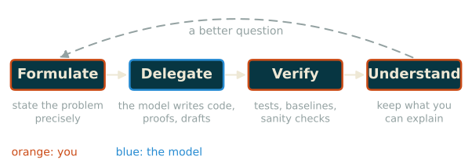

::: lecture
Are opinions are my own. The question is what it takes to be a researcher or a developer when a language model can write the code and the proofs.
:::

::: slides
# Outline
<!-- type: content -->

1. What has changed
2. Working with something faster than you
3. The same core skills
:::

# 1. What has changed {#1-changed}
<!-- type: content -->

> Focus of this discussion: the jobs of researcher and of developer.

## Two jobs
<!-- type: content -->

| | Before | Now |
|---|---|---|
| **Developer** | write the code, debug it, read the documentation | specify, delegate, review, integrate |
| **Researcher** | implement the experiment, write the proof, search the literature | choose the question, run many experiments in parallel, check the results |

. . .

In many scenarios, **writing code is no longer required**.

::: lecture
Both jobs used to contain a large amount of production work: typing the implementation, writing the first version of a proof, running through the literature by hand, producing the plots. A language model now does most of this work, often at an acceptable level. What remains for the person is everything around the production: deciding what is worth doing, stating it precisely, and judging the result.
:::

## The bottleneck has moved
<!-- type: content -->

- The cost of **producing** code falls towards zero.
- The question becomes **what to produce**, and deciding **whether it is right** and **useful**.

. . .

AI is faster than we are, but **not always smarter**.

::: lecture
When code and proof production is cheap, what the researcher and the developer bring are the questions and the verdicts. A model can write ten implementations of an idea in the time it takes to read one, so the person who cannot tell the good one from the bad one gains nothing from the speed. The speed is useful only to someone who can use it to explore, and then to select.

The model is fast, wide and tireless; it has read more code and more papers than any of us. It is also fluent in a way that hides its errors: a wrong answer comes in the same confident tone as a right one. The rest of the lecture is about how to work under these conditions.
:::

## What the job is now
<!-- type: content -->

Being the **architect of ideas**:

- choosing the problem, and stating it precisely;
- splitting it into parts that can be delegated and checked;
- recognizing whether an answer is correct;
- understanding why something works.

::: lecture
An architect does not lay the bricks, but must know what a wall can carry. The comparison is useful in one more respect: the architect is responsible for the building, whoever laid the bricks. A bug in generated code is still a bug in our software, and a false lemma suggested by a model is still a false lemma in our paper.
:::

# 2. Working with Something Faster than You {#2-working}
<!-- type: content -->

> How do we use a tool that is quick, wide, and sometimes wrong?

## Fast, fluent, sometimes wrong
<!-- type: content -->

Typical failures of generated code, proofs and analyses:

- **plausible but wrong**: the code runs, the plot looks reasonable, the proof has a gap in one line;
- **subtly wrong**: a leak between the training and the test set, a missing normalization, an off-by-one;
- **agreeable**: the model follows a wrong premise in the question;
- **overconfident**: there is no signal telling us which part is uncertain.

::: lecture
The dangerous errors are not the ones that crash. A program that fails with a stack trace is repaired in a minute; a program that runs and returns a slightly wrong number goes into the paper. Models make this second kind of error often enough to matter and rarely enough to lower our guard, which is the worst combination for a reviewer.

Agreeableness deserves a special mention. If a question contains a mistaken assumption, the model tends to build on it rather than to contest it. Asking "why does my method beat the baseline?" will produce reasons, whether or not it does.
:::

## Delegate what you can verify
<!-- type: content -->

| Delegate freely | Delegate with care |
|---|---|
| code with tests, or a reference to compare with | code whose correctness is only in your head |
| a proof that a proof assistant accepts | a proof sketch you do not understand |
| an experiment with a baseline and an ablation | a single run that confirms what you hoped |

::: lecture
Verification is the real cost of delegation. The task that suits a model is one where the answer is hard to produce but cheap to check: a solution to a puzzle, a program with a test suite, a formal proof accepted by a checker. The reverse case is a task whose result we can only judge by reading it with the same expertise that writing it would have needed. There, the saving is small and the risk is large.

A good habit is to write the check before the request: the test, the baseline, the quantity whose order of magnitude we expect. It forces us to state what a correct answer looks like, and it is the part of the work that the model cannot do for us.
:::

## The loop of the architect
<!-- type: content -->

{fig-align="center"}

The model sits in **one step out of four**. The three others need the same understanding as before.

::: lecture
The loop does not run once. What we understand after verifying changes the next question: we notice that the model solved an easier problem than the one we meant, or that the baseline was too weak, and we state the problem again, more precisely. Each pass makes the specification better, and a better specification is also the best input for the model.

The steps in orange are where the education matters. To formulate, we need abstraction: to see which part of a problem is the essential one. To verify, we need the theory that tells us what to expect. To understand, we need both.
:::

# 3. The Same Core Skills {#3-core}
<!-- type: content -->

> The tools change the interface, but not the foundations.

## Mathematics
<!-- type: content -->

Understanding the notions **at a theoretical level**, so that we can see:

- why scores are divided by $\sqrt{d_k}$ in attention (variance of a dot product, saturation of the softmax);
- why a loss of $\log V$ is the baseline of a language model (cross-entropy of the uniform distribution);
- why a detection test needs a threshold set by the false positive rate (hypothesis testing, multiple comparisons);
- why a longer context costs quadratic time (complexity).

::: lecture
A reader who knows the mathematics sees at a glance what a reader who does not must find by trial. Take the scaling of attention. If the entries of a query $q$ and of a key $k$ are independent with mean 0 and variance 1, the dot product $q \cdot k$ has mean 0 and variance $d_k$. Without the division by $\sqrt{d_k}$, the scores grow with the dimension, the softmax is nearly one-hot, and its gradients nearly vanish. An implementation that omits the factor runs, and trains poorly; someone who knows the argument finds the cause in a minute, and someone who does not will try other learning rates for a week.

This is why the mathematics matters more, not less, when the code is written for us. The code is cheap to obtain and just as easy to get subtly wrong, and the mathematics is the instrument that tells the difference.
:::

## Abstraction
<!-- type: content -->

To automate, you need to be able to abstract.

- To see that two problems are the same, we need a language in which they are the same.
- If you can state a problem precisely, you can delegate it. If you cannot, you do not understand it yet.

::: lecture
Much of the history of mathematics is a search for the right level of abstraction: the one at which a family of problems becomes a single problem. This is exactly the skill needed to write a good specification for a model, to decompose a task into verifiable parts, and to notice that a result obtained in one setting transfers to another.

A model can produce many instances quickly. Choosing which instance is worth producing, and recognizing the structure shared by all of them, remains the work of the person who asks.
:::

## Summary
<!-- type: content -->

| | What changed | What did not |
|---|---|---|
| **Developer** | the code is written for us | specifying, reviewing, designing systems |
| **Researcher** | experiments are cheap | choosing questions, judging evidence |

The jobs have changed dramatically, but they require **the same core skills**: understanding **mathematics** and **abstraction**.

::: lecture
The tools will keep changing, probably faster than any course can follow. A course on language models can therefore not promise skills tied to one tool; it can try to teach what makes a person useful with any of them. The rest of the course goes in that direction: for each component of a modern language model, from tokenization to watermarking, we look at what it is, why it works, and how to check that an implementation does what it should.
:::
