::: notebook
This notebook goes with the first lecture of the course. It contains the code of the lecture and the lab, in which we build a character-level language model on Molière's plays in five stages, from a bigram table to a small GPT.

**Hardware.** NVIDIA GPU, Apple Silicon or CPU, selected automatically. **Runtime**: about 20 minutes on a laptop GPU. On CPU, set `STEPS_SCALE = 0.3` in the setup cell of the lab: all training runs become shorter (and the losses a little higher).
:::

::: lecture
These notes follow the slides of the first lecture and add the explanations given in class. Each part of the lab comes after the part of the lecture it illustrates: we build a character-level language model on Molière's plays in five stages, from a bigram table to a small GPT, and run the experiments of the lecture on it. The code and its results are shown in full. The notebook contains the same code ready to run.

I included interview questions for machine learning engineer and research positions. They are framed in orange, and each is followed by a detailed answer and discussion, folded so that you can think about the question first.
:::

::: slides
# Outline
<!-- type: content -->

:::: {.columns}
::: {.column width="50%"}
0.  Language models
1.  Tokenization
2.  Embeddings
3.  Multi-layer perceptron
4.  Self-attention
:::
::: {.column width="50%"}
5.  Blocks
6.  (Decoder) Transformer
7.  Autoregressive generation
8.  Using Hugging Face models
:::
::::
:::

# 0. Language models {#0-language-models}
<!-- type: content -->

> A **language model** takes a text and predicts the next word.

<br>
The idea goes back to Shannon (1948, 1951), who used next-letter prediction to measure the entropy of English.

<br>
Intrinsically, language modeling is a **stochastic** task: the model outputs a probability distribution.

::: lecture
Formally, a language model gives, for every prefix $x_1, \ldots, x_t$, a probability distribution $P(x_{t+1} \mid x_1, \ldots, x_t)$ over the next token. By the chain rule, these conditional distributions define a distribution over whole texts:
$$P(x_1, \ldots, x_n) = \prod_{t=1}^{n} P(x_t \mid x_1, \ldots, x_{t-1}).$$
A model of the next token is therefore a model of language, and generating a text amounts to drawing one token at a time.

The model is trained on the next token prediction task: give a high probability to the token that comes next in the training data. The loss is the **cross-entropy**, the average of $-\log P(x_{t+1} \mid x_1, \ldots, x_t)$ over the positions of the training texts. A model that spreads its probability uniformly over a vocabulary of $V$ tokens has a loss of $\log V$.
:::

## Example: a probability distribution
<!-- type: example -->

GPT-2 (OpenAI, 2019), on a short prompt:

```{python}
#| eval: true
#| class-source: hide-on-slides
#| code-fold: true
import torch
import torch.nn as nn
import torch.nn.functional as F
from transformers import GPT2LMHeadModel, GPT2TokenizerFast
from transformers.utils import logging as hf_logging
hf_logging.set_verbosity_error()
hf_logging.disable_progress_bar()

tok = GPT2TokenizerFast.from_pretrained("gpt2")             # used by the sampling slides (Section 7)
lm = GPT2LMHeadModel.from_pretrained("gpt2").eval()
```

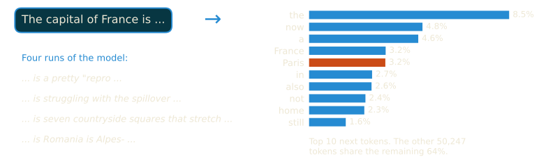{width="95%" fig-align="center"}

*Paris* only gets 3%: GPT-2 is a small model. Generating text means **sampling** from this distribution, again and again (Section 7).

::: {.lecture .notebook}
The figure comes from the following computation: the model returns one vector of scores (logits) per position, and the softmax of the last one is the distribution of the next token.

```{python}
prompt = "The capital of France is"
with torch.no_grad():
    next_logits = lm(tok(prompt, return_tensors="pt").input_ids).logits[0, -1]
probs = torch.softmax(next_logits, dim=-1)
for p, i in zip(*probs.topk(10)):
    print(f"{tok.decode([i])!r:14} {p:.3f}")
```
:::

## Perplexity
<!-- type: content -->

:::: {.columns}
::: {.column width="52%"}
**Log-likelihood** of a text:
$$\mathrm{LL} = \sum_{t=1}^{N} \log P(x_t \mid x_{<t})$$

**Perplexity**:
$$\mathrm{PPL} = \exp\Big(-\frac{\mathrm{LL}}{N}\Big)$$
:::
::: {.column width="48%"}
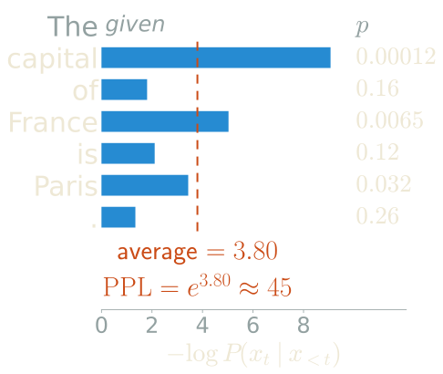{width="100%" fig-align="center"}
:::
::::

A model that is **uniform** over $V$ tokens has perplexity $V$.

::: lecture
The perplexity is the exponential of the average negative log-likelihood per token. The average of $-\log P(x_t \mid x_{<t})$ over the tokens is the cross-entropy loss used for training, so the perplexity is the exponential of the loss. Equivalently, it is the inverse of the geometric mean of the probabilities given to the tokens of the text: a single very unlikely token weighs heavily. A model that gives probability $1/V$ to each of $V$ tokens has perplexity exactly $V$, which is why the perplexity can be understood as an **effective number of choices**.

The figure scores the sentence of the previous slide with GPT-2. The first token is given, and each bar is the loss on one of the following tokens. The model is surprised by *capital* (probability 0.00012) and by *France*, much less by *of* and by the final period. The average loss is 3.80 nats, and the perplexity is $e^{3.80} \approx 45$: on this sentence, GPT-2 is as uncertain as a uniform choice among 45 tokens.
:::

## Interview: comparing perplexities {.interview}
<!-- type: interview -->

Model A has a validation perplexity of 12, model B of 20. Is A the better language model?

What would you measure to compare them fairly?

::: answer
**The tokenizers.** Perplexity is measured *per token*, and the two models may not use the same tokens. A model with a larger vocabulary cuts the same text into fewer and longer tokens; each of them carries more information, so its loss per token is higher even if it predicts the text equally well. A character-level model has a vocabulary of about 90 symbols and a small perplexity, while GPT-2 has a perplexity of about 20 on English web text, and this tells us nothing about which one is better. Without knowing the tokenizers, the answer to the question is therefore "we cannot say".

**The fair comparison.** The quantity that does not depend on the tokenizer is the log-likelihood of the whole text. Dividing it by a unit that does not depend on the tokenizer either, such as bytes or characters, gives the **bits per byte** (or bits per character):
$$\mathrm{BPB} = \frac{-\sum_t \log_2 P(x_t \mid x_{<t})}{\text{number of bytes of the text}} = \frac{\mathcal{L}_{\text{token}}}{\ln 2} \cdot \frac{N_{\text{tokens}}}{N_{\text{bytes}}},$$
where $\mathcal{L}_{\text{token}}$ is the loss per token in nats. A loss of 3 nats per token (perplexity 20) with about 4 characters per token gives $3 / (4 \ln 2) \approx 1.1$ bits per character, whereas a character-level model with a perplexity of 4 is at $\log_2 4 = 2$ bits per character: the model with the higher perplexity is by far the better one.

**Other conditions to check.** Even with the same tokenizer, two perplexities are comparable only if they are measured:

- on the same text, which must not appear in either training set (contamination lowers the perplexity for the wrong reason);
- with the same context: the loss of a token depends on how much text precedes it, so cutting the validation set into independent chunks of 512 tokens gives a worse perplexity than a sliding window with a long context, for the same model;

Perplexity measures how well a model predicts a given distribution of text, not how useful the model is. Post-training (Part 5) usually *increases* the perplexity on web text, since the model moves away from that distribution towards helpful answers, while making the model much better at its tasks. Perplexity is the right metric during pretraining and to compare pretrained models on the same data; downstream evaluations are needed beyond that.

What is the lowest possible perplexity? The exponential of the entropy rate of the text itself: language is not deterministic, so no model reaches a perplexity of 1. With human subjects guessing the next letter, Shannon (1951) estimated the entropy of English between 0.6 and 1.3 bits per character. In scaling laws (Part 4), this is the irreducible term of the loss.
:::

# 1. Tokenization {#1-tokenization}
<!-- type: content -->

<u>First step</u>: we need to decompose texts into basic units:
<br>

- **Characters**: hard to capture semantics
- **Words**: too many, doesn't capture similarities (long / longer /
  longest)
- **Tokens**: somewhere between characters and words (rule of thumb in
  English: 1 token ≈ 4 characters ≈ 3/4 of a word)

The set of tokens is called the **vocabulary**. Each token is mapped to an integer ID.

::: lecture
The three choices trade the size of the vocabulary against the length of the sequences. Characters give a vocabulary of about a hundred symbols, but long sequences in which each symbol carries little meaning. Words give short sequences, but the vocabulary is open: every new name, typo or inflected form is missing from it, and *long*, *longer* and *longest* get unrelated IDs. Subword tokens are learned from data so that frequent words are a single token and rare words are split into frequent pieces. Part 3 is devoted to the algorithms that build them (BPE, WordPiece, Unigram).
:::

## Examples
<!-- type: example -->

```{python}
#| eval: true
import tiktoken
enc = tiktoken.get_encoding("gpt2")
words = ["king", "queen", "dog", "cat"]
for w in words:
    ids = enc.encode(w)
    print(f"{w!r:12} -> token ids {ids}")
```

::: {.callout-note}
Common words are a single token. Each model has its own tokenizer: here, GPT-2's (BPE).
:::

## Examples
<!-- type: example -->

```{python}
#| eval: true
text = "Transformers are all you need!"
token_ids = enc.encode(text)
print(f"Text: {text!r}")
print(f"Token IDs: {token_ids}")
print(f"Tokens: {[enc.decode([t]) for t in token_ids]}")
print(f"Vocabulary size: {enc.n_vocab}")
```

**Bottom line**: at this point, we have converted text into a sequence of integers.

::: lecture
In GPT-2's tokenizer, the space before a word belongs to the token: *king* at the start of a text and *&nbsp;king* inside a sentence are different tokens. A rare word such as *Transformers* is split into pieces.
:::

## Interview: choosing the vocabulary size {.interview}
<!-- type: interview -->

You design the tokenizer of a new multilingual LLM. How do you choose the size of the vocabulary?

What goes wrong if it is too small, or too large?

::: answer
The size $V$ of the vocabulary trades the length of the sequences against the cost and the quality of the token embeddings.

**Too small.** Texts are cut into many short pieces. The sequences get longer, so the same context window holds less text, processing a text costs more, and generation needs more steps. The model also spends part of its layers putting words back together from fragments. At the extreme, byte-level models such as ByT5 have 256 symbols and sequences about four times longer than with subword tokens.

**Too large.** The embedding matrix and the output head have $V \times d_{\text{model}}$ parameters each, and the output head costs about $2Vd_{\text{model}}$ FLOPs per token: with $V = 256{,}000$ and $d_{\text{model}} = 2{,}048$, each of the two matrices has half a billion parameters. More importantly, token frequencies follow Zipf's law: with a larger vocabulary, many tokens are rare and their embeddings receive few gradient updates. Under-trained tokens are a known source of bugs. The "glitch tokens" of the GPT-2 and GPT-3 tokenizer, such as ` SolidGoldMagikarp`, were frequent in the data used to build the tokenizer (they are Reddit user names) but almost absent from the training data of the model, which produced erratic outputs when they appeared in a prompt.

**Multilingual fairness.** A tokenizer learned mostly on English cuts other languages into many more tokens. Petrov et al. (2023) measured that the same text can need up to 15 times more tokens in some languages than in English: their users pay more, fit less text in the context, and often get lower quality. A multilingual model needs a larger vocabulary and a balanced mix of languages to train the tokenizer.

**How to decide in practice.**

- Measure the compression (bytes per token) on held-out text in each target language, and the fraction of the parameters spent on embeddings at the planned model size.
- Scale the vocabulary with the model: Tao et al. (2024) fit scaling laws in which the optimal vocabulary grows with the compute budget, and conclude that most models use a vocabulary that is too small.
- Round $V$ up to a multiple of 64 or 128, so that the embedding and output matrices have shapes that GPU kernels handle efficiently (nanoGPT pads the 50,257 tokens of GPT-2 to 50,304 for this reason).

**Beyond the size.** Some well-known failures come from how tokens are cut rather than from their number. A model sees ` strawberry` as one or two tokens, never as a sequence of letters, which is why counting its letters is hard. Numbers are cut into irregular pieces by GPT-2's tokenizer, depending on which digit groups were frequent, which hurts arithmetic; Llama 1 and 2 split numbers into single digits for this reason. Part 3 is devoted to tokenizers.
:::

::: {.lecture .notebook}
## Lab: Molière's plays, one character at a time {#lab-data .lab}

The lab builds a character-level language model incrementally, training on Molière's plays:

| Stage | Model | What is new | Section |
|-------|-------|-------------|---------|
| 1 | **Bigram** | a bare embedding lookup (no memory) | 2 |
| 2 | **MLP** | a fixed-size context window, with causal sliding windows | 3 |
| 3 | **Single attention head** | dynamic, input-dependent weighting of the context | 4 |
| 4 | **Transformer block** | multi-head attention, MLP, LayerNorm, residual connections | 5 |
| 5 | **MiniGPT** | stacked blocks, weight tying | 6 |

At each stage, the experiments of the lecture are run in place, with their results: the context size and the shape of the MLP, the causal mask, the head dimension, the number of heads, residual connections, depth versus width, the context length, the temperature and top-k sampling.

### Setup

```{python}
import math
import time
from collections import Counter

import matplotlib.pyplot as plt
import numpy as np
import pandas as pd
import torch
import torch.nn as nn
import torch.nn.functional as F
from datasets import load_dataset

plt.rcParams.update({"figure.dpi": 110, "axes.grid": True, "grid.alpha": 0.3})

# Device selection: NVIDIA GPU, then Apple Silicon, then CPU.
if torch.cuda.is_available():
    device = "cuda"
elif torch.backends.mps.is_available():
    device = "mps"
else:
    device = "cpu"
print(f"Device: {device}   torch {torch.__version__}")

STEPS_SCALE = 1.0          # multiply every training length; use 0.3 on CPU
```

### The data

```{python}
ds = load_dataset("grlll/tiny-moliere", verification_mode="no_checks")   # skip a size check that some versions fail
text = "\n".join(ds["train"]["text"])

print(f"Total characters : {len(text):,}")
print(f"\nFirst 400 characters:\n{text[:400]}")
```

### Character-level tokenization

We use the simplest possible vocabulary: every unique character gets an integer ID. This gives a very small vocabulary (~90 tokens). Part 3 (Tokenization) explores more sophisticated methods like BPE.

```{python}
chars = sorted(set(text))
vocab_size = len(chars)
print(f"Vocabulary size: {vocab_size} unique characters")
print(f"Characters: {''.join(chars)!r}")

# Encoder / decoder
stoi = {c: i for i, c in enumerate(chars)}
itos = {i: c for i, c in enumerate(chars)}

def encode(s):  return [stoi[c] for c in s]
def decode(ids): return "".join(itos[i] for i in ids)

# Sanity check
sample = "Molière parle!"
print(f"\nencode({sample!r})\n  = {encode(sample)}")
print(f"decode(...) = {decode(encode(sample))!r}")
```

### Train / validation split

We take 90% of the text for training and hold out 10% as a validation set.
The split happens at a single index with no shuffling, to preserve text continuity.

```{python}
torch.manual_seed(42)
data = torch.tensor(encode(text), dtype=torch.long)

split_idx = int(0.9 * len(data))
train_data = data[:split_idx]
val_data   = data[split_idx:]
print(f"Train tokens : {len(train_data):,}")
print(f"Val tokens   : {len(val_data):,}")
```

### The character distribution

```{python}
counts = Counter(text)
labels, freqs = zip(*sorted(counts.items(), key=lambda kv: -kv[1])[:30])

fig, ax = plt.subplots(figsize=(12, 3))
ax.bar(range(len(labels)), freqs, color="steelblue")
ax.set_xticks(range(len(labels)))
ax.set_xticklabels([repr(c)[1:-1] for c in labels], fontsize=9)
ax.set_ylabel("Count")
ax.set_title("Top-30 characters by frequency")
plt.tight_layout()
plt.show()
```
:::

::: slides
---

<!-- type: content -->

:::{.paper}
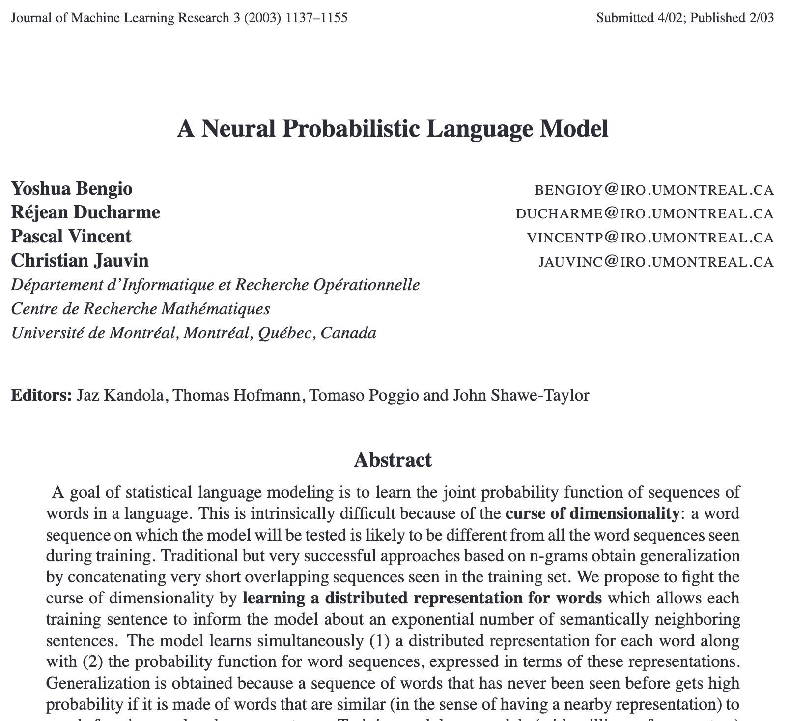
:::
:::

# 2. Embeddings {#2-embeddings}
<!-- type: content -->

In Machine Learning, we distinguish between **discrete** (**sparse**) and **continuous** (**dense**) representations.

<br>

The <u>key idea</u>: represent each token as a vector in a vector space, called the **latent space**.

::: lecture
The discrete representation of token $i$ is the one-hot vector $e_i \in \mathbb{R}^V$, with a 1 in position $i$ and 0 elsewhere. It is sparse, and all tokens are at the same distance from each other: *cat* is as far from *kitten* as from *philosophy*. The dense representation is a vector of dimension $d_{\text{model}}$, much smaller than $V$ (768 for GPT-2, against 50,257 tokens), whose coordinates are learned. Since similar tokens play similar roles in next-token prediction, training places them close to each other.

This idea, learning a vector per word jointly with the language model, comes from Bengio et al. (2003), *A Neural Probabilistic Language Model*.
:::

## Example
<!-- type: example -->

Concretely, an **embedding matrix** maps each token into a dense vector: it is a **look-up table**.

```{python}
#| eval: true
#| class-source: hide-on-slides
#| code-fold: true
from transformers import GPT2Model
model = GPT2Model.from_pretrained("gpt2").eval()
E = model.wte.weight.detach().numpy()            # (50257, 768): one row per token, used by the 3D slide
```

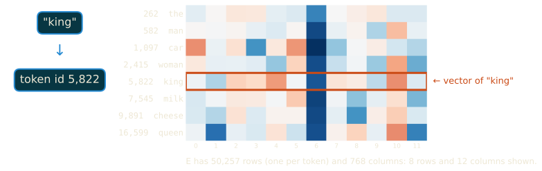{width="95%" fig-align="center"}

::: lecture
The embedding matrix $E$ has one row per token, $V \times d_{\text{model}}$ in total. Looking up token $i$ returns row $i$, which is also the product $e_i^\top E$ of the one-hot vector with the matrix. The rows are parameters of the model, trained with all the others.
:::

## A 3D visualization of the latent space
<!-- type: example -->

GPT-2 embeddings of 30 words, placed in 3D to preserve their cosine distances (MDS). Drag to rotate.

```{python}
#| eval: true
#| class-source: hide-on-slides
#| code-fold: true
import plotly.graph_objects as go
from IPython.display import HTML, display
import numpy as np
from sklearn.manifold import MDS
from sklearn.metrics.pairwise import cosine_distances

categories = {   
    "days"     : ["Monday", "Tuesday", "Wednesday", "Thursday", "Friday", "Sunday"],
    "countries": ["France", "Germany", "Italy", "Spain", "Japan", "China"],
    "colours"  : ["red", "blue", "green", "yellow", "purple", "orange"],
    "animals"  : ["dog", "cat", "horse", "cow", "sheep", "pig"],
    "family"   : ["mother", "father", "sister", "brother", "son", "daughter"],
}
colors = {"days": "#268bd2", "countries": "#cb4b16", "colours": "#859900", "animals": "#b58900", "family": "#d33682"}

words = [w for ws in categories.values() for w in ws]
X = E[[enc.encode(" " + w)[0] for w in words]]
X3 = MDS(n_components=3, metric="precomputed", init="classical_mds",
         random_state=0).fit_transform(cosine_distances(X))

fg, grid = "#eee8d5", "rgba(238, 232, 213, 0.08)"
fig = go.Figure()
for cat, ws in categories.items():
    idx = [words.index(w) for w in ws]
    fig.add_trace(go.Scatter3d(
        x=X3[idx, 0], y=X3[idx, 1], z=X3[idx, 2],
        mode="markers+text", name=cat, text=ws,
        textposition="top center", textfont=dict(size=13, color=fg),
        marker=dict(size=6, color=colors[cat], opacity=0.95),
    ))
axis = dict(showbackground=False, showticklabels=False, gridcolor=grid, zerolinecolor=grid,
            title=dict(font=dict(color=fg)))
fig.update_layout(
    paper_bgcolor="#002b36", plot_bgcolor="#002b36",   
    scene=dict(xaxis=dict(axis, title_text=""), yaxis=dict(axis, title_text=""),
               zaxis=dict(axis, title_text=""), bgcolor="rgba(0, 0, 0, 0)",
               aspectmode="cube", camera=dict(eye=dict(x=0.92, y=-0.52, z=0.86))),
    legend=dict(itemsizing="constant", font=dict(color=fg, size=14)),
    margin=dict(l=0, r=0, t=10, b=0), width=1050, height=500,
)
display(HTML(fig.to_html(full_html=False, include_plotlyjs="cdn", include_mathjax=False)))
```

::: lecture
Multidimensional scaling (MDS) looks for points in 3D whose distances are as close as possible to the given ones, here the cosine distances between the 768-dimensional embeddings. The five categories form separate groups, although GPT-2 was never told about categories: the groups come from next-token prediction alone, because words of the same category appear in similar contexts.
:::

## The linear representation hypothesis
<!-- type: content -->

> Concepts and relationships are encoded as directions in the latent space

. . .

What do these operations have in common?

* embedding(`Man`) - embedding(`Woman`)
* embedding(`King`) - embedding(`Queen`)
* embedding(`Actor`) - embedding(`Actress`)

. . .

**Answer**: they are approximately equal (they all represent the same concept, the *gender* direction).

::: lecture
This observation was made popular by word2vec (Mikolov et al., 2013), where embedding(`King`) - embedding(`Man`) + embedding(`Woman`) is closest to embedding(`Queen`). The hypothesis that concepts are directions, and not single neurons, is the starting point of much of interpretability research: Part 9 looks for such directions inside a trained Transformer.
:::

## Cosine similarity
<!-- type: content -->

The cosine similarity between two vectors $x$ and $y$ is defined as:
$$\text{sim}(x, y) = \frac{x \cdot y}{\|x\| \|y\|}$$

. . .

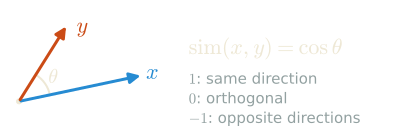{width=58% fig-align="center"}

. . .

This is how we measure similarity in the latent space.

::: lecture
The cosine similarity is the cosine of the angle between the two vectors: it is 1 for vectors pointing in the same direction, 0 for orthogonal vectors and -1 for opposite ones.
:::

## Some examples
<!-- type: example -->

```{=html}
<table style="font-size: 0.75em; width: 100%; white-space: nowrap;">
<thead><tr><th>Word 1</th><th>Word 2</th><th>Cosine similarity</th><th></th></tr></thead>
<tbody>
<tr><td><code>cat</code></td><td><code>kitten</code></td><td><div style="display:flex; align-items:center; gap:0.5em;"><div style="width:7em; height:0.55em; background:rgba(238, 232, 213, 0.12); border-radius:3px;"><div style="width:90%; height:100%; background:#268bd2; border-radius:3px;"></div></div><span>0.90</span></div></td><td><em>near synonyms</em></td></tr>
<tr><td><code>king</code></td><td><code>queen</code></td><td><div style="display:flex; align-items:center; gap:0.5em;"><div style="width:7em; height:0.55em; background:rgba(238, 232, 213, 0.12); border-radius:3px;"><div style="width:80%; height:100%; background:#268bd2; border-radius:3px;"></div></div><span>0.80</span></div></td><td><em>gender pair</em></td></tr>
<tr><td><code>coffee</code></td><td><code>tea</code></td><td><div style="display:flex; align-items:center; gap:0.5em;"><div style="width:7em; height:0.55em; background:rgba(238, 232, 213, 0.12); border-radius:3px;"><div style="width:75%; height:100%; background:#268bd2; border-radius:3px;"></div></div><span>0.75</span></div></td><td><em>same category</em></td></tr>
<tr><td><code>hot</code></td><td><code>cold</code></td><td><div style="display:flex; align-items:center; gap:0.5em;"><div style="width:7em; height:0.55em; background:rgba(238, 232, 213, 0.12); border-radius:3px;"><div style="width:70%; height:100%; background:#268bd2; border-radius:3px;"></div></div><span>0.70</span></div></td><td><em>antonyms</em></td></tr>
<tr><td><code>car</code></td><td><code>banana</code></td><td><div style="display:flex; align-items:center; gap:0.5em;"><div style="width:7em; height:0.55em; background:rgba(238, 232, 213, 0.12); border-radius:3px;"><div style="width:10%; height:100%; background:#93a1a1; border-radius:3px;"></div></div><span>0.10</span></div></td><td><em>unrelated</em></td></tr>
<tr><td><code>dog</code></td><td><code>philosophy</code></td><td><div style="display:flex; align-items:center; gap:0.5em;"><div style="width:7em; height:0.55em; background:rgba(238, 232, 213, 0.12); border-radius:3px;"><div style="width:0%; height:100%; background:#93a1a1; border-radius:3px;"></div></div><span>0.00</span></div></td><td><em>unrelated</em></td></tr>
</tbody>
</table>
```

::: lecture
These values are indicative: the actual numbers depend on the embedding model. Note that antonyms such as *hot* and *cold* are close. They appear in the same contexts (*the water is hot*, *the water is cold*), so a model trained on contexts places them close to each other, although their meanings are opposite.
:::

## Interview: how many concepts fit in 768 dimensions? {.interview}
<!-- type: interview -->

The embedding space of GPT-2 has dimension $d_{\text{model}} = 768$, so it contains at most 768 orthogonal directions.

Does this mean that GPT-2 can represent at most 768 concepts as directions?

::: answer
**No: almost orthogonal is enough, and there are exponentially many almost orthogonal directions.** Exactly orthogonal directions are limited to $d_{\text{model}}$. But if we only ask that any two directions have a cosine similarity at most $\varepsilon$ in absolute value, the number of directions that fit grows exponentially with $d_{\text{model}}$.

We can see that using random vectors. If $u$ and $v$ are independent random unit vectors of $\mathbb{R}^{d_{\text{model}}}$, their cosine similarity has mean 0 and standard deviation $1/\sqrt{d_{\text{model}}}$ (0.036 for $d_{\text{model}} = 768$), and its tail is Gaussian:
$$\Pr\big(|\cos(u, v)| > \varepsilon\big) \le 2\, e^{-d_{\text{model}} \varepsilon^2 / 2}.$$
For $N$ random vectors, a union bound over the $N^2/2$ pairs shows that all pairs are $\varepsilon$-orthogonal with positive probability as soon as $N^2 e^{-d_{\text{model}}\varepsilon^2/2} < 1$, that is, for $N$ up to about $e^{d_{\text{model}} \varepsilon^2 / 4}$. With $d_{\text{model}} = 768$ and $\varepsilon = 0.3$, this is already more than $10^7$ directions. This is the phenomenon behind the Johnson-Lindenstrauss lemma: $N$ points can be embedded in dimension $O(\log N / \varepsilon^2)$ with all their pairwise distances preserved up to a factor $1 \pm \varepsilon$.

**Superposition.** Neural networks exploit this. Elhage et al. (2022), *Toy Models of Superposition*, show that when features are sparse, that is, rarely active at the same time, a model represents many more features than it has dimensions, each as a direction, and accepts a small interference between them. The interference acts as noise, which the non-linearities can partly filter out: a ReLU with a negative bias ignores small activations. The sparser the features, the more of them fit; important and frequent features get their own nearly orthogonal directions, while rare ones share.

**Consequences.**

- Individual neurons are often **polysemantic**: they respond to several unrelated concepts, since the concepts are not aligned with the coordinate axes. Reading a model neuron by neuron does not work.
- To recover the features, interpretability research trains **sparse autoencoders**, which learn an overcomplete dictionary of directions: Templeton et al. (2024) extracted up to 34 million features from the residual stream of Claude 3 Sonnet. Part 9 comes back to this.

**A related practical point.** The vectors of trained language models are not spread uniformly on the sphere: they are **anisotropic**, concentrated in a narrow cone (Ethayarajh, 2019, for contextual representations), so that even unrelated tokens have clearly positive cosine similarities. Subtracting the mean vector before computing similarities removes most of this effect, which we do when embeddings are used for retrieval (Part 6).
:::

## Some statistics
<!-- type: content -->

::: {style="font-size: 0.7em;"}

  Model                          Embedding dim
  ------------------------------ ---------------
  GPT-2 small (2019)             768
  Qwen2.5-0.5B (2024)            896
  Qwen3-0.6B (2025)              1,024
  gpt-oss-120b (2025)            2,880
  Qwen3-235B-A22B (2025)         4,096
  Mistral Small 3.1 24B (2025)   5,120
  DeepSeek-V3 (2024)             7,168
  Kimi K2 (2025)                 7,168
  GPT-3 (2020)                   12,288
  Llama 3 405B (2024)            16,384

:::

::: lecture
The embedding dimension grows with the size of the model, but much more slowly than the number of parameters: from GPT-2 small (124M parameters) to Llama 3 405B, the dimension grows about 20 times and the number of parameters about 3,000 times. Most of the growth goes into the depth and into the width of the MLPs.
:::

## Key takeaway so far
<!-- type: content -->

We have discussed the first two steps:

* The text (prompt) is decomposed into **tokens**, which are represented by integers.
* Each token is mapped into a **dense vector**.

> The actual input of the model is a sequence of dense vectors, representing the sequence of tokens.

. . .

The next step is to understand how the model processes these vectors to generate the next token.

## Quiz: From text to model input
<!-- type: quiz -->

**Question**: Which sequence correctly describes the pipeline from raw text to Transformer input?

A) Text → Dense vectors → Tokens → Integers

B) Text → Integers → Tokens → Dense vectors

C) Text → Tokens → Integers → Dense vectors

D) Text → Tokens → Dense vectors → Integers

::: answer
**C**. The text is split into tokens, each token gets an integer ID, and each ID is looked up in the embedding matrix to produce a dense vector.
:::

::: {.lecture .notebook}
## Lab: the training loop and a bigram model {#lab-bigram .lab}

### Global hyperparameters

These two values are shared by all models. Feel free to change them!

```{python}
CONTEXT = 128   # characters of history the model can see
BATCH   = 64    # sequences processed in one gradient step
```

### Shared utilities

A batch is a set of random windows of the text. The targets are the same windows shifted by one character: position $t$ of `y` is the character that follows position $t$ of `x`, so one window gives `CONTEXT` next-character predictions (Section 6).

```{python}
def get_batch(split, ctx=None, batch=None):
    # Sample a random batch of (input, target) sequences; y is x shifted by one position.
    ctx, batch = ctx or CONTEXT, batch or BATCH
    data = train_data if split == "train" else val_data
    ix = torch.randint(len(data) - ctx, (batch,))
    x = torch.stack([data[i:i + ctx] for i in ix])
    y = torch.stack([data[i + 1:i + ctx + 1] for i in ix])
    return x.to(device), y.to(device)


xb, yb = get_batch("train")
print(f"Batch x: {tuple(xb.shape)}  (batch x context)")
print(f"Batch y: {tuple(yb.shape)}  (y[i] = x[i] shifted by 1)")
print(f"First input (decoded): {decode(xb[0].tolist())[:60]!r}")
```

Text generation, the training loop and the plots. Generation is the loop of Section 7: feed the text, read the logits at the last position, sample, append.

```{python}
@torch.no_grad()
def generate_chars(model, seed_text, n_chars=300, temperature=1.0, top_k=None, ctx=None, seed=0):
    # Autoregressively generate n_chars characters.
    # temperature > 1 = more random, < 1 = more confident; top_k = sample only among the k most likely tokens.
    torch.manual_seed(seed)
    model.eval()
    ctx = ctx or CONTEXT
    ids = encode(seed_text)
    for _ in range(n_chars):
        x = torch.tensor([ids[-ctx:]], dtype=torch.long, device=device)      # keep the last ctx characters
        logits, _ = model(x)
        logits = logits[0, -1] / temperature
        if top_k is not None:
            v, _ = torch.topk(logits, min(top_k, vocab_size))
            logits[logits < v[-1]] = float("-inf")
        ids.append(torch.multinomial(F.softmax(logits, dim=-1), 1).item())
    return decode(ids)
```

```{python}
def train_loop(model, n_steps, lr=3e-3, eval_every=None, cosine_decay=False, ctx=None, verbose=True, seed=0):
    # Train with AdamW; return a list of {step, train, val} dicts for plotting.
    torch.manual_seed(seed)
    n_steps = max(1, int(n_steps * STEPS_SCALE))
    eval_every = eval_every or max(1, n_steps // 10)
    model.to(device).train()
    opt = torch.optim.AdamW(model.parameters(), lr=lr, weight_decay=1e-1)
    sched = torch.optim.lr_scheduler.CosineAnnealingLR(opt, T_max=n_steps, eta_min=lr / 30) if cosine_decay else None
    history, t0 = [], time.time()
    for step in range(n_steps + 1):
        if step % eval_every == 0 or step == n_steps:
            model.eval()
            with torch.no_grad():
                tl = np.mean([model(*get_batch("train", ctx))[1].item() for _ in range(10)])
                vl = np.mean([model(*get_batch("val", ctx))[1].item() for _ in range(10)])
            history.append({"step": step, "train": float(tl), "val": float(vl)})
            if verbose:
                print(f"step {step:5d}/{n_steps}  |  train {tl:.3f}  val {vl:.3f}  |  {time.time() - t0:.0f}s")
            model.train()
        if step < n_steps:
            x, y = get_batch("train", ctx)
            _, loss = model(x, y)
            opt.zero_grad()
            loss.backward()
            torch.nn.utils.clip_grad_norm_(model.parameters(), 1.0)
            opt.step()
            if sched:
                sched.step()
    if not verbose:
        print(f"{n_steps} steps in {time.time() - t0:.0f}s: train {history[-1]['train']:.3f}, val {history[-1]['val']:.3f}")
    return history


def plot_losses(*histories, labels=None, title=None):
    # Overlay training (solid) and validation (dashed) curves.
    fig, ax = plt.subplots(figsize=(9, 3.5))
    colors = plt.rcParams["axes.prop_cycle"].by_key()["color"]
    for i, h in enumerate(histories):
        label, color = (labels[i] if labels else f"Model {i + 1}"), colors[i % len(colors)]
        steps = [e["step"] for e in h]
        ax.plot(steps, [e["train"] for e in h], color=color, linewidth=1.5, label=f"{label} (train)")
        ax.plot(steps, [e["val"] for e in h], color=color, linewidth=1.5, linestyle="--", label=f"{label} (val)")
    ax.set_xlabel("step"); ax.set_ylabel("cross-entropy loss"); ax.legend(fontsize=8, ncol=2)
    if title:
        ax.set_title(title)
    plt.tight_layout(); plt.show()


def count_params(model):
    return sum(p.numel() for p in model.parameters())
```

### Baseline: what is a good loss?

A model that assigns equal probability to all characters would achieve:
$$\mathcal{L}_{\text{random}} = -\log\left(\frac{1}{V}\right) = \log V$$

```{python}
random_loss = math.log(vocab_size)
print(f"Random baseline loss: {random_loss:.3f}  (= log {vocab_size})")
```

### Model 1: Bigram

**Idea**: predict the next character using *only* the previous character.

The model is a single embedding matrix of size `vocab_size × vocab_size`, used as a look-up table as in this section, except that the row of character `i` is directly the vector of logits for the character that follows `i`. This is equivalent to learning the character-level statistics $P(c_{t+1} \mid c_t)$.

```{python}
class BigramModel(nn.Module):
    """
    Predict the next token from the current token only.
    The learned table[i] is the logit vector for what follows token i.
    """
    def __init__(self, vocab_size):
        super().__init__()
        self.table = nn.Embedding(vocab_size, vocab_size)

    def forward(self, x, y=None):
        logits = self.table(x)   # (B, T, V)
        loss   = None
        if y is not None:
            loss = F.cross_entropy(logits.view(-1, vocab_size), y.view(-1))
        return logits, loss


print(f"BigramModel: {count_params(BigramModel(vocab_size)):,}  (= {vocab_size}²)")
```

```{python}
bigram_model = BigramModel(vocab_size)
bigram_history = train_loop(bigram_model, n_steps=1000)
```

```{python}
plot_losses(bigram_history, labels=["Bigram"])
```

```{python}
print(generate_chars(bigram_model, seed_text="DORINE\n", n_chars=300))
```

The bigram model knows which characters tend to follow which (a vowel after a consonant, a capital after a newline), and nothing else: no words, no memory.
:::

# 3. Multi-Layer Perceptron (MLP) {#3-MLP}
<!-- type: content -->

An MLP is a simple feedforward neural network, consisting of a sequence of layers.

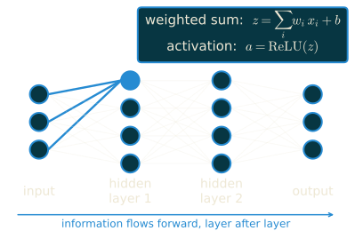{width=60% fig-align="center"}

## Neurons and layers
<!-- type: content -->

Each layer consists of a set of neurons, where:

* Each neuron receives inputs of all the neurons from the previous layer, and computes a weighted sum of its inputs.
* Each neuron then applies a non-linear activation function, and produces an output.

::: lecture
In matrix form, a layer with input $x \in \mathbb{R}^{n}$ and $m$ neurons computes $h = \sigma(Wx + b)$, where $W \in \mathbb{R}^{m \times n}$ holds the weights of the neurons (one row each), $b \in \mathbb{R}^m$ their biases, and $\sigma$ is the activation function, applied to each coordinate. The non-linearity is essential: without it, a stack of layers is a product of matrices, hence a single linear map.
:::

## Activation functions
<!-- type: content -->

The classical activation function is ReLU:
$$\text{ReLU}(x) = \max(0, x) \qquad \text{(Rectified Linear Unit)}$$

**Active** neuron: output $> 0$. **Inactive** neuron: output $= 0$.

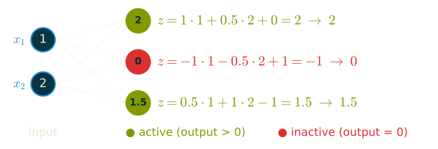{width=95% fig-align="center"}

::: lecture
GPT-2, and the models of the lab, use GELU, a smooth version of ReLU that lets small negative values through. Modern models use gated variants such as SwiGLU (Part 2). The choice matters less than the presence of a non-linearity.
:::

## Logits
<!-- type: content -->

The output of the MLP is a vector of **logits**, which are unnormalized scores for each token in the vocabulary.

<br>

We apply a softmax function to the logits to get a **probability distribution over the vocabulary**, which we can sample from to generate the next token:

$$\text{softmax}(\alpha)_{i,j} = \frac{\exp(\alpha_{i,j})}{\sum_{j'} \exp(\alpha_{i,j'})}$$

::: lecture
For a single vector of logits $z \in \mathbb{R}^V$, the softmax is $\text{softmax}(z)_i = \exp(z_i) / \sum_j \exp(z_j)$: the exponential makes every score positive, and the division makes them sum to one. Adding the same constant to all logits does not change the result, so only their differences matter. The training loss of Section 0 is computed directly from the logits: for a target token $y$, it is $-\log \text{softmax}(z)_y$, which `F.cross_entropy` computes in a numerically stable way.
:::

## Softmax on an example
<!-- type: example -->

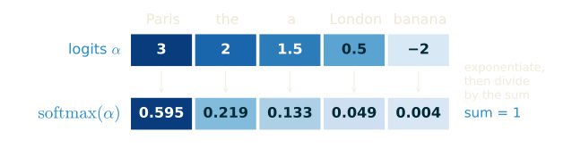{fig-align="center"}

- The order is kept, and large gaps are amplified: *Paris* gets 60%.
- Every token gets a positive probability, even *banana*.

## Illustration of an MLP
<!-- type: content -->

A full forward pass, with the same input and first layer as the ReLU example:

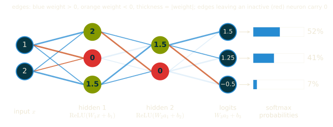{fig-align="center"}

## An MLP language model
<!-- type: example -->

It concatenates the embeddings of the last $k$ tokens to predict the next one, in the style of Bengio et al. (2003):

```python
class MLPLanguageModel(nn.Module):
    def __init__(self, vocab_size, d_model, hidden_dim, k=3):
        super().__init__()
        self.embed = nn.Embedding(vocab_size, d_model)
        self.fc1   = nn.Linear(k * d_model, hidden_dim)
        self.fc2   = nn.Linear(hidden_dim, vocab_size)

    def forward(self, token_ids):
        # token_ids : (batch, k), the last k tokens
        x = self.embed(token_ids)  # (batch, k, d_model)
        x = x.flatten(1)           # (batch, k * d_model)
        x = F.relu(self.fc1(x))    # (batch, hidden_dim)
        return self.fc2(x)         # (batch, vocab_size)
```

## An advanced question
<!-- type: content -->

What is the difference between `nn.Embedding` vs `nn.Linear`?

. . .

- `nn.Embedding` is a lookup table: given an index `i`, return the corresponding row.
- `nn.Linear` is a matrix multiplication.

::: lecture
The two compute the same thing: `nn.Embedding(V, d_model)` applied to index `i` returns the row that `nn.Linear(V, d_model, bias=False)` would return on the one-hot vector of `i` (with the weight matrix transposed). The look-up is much cheaper, since it never builds the one-hot vector, and during training only the rows of the tokens present in the batch receive a gradient.
:::

::: slides
---

<!-- type: content -->

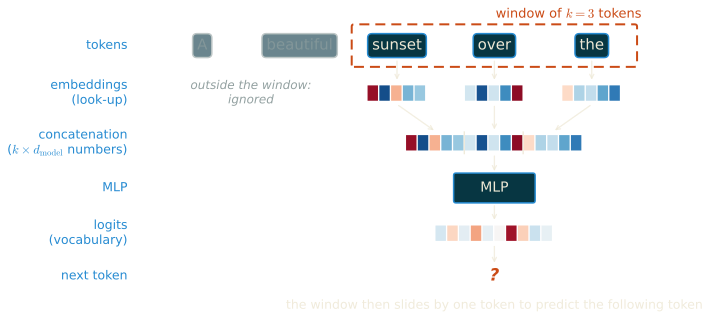{fig-align="center"}
:::

## The loss: cross-entropy
<!-- type: content -->

Cross-entropy between a target distribution $q$ and the prediction $p = \mathrm{softmax}(z)$:
$$H(q, p) = -\sum_{i=1}^{V} q_i \log p_i$$

. . .

With a **single target** token $y$ ($q$ is one-hot on $y$):
$$H(q, p) = -\log p_y$$

::: lecture
The name comes from information theory: $H(q, p)$ is the average number of nats needed to encode samples of $q$ with a code optimized for $p$. In training, each position gives a single target, the token that actually comes next, so $q$ is one-hot and the loss is $-\log p_y$: small when the model gives a high probability to the true token, and unbounded as $p_y$ goes to 0. Summed over the training data, these losses add up to minus the log-likelihood $\mathrm{LL}(\theta)$ of the data, as defined for perplexity: minimizing the cross-entropy is maximum likelihood estimation, and the perplexity is the exponential of the average loss.
:::

## Cross-entropy and KL divergence
<!-- type: content -->

After a given context, the training data contains several next tokens: their empirical distribution is $\hat q$. The average loss is
$$\mathbb{E}_{y \sim \hat q}\big[-\log p_y\big] = H(\hat q, p) = H(\hat q) + \mathrm{KL}(\hat q \,\|\, p)$$

. . .

$H(\hat q)$ is fixed by the data: minimizing the loss = minimizing $\mathrm{KL}(\hat q \,\|\, p)$.

The model learns the **distribution of the data**, not a single answer.

::: lecture
The Kullback-Leibler divergence $\mathrm{KL}(q \,\|\, p) = \sum_i q_i \log (q_i / p_i)$ measures how much is lost by encoding samples of $q$ with a code optimized for $p$ rather than for $q$ itself, whose cost is the entropy $H(q)$; this gives the decomposition $H(q, p) = H(q) + \mathrm{KL}(q \,\|\, p)$. The divergence is non-negative and vanishes only when $p = q$.

For a single one-hot target, $H(q) = 0$ and the cross-entropy is exactly the divergence. The decomposition says more when we average: the same context, or similar ones, appears many times in the data, followed by different tokens, and the one-hot targets then form the empirical distribution $\hat q$ of the next token. The model cannot change $H(\hat q)$, the uncertainty that is in the data itself, so the best it can do is to predict $p = \hat q$. This is why a trained model gives calibrated probabilities that can be sampled, rather than only the most likely token.
:::

## Training an MLP
<!-- type: content -->

- **Forward pass**: compute the output, then the loss $\mathcal{L}$, layer by layer.
- **Backward pass** (backpropagation): the gradient $\nabla_\theta \mathcal{L}$ for every parameter, from the output back to the input, by the chain rule.
- **Update**: $\theta \leftarrow \theta - \eta\, \nabla_\theta \mathcal{L}$, on a mini-batch of examples.

```python
logits = model(x)                    # forward
loss = F.cross_entropy(logits, y)
loss.backward()                      # backward: fills p.grad
optimizer.step()                     # update
optimizer.zero_grad()
```

::: lecture
The forward pass stores the intermediate activations of every layer, because the backward pass needs them. The backward pass applies the chain rule from the loss down to the input: each layer receives the gradient of the loss with respect to its output, computes the gradient with respect to its parameters, and passes the gradient with respect to its input to the layer below. PyTorch records the operations of the forward pass and runs this computation automatically when we call `loss.backward()`. The optimizer then moves each parameter against its gradient, with a learning rate $\eta$; in practice, Adam or AdamW rather than plain gradient descent (Part 4).
:::

## Interview: the gradient of the cross-entropy {.interview}
<!-- type: interview -->

Derive the gradient of $\mathcal{L} = -\log \mathrm{softmax}(z)_y$ with respect to the logits $z$.

Why not train with the squared error between $\mathrm{softmax}(z)$ and the one-hot target? How do you compute $\mathcal{L}$ without overflow?

::: answer
**The gradient.** Write $p = \mathrm{softmax}(z)$ and expand the loss:
$$\mathcal{L} = -z_y + \log \sum_{j} e^{z_j}, \qquad \frac{\partial \mathcal{L}}{\partial z_i} = -\mathbb{1}[i = y] + \frac{e^{z_i}}{\sum_j e^{z_j}} = p_i - \mathbb{1}[i = y].$$
In vector form, $\nabla_z \mathcal{L} = p - e_y$: prediction minus target. Its coordinates lie between $-1$ and $1$, they sum to zero (adding a constant to all logits changes nothing), and the gradient is largest exactly when the model is confidently wrong: if $p_y \approx 0$, the coordinate of the right token is close to $-1$.

**Why cross-entropy.** It is maximum likelihood: the model defines a distribution $P_\theta(y \mid x)$, and maximizing the log-likelihood of the data amounts to minimizing the average of $-\log P_\theta(y \mid x)$. It is a KL divergence: for a one-hot target $q = e_y$, $H(q, p) = H(q) + \mathrm{KL}(q \,\|\, p)$ with $H(q) = 0$. And it is a strictly proper scoring rule: if the true distribution of the next token is $q$, the expected loss $\mathbb{E}_{y \sim q}[-\log p_y]$ is minimized only by $p = q$, so a well-trained model outputs calibrated probabilities and not only a ranking. This is what makes sampling from the model meaningful.

**Why not the squared error.** The gradient of $\|p - e_y\|^2$ with respect to $z$ goes through the Jacobian of the softmax:
$$\nabla_z \|p - e_y\|^2 = 2\, J (p - e_y), \qquad J = \mathrm{diag}(p) - p p^\top.$$
When the softmax saturates on a wrong token $k$, we have $p \approx e_k$ and $J \approx \mathrm{diag}(e_k) - e_k e_k^\top = 0$: a model that is confidently wrong receives almost no gradient. With the cross-entropy, the logarithm cancels the exponential of the softmax and this Jacobian disappears from the gradient.

**Numerical stability.** Computing $e^{z_j}$ overflows for large logits (in float16, as soon as $z_j > 11$), and the logarithm of a probability that underflowed to 0 is $-\infty$. The log-sum-exp trick, with $m = \max_j z_j$,
$$\log \sum_j e^{z_j} = m + \log \sum_j e^{z_j - m},$$
only computes exponentials of non-positive numbers. `F.cross_entropy` takes the raw logits and does this internally. A classic bug is to apply a softmax before calling it: the model still trains, but on the wrong loss, and worse.

**At the scale of an LLM.** Three further points come up in practice.

- The logits form a tensor of shape (batch, length, $V$). For 8 sequences of 4,096 tokens and $V = 128{,}000$, it has $4.2 \times 10^9$ entries, about 17 GB in float32, more than the activations of many layers together. Fused kernels compute the loss and its gradient chunk by chunk without ever storing all the logits (Wijmans et al., 2024, *Cut Your Losses in Large-Vocabulary Language Models*).
- The gradient $p - e_y$ is dense: every row of the output matrix receives a gradient at every position, which pushes down the logits of all wrong tokens in proportion to their probability. The input embedding, by contrast, only updates the rows of the tokens present in the batch (see the question on `nn.Embedding` below).
- To keep the logits in a safe range when training in bfloat16, PaLM adds a small auxiliary loss $10^{-4} \cdot \big(\log \sum_j e^{z_j}\big)^2$, the z-loss, which keeps the normalizer close to 1. Label smoothing, which replaces $e_y$ by $(1 - \varepsilon)\, e_y + \frac{\varepsilon}{V} \mathbf{1}$, also bounds the logits, at the price of calibration.
:::

## FLOPs
<!-- type: content -->

A **FLOP** is one floating-point operation: an addition or a multiplication.

- **FLOPs**: a number of operations, the *cost* of a computation.
- **FLOP/s**: operations per second, the *speed* of the hardware (H100: about $10^{15}$ in bfloat16).

. . .

Matrix product $A \in \mathbb{R}^{m \times n}$, $B \in \mathbb{R}^{n \times p}$: $mp$ dot products of length $n$, each with $n$ multiplications and $n$ additions:
$$\mathrm{FLOPs}(AB) \approx 2\,m\,n\,p$$

::: lecture
The two notions are easily confused, since both are often written "FLOPS". We write FLOPs for a count and FLOP/s for a rate. The peak rate depends on the number format: the same H100 is much slower in float32 than in bfloat16. A real training run reaches only a fraction of the peak, the model FLOPs utilization (MFU), typically 35 to 50%.

Strictly, a dot product of length $n$ needs $n - 1$ additions, but $2mnp$ is the convention, and it is exact for a fused multiply-add, the instruction that GPUs execute. PyTorch can count the FLOPs of a computation:

```{python}
from torch.utils.flop_counter import FlopCounterMode
rows, inner, cols = 64, 128, 256
with FlopCounterMode(display=False) as flop_counter:
    torch.randn(rows, inner) @ torch.randn(inner, cols)
print(flop_counter.get_total_flops(), 2 * rows * inner * cols)
```
:::

## FLOPs of a forward pass
<!-- type: example -->

One example through an $n \times p$ linear layer: $2np$ FLOPs, **2 per weight**.

MLP language model ($k = 3$, embeddings 64, hidden 512, $V = 50{,}257$):

- `fc1`: $192 \times 512 \approx 0.1$M weights
- `fc2`: $512 \times 50{,}257 \approx 25.7$M weights

. . .

In total, $N \approx 25.8$M weights: $2N \approx 52$ MFLOPs per example.

::: lecture
In general, the forward pass costs about $2N$ FLOPs per example, where $N$ is the number of weights of the linear layers: each weight takes part in one multiplication and one addition. Biases, activations and the softmax add a number of operations proportional to the size of the activations, not to the number of weights, and are negligible for wide layers. A look-up in an embedding table do not require any computation. The example shows a feature of language models that persists at scale: with a vocabulary of 50,000 tokens, the output layer is expensive, and for small models it dominates the cost.
:::

## FLOPs of a backward pass
<!-- type: content -->

For a linear layer $Y = XW$ (forward: $2mnp$ FLOPs), backpropagation computes **two** products of the same size:

- $\nabla_X = \nabla_Y\, W^\top$: the gradient passed to the layer below;
- $\nabla_W = X^\top\, \nabla_Y$: the gradient of the weights.

. . .

Backward $\approx 2 \times$ forward: **4 FLOPs per weight**.

Training step: forward + backward $\approx 6N$ FLOPs per example.

::: lecture
Here $X$ holds the inputs of the layer for the $m$ examples of the batch, one per row, $W$ is the $n \times p$ weight matrix, and $\nabla_Y$ is the gradient of the loss with respect to the outputs, of the same shape as $Y$. The two gradients are matrix products of sizes $m \times p$ by $p \times n$, and $n \times m$ by $m \times p$: both cost $2mnp$ FLOPs, like the forward product. The first layer does not need $\nabla_X$, and the operations without weights (activations, softmax, and later normalizations) add a little, but these corrections are small. The same factor 2 will hold for the attention products between activations in Section 6.
:::

## Interview: reviewing a training loop you did not write {.interview}
<!-- type: interview -->

A coding assistant writes a training loop for your classifier and reports 97% test accuracy.

How do you convince yourself that the result is real?

::: answer
**Leakage.** The most common bug is information passing from the test set to the training. Check the order of operations: the split must come before any statistic is computed (normalization, vocabulary, feature selection), and before augmentation or deduplication. Look for near-duplicates across the split, and for a feature that encodes the label, such as an identifier or a file name.

**Baselines.** A trivial baseline (majority class, a linear model, a bag of words) tells us what 97% means. If the baseline reaches 96%, the improvement is small, and if the classes are imbalanced, accuracy alone is the wrong metric.

**Sanity checks of the training itself.** The loss at initialization should be close to $\log K$ for $K$ balanced classes. The model must be able to overfit a single batch of ten examples. A gradient check or a comparison with a reference implementation on a toy case finds shape and indexing errors that still produce valid numbers.

**Uncertainty.** One run is one sample. Repeat with other seeds and report the spread; with a test set of $n$ examples, the standard error of an accuracy $p$ is about $\sqrt{p(1-p)/n}$, which is about 0.8 points for $n = 500$ and $p = 0.97$.
:::

## Limitations of MLPs
<!-- type: content -->

The model above sees a **fixed window** of the last $k$ tokens:

- $k$ is small and fixed: every earlier token is ignored.
- Each slot of the window has its own weights: the same word is processed differently depending on its position in the window.
- The first layer grows with $k$: it has $k \times d_{\text{model}}$ inputs, for embeddings of dimension $d_{\text{model}}$.

. . .

An MLP cannot use a long, variable-length context: this is what attention solves.

::: {.lecture .notebook}
## Lab: an MLP language model {#lab-mlp .lab}

Bigrams only see one character at a time. The MLP of this section (Bengio et al., 2003) looks at a fixed-size window of the last `ctx` characters, embeds each one, concatenates the embeddings, and passes them through an MLP.

The slide's model predicts one token from one window. Here we predict the next character at **every** position of the batch at once: `F.pad` + `unfold` creates all the sliding windows in one go, without any Python loop. Padding on the left makes the windows causal: the window of position $t$ ends at $t$.

```{python}
class MLPModel(nn.Module):
    """
    Fixed-context MLP language model.

    For every position t, embeds the previous `ctx` characters,
    concatenates the embeddings, and passes them through a 2-layer MLP.

    Uses torch.Tensor.unfold for causal sliding windows (no Python loops).
    """
    def __init__(self, vocab_size, ctx=16, d_emb=32, d_hid=256):
        super().__init__()
        self.ctx = ctx
        self.emb = nn.Embedding(vocab_size, d_emb)
        self.net = nn.Sequential(
            nn.Linear(ctx * d_emb, d_hid),
            nn.GELU(),
            nn.Linear(d_hid, vocab_size),
        )

    def forward(self, x, y=None):
        B, T = x.shape
        # Left-pad with zeros so position 0 has context [0, 0, ..., x[0]]
        x_pad   = F.pad(x, (self.ctx - 1, 0), value=0)   # (B, T+ctx-1)
        windows = x_pad.unfold(1, self.ctx, 1)             # (B, T, ctx)
        e       = self.emb(windows)                        # (B, T, ctx, d_emb)
        logits  = self.net(e.view(B, T, -1))               # (B, T, vocab_size)
        loss    = None
        if y is not None:
            loss = F.cross_entropy(logits.view(-1, vocab_size), y.view(-1))
        return logits, loss


MLP_CTX = 8
mlp_model = MLPModel(vocab_size, ctx=MLP_CTX, d_emb=32, d_hid=128)
print(f"MLPModel: {count_params(mlp_model):,}")
```

```{python}
mlp_history = train_loop(mlp_model, n_steps=2000, lr=3e-3)
```

```{python}
plot_losses(bigram_history, mlp_history, labels=["Bigram", "MLP"])
```

```{python}
print(generate_chars(mlp_model, seed_text="DORINE\n", n_chars=400))
```

### Experiment: the size of the context

How far back the MLP can look: 4, 8 (default) or 16 characters, each trained for the same number of steps. 
A larger context gives more information, but the input layer grows linearly with it (`ctx x d_emb` inputs).

```{python}
ctx_histories = {}
for ctx in [4, 8, 16]:
    m = MLPModel(vocab_size, ctx=ctx, d_emb=32, d_hid=128)
    print(f"ctx = {ctx:2d} ({count_params(m):,} parameters): ", end="")
    ctx_histories[ctx] = train_loop(m, n_steps=1500, verbose=False)
plot_losses(*[ctx_histories[c] for c in [4, 8, 16]], labels=["ctx = 4", "ctx = 8", "ctx = 16"], title="MLP: context size")
```

More context barely helps the MLP: it must learn separate weights for every (position, feature) pair, so distant characters are used inefficiently, and the larger input layer needs more training. Attention will use the context much better.

### Experiment: deeper versus wider MLP

Same context of 8 characters; a third hidden layer, or a hidden layer twice as wide.

```{python}
class MLPDeep(MLPModel):
    def __init__(self, vocab_size, ctx=8, d_emb=32, d_hid=128):
        super().__init__(vocab_size, ctx, d_emb, d_hid)
        self.net = nn.Sequential(nn.Linear(ctx * d_emb, d_hid), nn.GELU(),
                                 nn.Linear(d_hid, d_hid), nn.GELU(),
                                 nn.Linear(d_hid, vocab_size))


variants = {"baseline (2 layers, 128)": ctx_histories[8]}            # same model, same number of steps
for name, m in [("deeper (3 layers, 128)", MLPDeep(vocab_size, ctx=MLP_CTX)),
                ("wider (2 layers, 256)", MLPModel(vocab_size, ctx=MLP_CTX, d_emb=32, d_hid=256))]:
    print(f"{name:24} {count_params(m):7,} parameters: ", end="")
    variants[name] = train_loop(m, n_steps=1500, verbose=False)
plot_losses(*variants.values(), labels=list(variants), title="MLP: depth and width")
```

Extra capacity helps more than extra context did (0.07 to 0.08 nats), but the MLP stays far behind the attention-based models below: a fixed window of 8 characters, processed position by position, limits what it can learn.
:::

## A very quick summary of research on language models
<!-- type: content -->

* <u>1960 -- 2010</u>: The best language models are built by computational linguists using grammars, rules, and heuristics
* <u>2010 -- 2017</u>: Deep Learning models start improving: *Recurrent Neural Networks* (RNNs), *Long-Short Term Memory* (LSTMs), but they struggle with **long context**
* <u>2017 -- today</u>: **Transformers** are the dominant models for language models

::: lecture
Recurrent networks read the text one token at a time and carry a state vector from one step to the next. They are not limited to a fixed window, but everything they know about the past must fit in that state, and information from far back fades away. Their sequential nature also prevents parallel training over the positions of a text. The Transformer removes both limitations.
:::

## Scale
<!-- type: content -->

Noam Brown (OpenAI scientist) in 2022:

> ``All of the incredible progress made in AI in the past 5 years can be summarized in one word: scale``

Scale in two dimensions: in <b>model size</b> (number of parameters) and in <b>data size</b> (number of tokens). The Transformer is the architecture that made this scaling possible.

::: lecture
The Transformer was introduced by Vaswani et al. (2017), *Attention Is All You Need*, for machine translation. The rest of this lecture builds its decoder part, which is the architecture of GPT and of today's large language models. Part 4 comes back to scale: how the loss depends on the number of parameters and of training tokens.
:::

::: slides
---

<!-- type: content -->

:::{.paper}
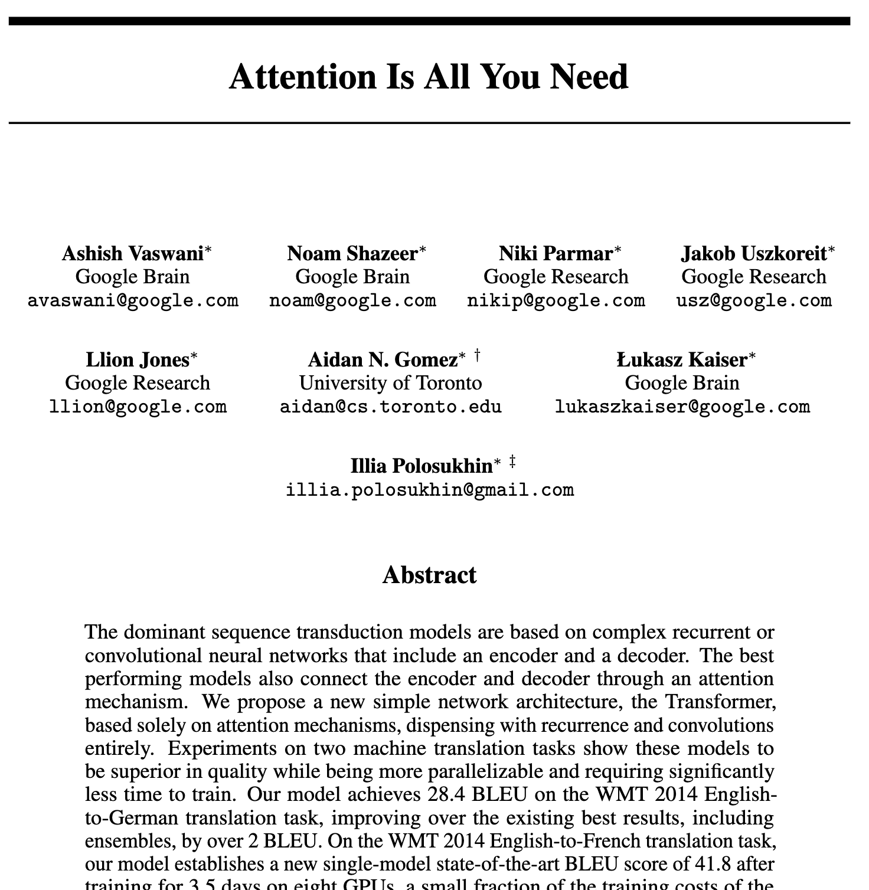
:::
:::

# 4. Self-Attention {#4-Self-Attention}
<!-- type: content -->

Essentially, the Transformer is a sequence of **communication** and **computation** steps.

* The computation step is the **MLP block**.
* The communication step is the **attention mechanism**: it allows tokens to share information with each other.

## The MLP inside a Transformer
<!-- type: content -->

In a Transformer, the MLP is used differently from the window model of Section 3: it processes each token **independently**, with the same weights at every position, and never looks at the neighbouring tokens.

::: lecture
This removes two of the three limitations of the window model: the weights no longer depend on the position, and the size of the MLP no longer depends on the length of the context. The price is that the MLP alone cannot combine information from several tokens. This is the job of attention.
:::

## The MLP in code
<!-- type: example -->

```python
class MLP(nn.Module):
    def __init__(self, d_model):
        super().__init__()
        hidden_dim = 4 * d_model  # convention: 4 * d_model
        self.up = nn.Linear(d_model, hidden_dim)
        self.act = nn.GELU()
        self.down = nn.Linear(hidden_dim, d_model)

    def forward(self, x):  # x: (batch, T, d_model)
        return self.down(self.act(self.up(x)))
```

- The hidden dimension $4d_{\text{model}}$ is a **convention**, from the original Transformer ($d_{\text{model}} = 512$, hidden $2048$).
- `nn.Linear` acts on the last dimension only: each token is processed independently.

::: lecture
Nothing forces the factor 4: it is a trade-off found to work well in the original Transformer and kept by GPT-2 ($d_{\text{model}} = 768$, hidden 3072). With this choice, the MLP of a block has about $8d_{\text{model}}^2$ parameters, against $4d_{\text{model}}^2$ for attention, so the MLPs hold about two thirds of the parameters of the blocks. Modern models use a gated MLP such as SwiGLU (Part 2), which has three matrices instead of two; to keep the same number of parameters, the hidden dimension is reduced to about $\frac{8}{3}d_{\text{model}}$, for instance 11,008 for $d_{\text{model}} = 4096$ in Llama 2 7B.
:::

## The attention mechanism: a high-level view
<!-- type: content -->

**Input**: dense vectors $x_1, \ldots, x_n$, one per token.

**Output**: new vectors $z_1, \ldots, z_n$, each updated with information from the other tokens.

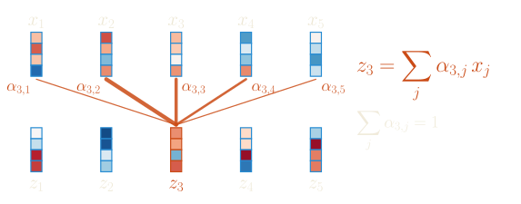{fig-align="center"}

## The attention mechanism: an intuitive explanation
<!-- type: content -->

Each token produces three vectors:

- **Query** $q_i$: "what information am I looking for?"
- **Key** $k_i$: "what information do I contain?"
- **Value** $v_i$: "what information do I provide?"

## Attention as a database lookup
<!-- type: content -->

Each token stores a (key, value) pair, and its query is compared with every key.

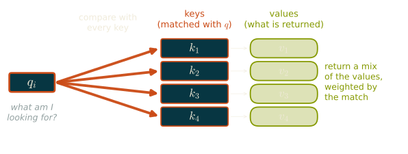{fig-align="center"}

::: lecture
In a database, a query matches exactly one key and returns its value. Attention is a soft version of this lookup: the query is compared with every key, each comparison gives a weight, and the result is the weighted average of all the values. Since every step is differentiable, the model can learn what to put in the queries, the keys and the values.
:::

## Example
<!-- type: example -->

Consider the sentence: *"The cat sat on the mat because **it** was tired."*

. . .

When processing the token **"it"**, the model needs to resolve the pronoun:

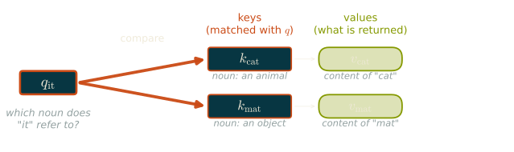{width=100% fig-align="center"}

## Example (continued)
<!-- type: example -->

The model computes $q_{\text{it}} \cdot k_{\text{cat}}$ and $q_{\text{it}} \cdot k_{\text{mat}}$: which noun is more relevant to **"it"**?

. . .

If $q_{\text{it}} \cdot k_{\text{cat}}$ is much larger, the new representation of **"it"** mostly takes the information in $v_{\text{cat}}$.

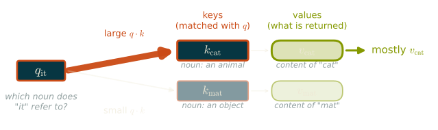{width=100% fig-align="center"}

## The attention score
<!-- type: content -->

The question is: how much should token $i$ attend to token $j$?

We compute an attention score $\alpha_{i,j}$ based on the similarity between $q_i$ and $k_j$.

. . .

$$\alpha_{i,j} = \frac{q_i \cdot k_j}{\sqrt{d_{\text{model}}}}$$

The attention scores are normalized using the softmax function.

::: lecture
Here $d_{\text{model}}$ is the dimension of the queries and keys, that of the model for a single head (with $h$ heads, it becomes $d_{\text{model}}/h$, see below). The softmax is taken over $j$, separately for each $i$: the weights that token $i$ gives to the other tokens are positive and sum to one.
:::

## Why scale the attention scores?
<!-- type: content -->

The argument of the original paper (Vaswani et al., 2017): sum the products $q_i k_i$ one by one, for random $q$ and $k$.

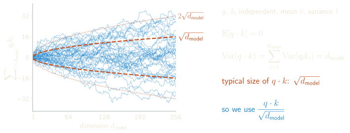{width="100%" fig-align="center"}

::: lecture
Without the division, the scores have a spread of about $\sqrt{d_{\text{model}}}$, which is 16 for $d_{\text{model}} = 256$, and the softmax saturates: it puts almost all the weight on one token, and its gradient with respect to the other scores is almost zero, so the model cannot learn to change its attention. With the scaling, the scores have variance about 1 at initialization, whatever the dimension.
:::

## Interview: spotting a bug from the mathematics {.interview}
<!-- type: interview -->

A generated implementation of multi-head attention trains well with head dimension 16 but becomes unstable and learns slowly with head dimension 128. The code looks correct.

What do you suspect first, and how do you check?

::: answer
The first suspect is the missing scaling $1/\sqrt{d_{\text{head}}}$ in the attention scores, where $d_{\text{head}} = d_{\text{model}}/h$ is the dimension of a head.

**Why.** If the entries of $q$ and $k$ are independent with mean 0 and variance 1, then $q \cdot k = \sum_{i=1}^{d_{\text{head}}} q_i k_i$ has mean 0 and variance $d_{\text{head}}$. The typical size of a score therefore grows like $\sqrt{d_{\text{head}}}$: about 4 for $d_{\text{head}} = 16$, and about 11 for $d_{\text{head}} = 128$. The softmax of scores of this size is almost one-hot, so each position attends to a single other position, and the Jacobian of the softmax is close to zero in that regime. The gradients that reach the queries and the keys vanish, and the little signal left is dominated by a few large entries, which explains both the slow learning and the instability.

**Check.** Print the standard deviation of the scores before the softmax, and the entropy of the attention rows, at initialization and during training. Without the scaling, the standard deviation is about $\sqrt{d_{\text{head}}}$ and the entropy is much lower for $d_{\text{head}} = 128$ than for $d_{\text{head}} = 16$. Then add the factor $1/\sqrt{d_{\text{head}}}$: the scores have variance 1 whatever the dimension, and the two configurations behave alike.
:::

## Context vectors
<!-- type: content -->

We compute **context vectors** from attention scores and value vectors:
$$z_i = \sum_j \text{softmax}(\alpha)_{i,j} \cdot v_j$$

. . .

Intuitively, $z_i$ is a weighted average of the value vectors, where the weights are given by the attention scores.

::: lecture
Stacking the queries, keys and values of all tokens as the rows of matrices $Q$, $K$ and $V$, the whole computation is
$$Z = \mathrm{softmax}\left(\frac{QK^\top}{\sqrt{d_{\text{model}}}}\right) V,$$
with the softmax applied to each row. The matrix $QK^\top$ contains the scores of all pairs of tokens: this is the attention matrix, and the formula is what the code below implements.
:::

## Computing the query, key, and value vectors
<!-- type: content -->

The query, key, and value vectors are computed from the input token embeddings using learned linear transformations:
$$q_i = W_q x_i, \quad k_i = W_k x_i, \quad v_i = W_v x_i$$

In other words, we have three matrices $W_q$, $W_k$, and $W_v$ that project the input vector $x_i$ into the query, key, and value spaces.

::: lecture
The same three matrices are used at every position. This is what makes attention independent of the length of the text: the number of parameters is $3 \times d_{\text{model}} \times d_{\text{model}}$, whatever the number of tokens.
:::

## Implementing a self-attention head
<!-- type: example -->

```python
class SelfAttentionHead(nn.Module):
    def __init__(self, d_in, d_head):
        super().__init__()
        self.W_q = nn.Linear(d_in, d_head, bias=False)
        self.W_k = nn.Linear(d_in, d_head, bias=False)
        self.W_v = nn.Linear(d_in, d_head, bias=False)
        self.scale = d_head ** 0.5

    def forward(self, x, mask=None):
        Q = self.W_q(x)
        K = self.W_k(x)
        V = self.W_v(x)
        scores = (Q @ K.transpose(-2, -1)) / self.scale
        weights = F.softmax(scores, dim=-1)
        return weights @ V
```

## Two important remarks
<!-- type: content -->

The attention mechanism only requires **matrix multiplications** (and a softmax computation), which are highly optimized on modern hardware.

. . .

<br>

It is entirely **data-driven**: the model learns to compute the query, key, and value vectors in a way that captures the relevant information for the task at hand, without any hand-crafted rules.

::: {.lecture .notebook}
The head used in the next examples: the same code as above, with the optional mask and the attention weights returned for inspection.
:::

```{python}
#| eval: true
#| class-source: hide-on-slides
#| code-fold: true

class SelfAttentionHead(nn.Module):
    """A single self-attention head."""
    def __init__(self, input_dim, head_dim):
        super().__init__()
        self.W_q = nn.Linear(input_dim, head_dim, bias=False)
        self.W_k = nn.Linear(input_dim, head_dim, bias=False)
        self.W_v = nn.Linear(input_dim, head_dim, bias=False)
        self.scale = head_dim ** 0.5

    def forward(self, x, mask=None):
        # x: (batch, seq_len, input_dim)
        Q = self.W_q(x)  # (batch, seq_len, head_dim)
        K = self.W_k(x)  # (batch, seq_len, head_dim)
        V = self.W_v(x)  # (batch, seq_len, head_dim)

        # Attention scores: (batch, seq_len, seq_len)
        scores = (Q @ K.transpose(-2, -1)) / self.scale

        if mask is not None:
            scores = scores.masked_fill(mask == 0, float('-inf'))

        weights = F.softmax(scores, dim=-1)
        context = weights @ V  # (batch, seq_len, head_dim)
        return context, weights
```

## Masking future positions
<!-- type: example -->

In a decoder, token $i$ can only attend to tokens $j \le i$. We
implement this by masking future positions.

```{python}
#| eval: true
seq_len = 5
causal_mask = torch.tril(torch.ones(seq_len, seq_len))
print("Causal mask:")
print(causal_mask)
```

::: lecture
The mask sets the scores of the future positions to $-\infty$ before the softmax, so that their weights are exactly zero. The reason is training: the model reads a whole text at once and predicts the next token at every position in parallel. Without the mask, the prediction at position $t$ could simply read the token at position $t+1$, which is the answer. The lab below shows what happens then.
:::

## Causal decoder mask
<!-- type: example -->

```{python}
#| eval: true
# Self-attention with causal mask
x = torch.randn(1, seq_len, 8)
head = SelfAttentionHead(8, 4)
z, attn_weights = head(x, mask=causal_mask)
print("Attention weights with causal mask:")
print(attn_weights[0].detach().numpy().round(3))
```

::: {.lecture .notebook}
## Lab: a single attention head {#lab-attention .lab}

With MLPs the context window is fixed. The token at position 3 always weighs position 1 the same, regardless of the actual content.

**Idea**: make the context *input-dependent*. Each token dynamically selects which past tokens to look at. Self-attention computes, for each token, a *weighted sum* of past token values:

$$z_t = \sum_{s \le t} \alpha_{t,s} \cdot v_s \qquad \alpha_{t,s} = \text{softmax}\!\left(\frac{q_t \cdot k_s}{\sqrt{d_{\text{head}}}}\right)$$

where $q, k, v$ are learned linear projections of the input. **Causal mask**: we forbid attending to future positions (masked with $-\infty$ before softmax).

Attention alone does not know the order of the tokens: permuting the past tokens permutes the terms of the sum, which does not change it. The model therefore adds a learned **positional embedding** to each token embedding (Section 6).

```{python}
class SingleHeadLM(nn.Module):
    """
    Language model with a single causal self-attention head.
    """
    def __init__(self, vocab_size, ctx=CONTEXT, d_model=256, head_dim=256):
        super().__init__()
        self.ctx      = ctx
        self.tok_emb  = nn.Embedding(vocab_size, d_model)
        self.pos_emb  = nn.Embedding(ctx, d_model)
        self.Q        = nn.Linear(d_model, head_dim, bias=False)
        self.K        = nn.Linear(d_model, head_dim, bias=False)
        self.V        = nn.Linear(d_model, head_dim, bias=False)
        self.proj     = nn.Linear(head_dim, vocab_size)
        self.scale    = head_dim ** -0.5
        # Causal mask: lower-triangular matrix (buffer moves with the model to device)
        self.register_buffer("mask", torch.tril(torch.ones(ctx, ctx)))

    def forward(self, x, y=None):
        B, T   = x.shape
        pos    = torch.arange(T, device=x.device)
        e      = self.tok_emb(x) + self.pos_emb(pos)               # (B, T, d_model)
        q, k, v = self.Q(e), self.K(e), self.V(e)                  # (B, T, head_dim)
        scores = (q @ k.transpose(-2, -1)) * self.scale             # (B, T, T)
        scores = scores.masked_fill(self.mask[:T, :T] == 0, float('-inf'))
        attn   = F.softmax(scores, dim=-1)                          # (B, T, T)
        out    = attn @ v                                            # (B, T, head_dim)
        logits = self.proj(out)                                      # (B, T, vocab_size)
        loss   = None
        if y is not None:
            loss = F.cross_entropy(logits.view(-1, vocab_size), y.view(-1))
        return logits, loss

    @torch.no_grad()
    def get_attn_weights(self, x):
        """Return attention weights for visualisation."""
        pos    = torch.arange(x.shape[1], device=x.device)
        e      = self.tok_emb(x) + self.pos_emb(pos)
        q, k   = self.Q(e), self.K(e)
        scores = (q @ k.transpose(-2, -1)) * self.scale
        scores = scores.masked_fill(self.mask[:x.shape[1], :x.shape[1]] == 0, float('-inf'))
        return F.softmax(scores, dim=-1)   # (B, T, T)


attn_model = SingleHeadLM(vocab_size)
print(f"SingleHeadLM: {count_params(attn_model):,}")
```

```{python}
attn_history = train_loop(attn_model, n_steps=3000, lr=3e-3)
```

```{python}
plot_losses(bigram_history, mlp_history, attn_history,
            labels=["Bigram", "MLP", "1-head attn"])
```

```{python}
print(generate_chars(attn_model, seed_text="DORINE\n", n_chars=400))
```

A single attention head with no MLP is weaker than the MLP: it can choose **where** to look, but each output is only a weighted average of value vectors followed by a linear map. It has no non-linear processing of what it reads.

### Visualising attention patterns

Let's look at what the attention head has learned to focus on.

```{python}
attn_model.eval()
snippet = "DORINE\nC'est la faute de votre maître qui n'a"
ids     = encode(snippet)
x_vis   = torch.tensor([ids], dtype=torch.long, device=device)
weights = attn_model.get_attn_weights(x_vis)[0].cpu().numpy()  # (T, T)

T   = len(ids)
fig, ax = plt.subplots(figsize=(10, 8))
im  = ax.imshow(weights, aspect="auto", cmap="Blues", origin="upper",
                vmin=0, vmax=weights.max())
ax.set_xticks(range(T))
ax.set_yticks(range(T))
ax.set_xticklabels([repr(c)[1:-1] for c in snippet], fontsize=7)
ax.set_yticklabels([repr(c)[1:-1] for c in snippet], fontsize=7)
ax.set_title("Attention weights: row = query position, col = key position")
plt.colorbar(im, ax=ax, fraction=0.03)
plt.tight_layout()
plt.show()
print("\nNote the triangular shape: each token only attends to itself and earlier tokens.")
```

### Experiment: removing the causal mask

Without the mask, position $t$ can attend to position $t+1$, which is exactly the character it must predict. Training becomes trivial, and the model learns nothing usable for generation, where the future is not available.

```{python}
class SingleHeadNoCausal(SingleHeadLM):
    def forward(self, x, y=None):
        B, T = x.shape
        e = self.tok_emb(x) + self.pos_emb(torch.arange(T, device=x.device))
        q, k, v = self.Q(e), self.K(e), self.V(e)
        attn = F.softmax((q @ k.transpose(-2, -1)) * self.scale, dim=-1)      # no mask: the model sees the future
        logits = self.proj(attn @ v)
        loss = F.cross_entropy(logits.view(-1, vocab_size), y.view(-1)) if y is not None else None
        return logits, loss


no_causal = SingleHeadNoCausal(vocab_size)
h_nc = train_loop(no_causal, n_steps=1500, verbose=False)
plot_losses(attn_history, h_nc, labels=["causal", "no mask (cheating)"], title="Removing the causal mask")
print(generate_chars(no_causal, seed_text="DORINE\n", n_chars=200))
```

The model copies the next character from its input. At generation time there is no next character to copy, and the output is garbage. The causal mask is what makes training on all positions in parallel equivalent to next-token prediction.

### Experiment: the head dimension

The head dimension is the size of the query, key and value vectors.

```{python}
head_rows = []
for head_dim in [16, 64, 256]:
    m = SingleHeadLM(vocab_size, head_dim=head_dim)
    print(f"head_dim = {head_dim:3d} ({count_params(m):,} parameters): ", end="")
    h = train_loop(m, n_steps=1500, verbose=False)
    head_rows.append({"head_dim": head_dim, "parameters": count_params(m), "val loss": h[-1]["val"]})
print(pd.DataFrame(head_rows).set_index("head_dim").round(3).to_string())
```

The head dimension barely matters here: 16, 64 and 256 give the same loss within noise, although the parameter count quadruples. A single head is limited by its structure (one attention pattern, no MLP), not by the size of its query, key and value vectors.
:::

## Quiz: Attention complexity
<!-- type: quiz -->
<!-- answer: C -->

**Question**: For a sequence of $n$ tokens, what is the memory complexity of the attention matrix?

A) $O(n)$: linear in sequence length

B) $O(n \log n)$: pseudo-linear

C) $O(n^2)$: quadratic

D) $O(d_{\text{model}} \cdot n)$: linear in embedding dimension

::: answer
**C**. Every token is compared with every other token, which gives an $n \times n$ attention matrix: time and memory both grow as $O(n^2)$.
:::

## Complexity
<!-- type: content -->

For a sequence of $n$ tokens with embedding dimension $d_{\text{model}}$:

. . .

Computing all pairwise scores $\alpha_{i,j} = q_i \cdot k_j / \sqrt{d_{\text{model}}}$ requires comparing every token with every other token: that is $n^2$ dot products.

. . .

**Consequence**: the attention matrix is $n \times n$, so both compute and memory scale as $O(n^2)$.

. . .

::: {.callout-note}
For $n = 128\,000$ tokens, the attention matrix has ~16 billion entries. This is why long-context efficiency is an active research area.
:::

::: lecture
More precisely, in each block the attention scores and the weighted sums cost about $2n^2 d_{\text{model}}$ operations, while the projections and the MLP cost about $12 n d_{\text{model}}^2$. For short texts the second term dominates; attention takes over once $n$ exceeds about $6d_{\text{model}}$. Part 2 presents the techniques that make long contexts affordable, such as FlashAttention, which never stores the full matrix, and the KV cache used during generation.
:::

## Interview: from 4k to 128k tokens {.interview}
<!-- type: interview -->

Your model was trained with a context of 4,096 tokens, and you are asked to support 128,000.

What breaks, in memory, in compute and in modelling? What would you do?

::: answer
As an example we take a 7B model with $L = 32$ layers, width $d_{\text{model}} = 4{,}096$, and 32 heads.

**Memory of attention.** The naive implementation stores the $n \times n$ matrix of scores of each head. For $n = 131{,}072$, it has $1.7 \times 10^{10}$ entries, 34 GB in bfloat16, for a single head of a single layer. The standard fix is **FlashAttention** (Dao et al., 2022): it processes the keys block by block and maintains a running maximum and a running sum for the softmax (the "online softmax"), so that the full matrix never exists in memory. The result is exact, the memory becomes linear in $n$, and it is faster because it moves much less data between the memory and the compute units, although the compute is still quadratic.

**Compute.** Per layer and per token, the projections and the MLP cost about $24 d_{\text{model}}^2$ FLOPs, and attention about $4 n d_{\text{model}}$, halved by the causal mask. The ratio of attention to the rest is therefore about $n / (12 d_{\text{model}})$: 8% at $n = 4{,}096$, but 2.7 at $n = 131{,}072$. Each token becomes several times more expensive, and the prefill of a 128k prompt is dominated by attention.

**Memory of the KV cache.** At inference, the keys and values of all previous tokens are kept (see the question on the KV cache in Section 7). Per token, this is $2 \times L \times d_{\text{model}}$ numbers, 0.5 MB in bfloat16 for our model, so 64 GB for a single sequence of 128k tokens, more than four times the weights. 
Some ideas to cope with this: grouped-query attention, where several query heads share the same keys and values (Llama 3 8B has 8 key-value heads for 32 query heads, hence a cache four times smaller); quantized caches; layers that only attend to a sliding window of the last few thousand tokens (Mistral 7B; Gemma 2 and 3 alternate local and global layers); compressing keys and values into a latent vector (multi-head latent attention, DeepSeek).

**Modelling.** The model has never seen positions beyond 4,096. Learned absolute position embeddings cannot extrapolate at all: GPT-2 has exactly 1,024 of them. With rotary embeddings (RoPE, Part 2), positions beyond the training range produce rotation angles never seen in training, and the quality collapses. The fixes rescale the positions so that the new range maps onto angles seen in training: position interpolation (Chen et al., 2023), then NTK-aware scaling and YaRN (Peng et al., 2023), which rescale the low frequencies more than the high ones. Many models also raise the base frequency of RoPE (Llama 3 uses 500,000 instead of 10,000). In all cases, this is followed by **continued pretraining on long documents**, typically a few billion tokens with a progressively increasing length, and the data must contain genuinely long dependencies: books, code repositories, long reports.

**Training.** Even with FlashAttention, the activations grow linearly with $n$, so a single sequence of 128k tokens may not fit on one GPU. One uses gradient checkpointing and **context parallelism**, which splits the sequence over several GPUs and passes the keys and values around a ring (ring attention).

**Evaluation.** Finding a "needle" sentence in a long haystack is too easy to be convincing. Models use the middle of a long context less well than its beginning and its end (Liu et al., 2023, *Lost in the Middle*), and benchmarks such as RULER test multi-hop retrieval and aggregation over the whole context. Finally, a good answer asks whether 128k tokens is the right solution: for many products, retrieval (Part 6) gives better results at smaller cost.
:::

## Multi-Head Attention
<!-- type: content -->

Instead of a single attention head, we run multiple heads in parallel.

Each head can learn to attend to different types of information. Their
outputs are concatenated and projected.

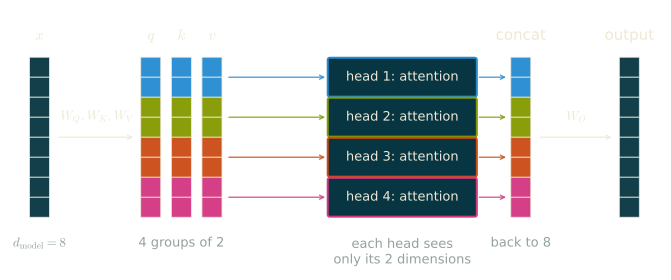{fig-align="center"}

::: lecture
With $h$ heads, each head works in dimension $d_{\text{model}}/h$, so that their concatenated outputs have dimension $d_{\text{model}}$ again. The number of parameters and the cost are the same as for a single head of dimension $d_{\text{model}}$: multi-head attention does not make the model larger, it splits it into several independent attention patterns. One head can follow the previous token while another looks for the subject of the sentence.
:::

## Multi-head attention implementation
<!-- type: content -->

```python
class MultiHeadAttention(nn.Module):
    def __init__(self, d_model, num_heads):
        super().__init__()
        head_dim = d_model // num_heads
        # One independent SelfAttentionHead per head
        self.heads = nn.ModuleList([
            SelfAttentionHead(d_model, head_dim)
            for _ in range(num_heads)
        ])
        self.W_out = nn.Linear(d_model, d_model, bias=False)

    def forward(self, x, mask=None):
        # Run all heads in parallel, concatenate their outputs
        head_outputs = [head(x, mask)[0] for head in self.heads]
        # concat: (batch, seq_len, d_model)
        concat = torch.cat(head_outputs, dim=-1)
        return self.W_out(concat)
```

## Interview: why several heads? {.interview}
<!-- type: interview -->

With $h$ heads of dimension $d_{\text{model}}/h$, multi-head attention has the same number of parameters and roughly the same cost as a single head of dimension $d_{\text{model}}$. What does it improve on?

What goes wrong at the extreme $h = d_{\text{model}}$, with heads of dimension 1?

::: answer
**One head, one distribution.** A head computes, for each token, a single probability distribution over the previous tokens and returns the corresponding average of the values. The softmax tends to concentrate this distribution, so a single head struggles to gather two unrelated pieces of information at once, for instance the previous token and the subject of the sentence. With $h$ heads, each token gets $h$ independent distributions, whose outputs live in separate coordinates of the concatenation and do not blur each other. Splitting $W_{out}$ into $h$ blocks of rows $W_{out}^k$ shows that the layer is a sum of $h$ independent mechanisms (the tokens are the rows of $X$, and the mask is omitted):
$$\mathrm{MHA}(X) = \sum_{k=1}^{h} \mathrm{softmax}\Big(\frac{X W_q^k (X W_k^k)^\top}{\sqrt{d_{\text{model}}/h}}\Big)\, X W_v^k W_{out}^k.$$

**The price: low-rank scores.** The scores of head $k$ form the matrix $X W_q^k (W_k^k)^\top X^\top$, whose rank is at most $d_{\text{model}}/h$. Smaller heads can only express simpler attention patterns, which Bhojanapalli et al. (2020) call the low-rank bottleneck of multi-head attention. The extreme case $h = d_{\text{model}}$ makes this concrete. With heads of dimension 1, the query and the key of each token are scalars $a_i$ and $b_j$, and the score is $a_i b_j$. For a given query, the softmax of $a_i b_j$ over $j$ is monotone in $b_j$: the head can only attend to the tokens with the largest $b_j$ (if $a_i > 0$) or the smallest (if $a_i < 0$), with a sharpness set by $|a_i|$. It can no longer express "find the token that matches me". In practice, heads have dimension 64 or 128 (GPT-2: 12 heads of 64; Llama 3 8B: 32 heads of 128), and the number of heads grows with the width.

**What heads do.** Trained heads specialize: some attend to the previous token, some follow syntactic relations, some attend to rare words (Voita et al., 2019). Many heads can be removed after training with little loss (Michel et al., 2019, *Are Sixteen Heads Really Better than One?*), but having them helps training. In interpretability, the **induction heads** (Olsson et al., 2022), which complete patterns of the form `[A][B] ... [A]` with `[B]`, are a composition of two heads in different layers: a previous-token head writes "the token before me was A" into the residual stream, and the induction head uses it to find where A appeared earlier and copies the token that followed.

**The cost is not exactly the same.** The FLOPs are equal, but there are $h$ matrices of scores instead of one. The KV cache has the same size as for a single head of dimension $d_{\text{model}}$, and this is what multi-query and grouped-query attention change: all heads, or groups of heads, share the same keys and values, which divides the cache by the size of the groups with little loss in quality (Part 2).
:::

## Positional embeddings
<!-- type: content -->

Attention is **blind to the order** of the tokens: $z_i = \sum_j \mathrm{softmax}(\alpha)_{i,j}\, v_j$ is a sum, and a sum does not depend on the order of its terms.

- After *the dog chased the cat* and after *the cat chased the dog*, a final token gets the same representation.

. . .

Fix: add to each token embedding a vector $p_i$ that encodes its **position** $i$: $\ x_i = embed_{\text{token}_i} + p_i$.

How to build $p_i$ (learned, sinusoidal, rotary): next lecture, *Advanced architectures*.

::: lecture
Without position information, self-attention is permutation-equivariant: permuting the input tokens permutes the outputs in the same way. For the prediction at the last position, the order of the earlier tokens is simply lost, and a language model cannot work without it. The code of Section 6 uses the simplest fix, as in GPT-2: a learned embedding, one vector per position up to the context window, added to the token embeddings. Part 2 compares this choice with sinusoidal and rotary embeddings (RoPE), which most recent models use.

With a causal mask, the symmetry is not complete: token $i$ attends to exactly $i$ tokens, and a model without position embeddings can learn to recover some positional information from this (Haviv et al., 2022). Standard models nevertheless add explicit position information.
:::

# 5. Blocks {#5-blocks}
<!-- type: content -->

:::: {.columns}
::: {.column width="55%"}
A **block** combines MLP (computation) and multi-head attention (communication).
To define a block we further need:

* layer normalization,
* residual connections.
:::
::: {.column width="45%"}
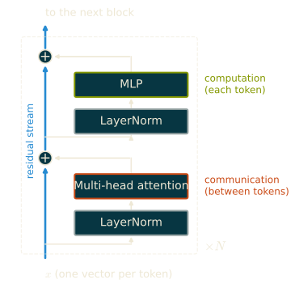
:::
::::

## The Transformer block
<!-- type: example -->

```python
class TransformerBlock(nn.Module):
    def __init__(self, d_model, num_heads):
        super().__init__()
        self.ln1 = nn.LayerNorm(d_model)
        self.attn = MultiHeadAttention(d_model, num_heads)
        self.ln2 = nn.LayerNorm(d_model)
        self.mlp = nn.Sequential(
            nn.Linear(d_model, 4 * d_model), nn.GELU(),
            nn.Linear(4 * d_model, d_model),
        )

    def forward(self, x, mask=None):
        x = x + self.attn(self.ln1(x), mask=mask)   # communication
        x = x + self.mlp(self.ln2(x))               # computation
        return x
```

::: lecture
The MLP of a block widens each token vector to $4d_{\text{model}}$ dimensions, applies the activation, and projects back to $d_{\text{model}}$. It is applied to each token separately, as explained in Section 4. Most of the parameters of a Transformer are in these MLPs.
:::

## Layer normalization
<!-- type: content -->

For each token vector $x \in \mathbb{R}^{d_{\text{model}}}$, layer normalization re-centers and re-scales **across its $d_{\text{model}}$ features**:
$$\text{LN}(x) = \gamma \odot \frac{x - \mu}{\sqrt{\sigma^2 + \epsilon}} + \beta$$

where $\mu$ and $\sigma^2$ are the mean and variance of the entries of $x$, and $\gamma, \beta$ are learned parameters.

. . .

We wrap every layer with `nn.LayerNorm`. **Why?** As vectors flow through dozens of blocks, their scale drifts: entries blow up or collapse, and training becomes unstable.

## Remark
<!-- type: content -->

Each token is normalized **independently**: nothing mixes across positions or batch, so it behaves identically at any sequence length.

::: {.callout-note}
**Why not BatchNorm?** BatchNorm normalizes across the batch, coupling examples and breaking on variable-length sequences. LayerNorm works within a single token, the natural fit for Transformers. Placing it *before* each sub-layer (**pre-norm**) is the modern default and lets us train very deep stacks.
:::

::: lecture
The original Transformer placed the normalization after each residual addition (post-norm). Pre-norm leaves the residual path itself untouched, which keeps the gradients well behaved in deep models. Many recent models replace LayerNorm with RMSNorm, which only re-scales and skips the centering (Part 2).
:::

## Layer normalization in action
<!-- type: example -->

Whatever the input scale, the output has zero mean and unit variance per token:

```{python}
#| eval: true
x = torch.randn(2, 4) * 5 + 3        # vectors with arbitrary mean/scale
y = nn.LayerNorm(4)(x)
print(f"before   -> mean {x.mean():+.2f}, std {x.std():.2f}")
print(f"after LN -> mean {y.mean():+.2f}, std {y.std():.2f}")
```

## RMSNorm
<!-- type: content -->

**RMSNorm** (Zhang and Sennrich, 2019) only re-scales:
$$\mathrm{RMSNorm}(x) = \gamma \odot \frac{x}{\sqrt{\frac{1}{d_{\text{model}}}\sum_{i=1}^{d_{\text{model}}} x_i^2 + \epsilon}}$$

Compared with LayerNorm, it saves:

- no mean $\mu$ to compute and subtract;
- no bias $\beta$: $d_{\text{model}}$ parameters per normalization instead of $2d_{\text{model}}$.

Same quality, the default since Llama (2023). More in Part 2.

::: lecture
Zhang and Sennrich (2019) observed that the re-centering of LayerNorm contributes little to the stability of training, and that the re-scaling is what matters. RMSNorm keeps only the re-scaling: it divides each token vector by the root mean square of its features, and multiplies by a learned gain $\gamma$. A normalization costs few FLOPs compared with the matrix products, but it reads and writes the whole activation tensor, so its running time is limited by memory bandwidth; dropping the mean and the bias makes it simpler and faster, and the authors report speed-ups of 7% to 64% depending on the model. Part 2 implements it and compares it with LayerNorm.
:::


## Residual connections
<!-- type: content -->

The other key ingredient is the `x = x +` in front of each sub-layer:
$$x \leftarrow x + \text{Attention}(x), \qquad x \leftarrow x + \text{MLP}(x)$$

. . .

Instead of *replacing* its input, each sub-layer only computes a **correction** that gets added back.

::: lecture
Residual connections come from computer vision (He et al., 2016). They help in two ways. A block that is not useful yet can stay close to the identity, so adding blocks never makes the model worse at initialization. And the gradient flows back through the additions unchanged, from the loss to the first layers, instead of being multiplied by the Jacobian of every sub-layer. The lab below trains a model without them.
:::

## A representation of the residual stream
<!-- type: content -->

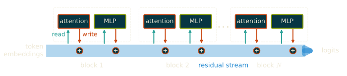{fig-align="center"}

## The residual stream
<!-- type: content -->

The residual connections form a **residual stream** running the full depth of the model.

- Each token carries a vector down this stream.
- Every block **reads** from the stream, computes something, and **writes** its result back by addition.
- Information can travel many layers untouched, or be refined step by step.

::: lecture
This point of view comes from interpretability research (Elhage et al., 2021, *A Mathematical Framework for Transformer Circuits*). Since every block adds its output to the stream, the final vector of a token is the sum of the contributions of all blocks, which can be studied one by one. Part 9 uses it to read what a trained model computes.
:::

## Interview: pre-norm or post-norm? {.interview}
<!-- type: interview -->

The original Transformer applies LayerNorm after the residual addition (post-norm). GPT-2 and almost all recent LLMs apply it at the input of each sub-layer (pre-norm).

Why? Does pre-norm have drawbacks?

::: answer
**The two variants.** With $F$ the attention or the MLP,
$$\text{post-norm: } x_{l+1} = \mathrm{LN}\big(x_l + F(x_l)\big), \qquad \text{pre-norm: } x_{l+1} = x_l + F\big(\mathrm{LN}(x_l)\big).$$

**Gradient flow.** With pre-norm, unrolling the recursion gives $x_L = x_l + \sum_{k = l}^{L-1} F_k\big(\mathrm{LN}(x_k)\big)$: the residual stream is a sum, and the Jacobian $\partial x_L / \partial x_l$ is the identity plus the contributions of the sub-layers. The gradient of the loss reaches every layer directly through the identity path. With post-norm, every LayerNorm sits on the main path, and the gradient that reaches layer $l$ has been multiplied by the Jacobians of all the normalizations above it. Xiong et al. (2020), *On Layer Normalization in the Transformer Architecture*, showed that at initialization, a post-norm model has large gradients for the parameters close to the output, so that a normal learning rate makes training diverge. Post-norm therefore needs a **learning-rate warmup**, and it is fragile in deep models. Pre-norm trains stably at depth with little or no warmup, which is why it became the default.

**Drawbacks of pre-norm.** Nothing ever normalizes the residual stream itself, so its norm grows with depth, each block adding its output. A deep block writes a vector of roughly fixed size into a stream that has grown large, so its relative contribution shrinks: the last layers of pre-norm models tend to be less useful, and many of them can be removed with little loss (Gromov et al., 2024, *The Unreasonable Ineffectiveness of the Deeper Layers*). When post-norm does train, it often reaches a slightly better quality, which is why methods such as DeepNorm (Wang et al., 2022) keep post-norm and fix its stability with a rescaled residual and initialization, up to 1,000 layers. Pre-norm also requires a final normalization before the output head (`ln_f` in GPT-2), since the stream would otherwise reach it unnormalized.

**What recent models do.** Most models use pre-norm with **RMSNorm**, which only rescales and skips the centering (Part 2). Several add normalizations elsewhere. Gemma 2 and 3 normalize both the input and the output of each sub-layer; OLMo 2 normalizes the output of each sub-layer before adding it to the stream, $x_{l+1} = x_l + \mathrm{Norm}\big(F(x_l)\big)$. **QK-norm**, a normalization of the queries and keys before their dot product, prevents the attention scores from growing without bound, a frequent cause of loss spikes in large models (Dehghani et al., 2023; used in OLMo 2 and Qwen3).
:::

::: {.lecture .notebook}
## Lab: a Transformer block {#lab-block .lab}

A Transformer block combines the following ingredients:

| Component | Why |
|-----------|-----|
| **Multi-head attention** | Multiple attention patterns in parallel |
| **Feed-forward MLP** | Per-token non-linear computation after attention |
| **Residual connections** | Gradients flow without degradation through depth |
| **LayerNorm** | Stable activations at each sub-layer |

This is the *pre-norm* variant (norm before the sub-layer), which is more stable for training. The multi-head attention below computes the same thing as the slides' version, but faster: one linear layer computes the queries, keys and values of all heads at once, and the heads become an extra dimension of the tensors instead of a Python loop.

```{python}
class MultiHeadAttention(nn.Module):
    """
    Multi-head causal self-attention.
    Runs n_heads attention heads in parallel, then projects their concatenated outputs.
    """
    def __init__(self, d_model, n_heads, ctx):
        super().__init__()
        assert d_model % n_heads == 0, "d_model must be divisible by n_heads"
        self.n_heads  = n_heads
        self.head_dim = d_model // n_heads
        # Project to Q, K, V in one shot for efficiency
        self.qkv      = nn.Linear(d_model, 3 * d_model, bias=False)
        self.proj     = nn.Linear(d_model, d_model,     bias=False)
        self.scale    = self.head_dim ** -0.5
        self.register_buffer("mask", torch.tril(torch.ones(ctx, ctx)))

    def forward(self, x):
        B, T, C = x.shape
        # Split into Q, K, V and reshape into n_heads heads
        q, k, v = self.qkv(x).split(C, dim=-1)             # each: (B, T, C)
        def reshape(t):
            return t.view(B, T, self.n_heads, self.head_dim).transpose(1, 2)
        q, k, v = reshape(q), reshape(k), reshape(v)         # (B, H, T, head_dim)
        # Scaled dot-product attention for all heads at once
        scores = (q @ k.transpose(-2, -1)) * self.scale      # (B, H, T, T)
        scores = scores.masked_fill(self.mask[:T, :T] == 0, float('-inf'))
        attn   = F.softmax(scores, dim=-1)                   # (B, H, T, T)
        out    = (attn @ v)                                   # (B, H, T, head_dim)
        # Merge heads and project
        out    = out.transpose(1, 2).contiguous().view(B, T, C)
        return self.proj(out)


class TransformerBlock(nn.Module):
    """
    One Transformer block: pre-norm, multi-head attention, FFN, residuals.
    Signature: (B, T, d_model) → (B, T, d_model)
    """
    def __init__(self, d_model, n_heads, d_ff, ctx):
        super().__init__()
        self.ln1  = nn.LayerNorm(d_model)
        self.attn = MultiHeadAttention(d_model, n_heads, ctx)
        self.ln2  = nn.LayerNorm(d_model)
        self.mlp  = nn.Sequential(
            nn.Linear(d_model, d_ff), nn.GELU(),
            nn.Linear(d_ff, d_model),
        )

    def forward(self, x):
        x = x + self.attn(self.ln1(x))   # attention sub-layer with residual
        x = x + self.mlp(self.ln2(x))    # FFN sub-layer with residual
        return x
```

```{python}
class BlockLM(nn.Module):
    """Language model with a single Transformer block."""
    def __init__(self, vocab_size, ctx=CONTEXT, d_model=128, n_heads=4, d_ff=1024):
        super().__init__()
        self.tok_emb = nn.Embedding(vocab_size, d_model)
        self.pos_emb = nn.Embedding(ctx, d_model)
        self.block   = TransformerBlock(d_model, n_heads, d_ff, ctx)
        self.ln    = nn.LayerNorm(d_model)
        self.head  = nn.Linear(d_model, vocab_size, bias=False)

    def forward(self, x, y=None):
        B, T = x.shape
        pos  = torch.arange(T, device=x.device)
        h    = self.tok_emb(x) + self.pos_emb(pos)
        h    = self.block(h)
        logits = self.head(self.ln(h))
        loss   = None
        if y is not None:
            loss = F.cross_entropy(logits.view(-1, vocab_size), y.view(-1))
        return logits, loss


block_model = BlockLM(vocab_size)
print(f"BlockLM: {count_params(block_model):,}")
```

```{python}
block_history = train_loop(block_model, n_steps=3000, lr=3e-3)
```

```{python}
plot_losses(bigram_history, mlp_history, attn_history, block_history,
            labels=["Bigram", "MLP", "1-head attn", "Transformer block"])
```

```{python}
print(generate_chars(block_model, seed_text="DORINE\n", n_chars=400))
```

### Experiment: the number of heads

Same width $d_{\text{model}} = 128$, so the same number of parameters; the heads split it: 1 head of dimension 128, or 8 heads of dimension 16.

```{python}
heads_rows, heads_histories = [], []
for n_heads in [1, 2, 4, 8]:
    m = BlockLM(vocab_size, n_heads=n_heads)
    print(f"{n_heads} head(s) of dimension {128 // n_heads:3d} ({count_params(m):,} parameters): ", end="")
    h = train_loop(m, n_steps=1500, verbose=False)
    heads_histories.append(h)
    heads_rows.append({"heads": n_heads, "head dimension": 128 // n_heads, "val loss": h[-1]["val"]})
print(pd.DataFrame(heads_rows).set_index("heads").round(3).to_string())
```

Several heads beat a single one at the same cost, and the loss improves steadily from 1 to 8 heads: each head computes its own attention pattern, so one can look at the previous character while another looks at the beginning of the word or at the speaker's name. With many more heads, each would become too narrow to be useful; the best number depends on the width.

### Experiment: ablating the residual connections

With a single block, residual connections matter little. We compare two 4-block models, with and without them.

```{python}
class TransformerBlockNoResidual(TransformerBlock):
    def forward(self, x):
        x = self.attn(self.ln1(x))          # no "+ x"
        return self.mlp(self.ln2(x))        # no "+ x"


class StackLM(nn.Module):
    def __init__(self, vocab_size, block_class, n_layers=4, d_model=128, n_heads=4, d_ff=512, ctx=CONTEXT):
        super().__init__()
        self.tok_emb, self.pos_emb = nn.Embedding(vocab_size, d_model), nn.Embedding(ctx, d_model)
        self.blocks = nn.Sequential(*[block_class(d_model, n_heads, d_ff, ctx) for _ in range(n_layers)])
        self.ln, self.head = nn.LayerNorm(d_model), nn.Linear(d_model, vocab_size, bias=False)

    def forward(self, x, y=None):
        h = self.blocks(self.tok_emb(x) + self.pos_emb(torch.arange(x.shape[1], device=x.device)))
        logits = self.head(self.ln(h))
        loss = F.cross_entropy(logits.view(-1, vocab_size), y.view(-1)) if y is not None else None
        return logits, loss


residual_histories = {}
for name, block_class in [("with residuals", TransformerBlock), ("without residuals", TransformerBlockNoResidual)]:
    print(f"{name:18}: ", end="")
    residual_histories[name] = train_loop(StackLM(vocab_size, block_class), n_steps=1500, verbose=False)
plot_losses(*residual_histories.values(), labels=list(residual_histories), title="4 blocks, with and without residual connections")
```

Without residual connections, the 4-block model does not train at all in 1,500 steps: it stays at the loss of a model that only knows character frequencies (about 3.2), while the same model with residuals reaches about 1.4. The signal and the gradient must go through every sub-layer, and the token and position information is lost on the way. With residuals, each block only adds an update to a shared stream.
:::

# 6. The Decoder Transformer {#6-decoder-transformer}
<!-- type: content -->

A decoder-only Transformer is just:

1. token embeddings + positional embeddings,
2. repeated Transformer blocks,
3. a causal mask,
4. a final output head for next-token prediction.

::: lecture
The output head maps the final vector of each token to $V$ logits; in GPT-2 its matrix is the embedding matrix itself (**weight tying**).
:::

## Implementation
<!-- type: example -->

```python
class DecoderTransformer(nn.Module):
    def __init__(self, vocab_size, d_model, n_layers, n_heads, context_window):
        super().__init__()
        self.token_emb = nn.Embedding(vocab_size, d_model)
        self.pos_emb = nn.Embedding(context_window, d_model)
        self.blocks = nn.ModuleList([TransformerBlock(d_model, n_heads) for _ in range(n_layers)])
        self.head = nn.Linear(d_model, vocab_size, bias=False)

    def forward(self, input_ids):
        T = input_ids.shape[1]
        x = self.token_emb(input_ids) + self.pos_emb(torch.arange(T))
        mask = torch.tril(torch.ones(T, T))
        for block in self.blocks:
            x = block(x, mask=mask)
        return self.head(x)
```

## Counting parameters
<!-- type: example -->

With $L$ blocks of width $d_{\text{model}}$: $4d_{\text{model}}^2$ parameters per block in attention ($W_q, W_k, W_v, W_{out}$), $8d_{\text{model}}^2$ in the MLP (two $d_{\text{model}} \times 4d_{\text{model}}$ matrices), so $12\,L\,d_{\text{model}}^2$ plus the embeddings.

```{python}
#| eval: true
from transformers import GPT2Model
g = GPT2Model.from_pretrained("gpt2")
count = lambda m: sum(p.numel() for p in m.parameters())
print(f"total:      {count(g) / 1e6:6.1f}M")
print(f"embeddings: {(g.wte.weight.numel() + g.wpe.weight.numel()) / 1e6:6.1f}M   (50,257 x 768 + 1,024 x 768)")
print(f"12 blocks:  {count(g.h) / 1e6:6.1f}M   (12 L d^2 = {12 * 12 * 768**2 / 1e6:.1f}M)")
```

::: lecture
For GPT-2 small, the embeddings are almost a third of the parameters, because the model is small and the vocabulary large. In large models the blocks dominate: the $12\,L\,d_{\text{model}}^2$ term grows with the square of the width, while the embeddings only grow linearly.
:::

## FLOPs of a Transformer forward pass
<!-- type: content -->

Per token, each weight is used once: **2 FLOPs per parameter**.

- Blocks: $2 \times 12\,L\,d_{\text{model}}^2$
- Output head (logits): $2\,d_{\text{model}}\,V$
- Attention between tokens ($QK^\top$, weighted sum of values): $4\,L\,n\,d_{\text{model}}$ for a context of $n$ tokens
- Embedding look-up: no FLOPs

. . .

GPT-2 small ($L = 12$, $d_{\text{model}} = 768$, $V = 50{,}257$, $n = 1{,}024$): $170 + 77 + 38 \approx 285$ MFLOPs per token.

::: lecture
The products with the weights dominate, and they cost $2N$ FLOPs per token, where $N$ is the number of parameters of the weight matrices (the output head included, the embeddings excluded, since a look-up is a memory access and not a computation). The products between activations do not involve the weights: for a query, the scores $q \cdot k_j$ against $n$ keys cost $2nd_{\text{model}}$ FLOPs, and the weighted sum of $n$ values another $2nd_{\text{model}}$, hence $4nd_{\text{model}}$ per token and per layer. Compared with the $24 d_{\text{model}}^2$ of the weights of a layer, this is a fraction $n / 6d_{\text{model}}$: 22% for GPT-2 small, and less for large models, whose width grows faster than their usual context.
:::

## FLOPs of a Transformer backward pass
<!-- type: content -->

A forward product $C = AB$ costs $2mnp$ FLOPs. The backward pass needs the gradients of **both** inputs:
$$\nabla_A = \nabla_C\, B^\top, \qquad \nabla_B = A^\top\, \nabla_C$$
Same sizes, so $2mnp$ FLOPs each (weights: $A = X$, $B = W$; attention: $A = Q$, $B = K^\top$).

GPT-2 small: $2 \times 285 = 570$ MFLOPs per token.

. . .

Checkpointing and optimizers such as Adam add further costs.

::: lecture
If $A$ is $m \times n$ and $B$ is $n \times p$, then $\nabla_C$ is $m \times p$, so $\nabla_C B^\top$ multiplies $m \times p$ by $p \times n$ and $A^\top \nabla_C$ multiplies $n \times m$ by $m \times p$: the same three dimensions as the forward product, in another order. For a product of the weights, $Y = XW$, the two backward products are $\nabla_X = \nabla_Y W^\top$ and $\nabla_W = X^\top \nabla_Y$, as in Section 3. For a product between activations, such as the scores $S = QK^\top$, both inputs depend on the parameters, and the backward pass computes $\nabla_Q = \nabla_S K$ and $\nabla_K = \nabla_S^\top Q$: again two products of the size of the forward one. The backward pass therefore costs about twice the forward pass, term by term.

This count assumes plain backpropagation with all activations kept in memory. Large models often use **activation checkpointing**: only some activations are stored, and the others are recomputed during the backward pass, which adds up to one forward pass, about $2N$ FLOPs per token. The update of the parameters has a cost too. Plain gradient descent and Adam need a few to a few dozen operations per parameter and per step, which is negligible: a step processes millions of tokens, at $6N$ FLOPs each.
:::

## Training compute: $6ND$
<!-- type: example -->

For $N$ weights: forward ($2N$) + backward ($4N$) = $6N$ FLOPs per token. On $D$ tokens:
$$C \approx 6\,N\,D \text{ FLOPs}$$

. . .

GPT-2 small, $N \approx 124$M weights (blocks and output head), $D = 10$B tokens: $C \approx 7.4 \times 10^{18}$ FLOPs.

One H100 at 40% of its peak ($4 \times 10^{14}$ FLOP/s): about **5 hours**.

::: lecture
The rule ignores the attention products between activations, which add about $12\,L\,n\,d_{\text{model}}$ FLOPs per token for a training step, and the operations without weights. It is the standard back-of-the-envelope estimate, used in the scaling laws (Part 4). For GPT-2 small, $N$ counts the blocks (85M) and the output head, which shares its weights with the token embedding (39M). The order of magnitude matches practice: the reproduction of GPT-2 small in Karpathy's llm.c trained on 10 billion tokens in about 90 minutes on 8 A100 GPUs.
:::

## Interview: the compute budget of pretraining {.interview}
<!-- type: interview -->

Estimate the number of FLOPs needed to train a 7B-parameter model on 2 trillion tokens.

How long does it take on 1,024 H100 GPUs?

::: answer
**The $6ND$ rule.** Almost all the FLOPs of a Transformer are in matrix products, and multiplying a vector by an $m \times n$ matrix costs $2mn$ FLOPs, one multiplication and one addition per weight. The forward pass therefore costs about $2N$ FLOPs per token, where $N$ is the number of parameters of the matrices (embeddings excluded: a look-up costs nothing). The backward pass computes, for each linear layer $y = Wx$, two products of the same size: the gradient with respect to the input, $W^\top \delta$, which propagates the signal to the layer below, and the gradient with respect to the weights, $\delta x^\top$. It costs about $4N$ per token, so training on $D$ tokens costs
$$C \approx 6\, N D \text{ FLOPs}.$$
Here, $C \approx 6 \times 7 \times 10^9 \times 2 \times 10^{12} = 8.4 \times 10^{22}$ FLOPs.

**The attention term.** The rule ignores the products between activations, $QK^\top$ and the weighted sum of the values. They cost $4 n d_{\text{model}}$ FLOPs per token and per layer in the forward pass, so $12 L n d_{\text{model}}$ per token for a training step. For a 7B model ($L = 32$, $d_{\text{model}} = 4{,}096$) with $n = 4{,}096$, this is $6.4 \times 10^9$ per token against $6N = 4.2 \times 10^{10}$: about 15%, or 8% with a kernel that skips the masked half. The rule is good enough for a back-of-the-envelope estimate at usual context lengths.

**From FLOPs to days.** An H100 delivers about $10^{15}$ FLOP/s in bfloat16 at peak, but a real training run only reaches a fraction of it, the **model FLOPs utilization** (MFU), typically 35 to 50%. Time is lost in operations limited by memory bandwidth (normalizations, activations, softmax), in communication between GPUs, in pipeline bubbles and in restarts after hardware failures. At 40% MFU, a GPU delivers $4 \times 10^{14}$ FLOP/s, so the training takes $8.4 \times 10^{22} / (4 \times 10^{14}) = 2.1 \times 10^8$ GPU-seconds, about 58,000 GPU-hours, or **2.4 days on 1,024 H100s**.

**Sanity check.** This is the budget of Llama 2 7B, trained on 2 trillion tokens, for which Meta reports 184,320 A100 GPU-hours. An A100 peaks at 312 TFLOP/s; at 40% MFU, the rule gives $8.4 \times 10^{22} / (1.25 \times 10^{14}) \approx 6.7 \times 10^8$ seconds, about 187,000 GPU-hours, within 2% of the reported number.

**Follow-ups.**

- *Is 2 trillion tokens a good choice for 7B parameters?* The Chinchilla analysis (Hoffmann et al., 2022) gives about 20 tokens per parameter as compute-optimal, 140 billion tokens here. Llama 2 trains 14 times longer on purpose: a smaller model trained longer costs more to train than needed for its quality, but less to serve, and inference dominates the total cost of a deployed model (Part 4).
- *What does gradient checkpointing cost?* It recomputes the forward pass during the backward pass, so about $8N$ instead of $6N$ per token, 33% more.
- *And inference?* About $2N$ FLOPs per generated token, but generation is limited by memory bandwidth rather than by FLOPs (see the question on the KV cache in Section 7).
:::

## Sliding windows
<!-- type: content -->

At each position, the model predicts the next token using the preceding context.

So a sequence of length $T$ gives $T$ next-token predictions, each conditioned on a different sliding window of past tokens.

. . .

::: {.callout-note}
The model reads a context window, predicts the next token, then shifts one step forward.
:::

::: lecture
This is what makes training efficient: thanks to the causal mask, one forward pass over a text of $T$ tokens gives $T$ training examples, one per position, and the loss is their average. The lab's `get_batch` builds exactly this: the targets are the inputs shifted by one position.
:::

::: {.lecture .notebook}
## Lab: MiniGPT {#lab-minigpt .lab}

We now **stack** multiple Transformer blocks to build a full GPT-style decoder. Two key additions compared with the single block:

1. **Stacked blocks**: $N$ Transformer blocks in series. Each block refines the representations from the previous one, allowing the model to build hierarchical, compositional features.

2. **Weight tying**: the output projection and the input token embedding share weights. This was used in the original GPT and GPT-2, and often improves perplexity.

```{python}
class MiniGPT(nn.Module):
    """
    GPT-style decoder Transformer.

    Token embedding + positional embedding → N Transformer blocks →
    LayerNorm → linear head (tied to token embedding weights).
    """
    def __init__(self, vocab_size, ctx=CONTEXT, d_model=128, n_heads=4,
                 n_layers=4, d_ff=512):
        super().__init__()
        self.ctx     = ctx
        self.tok_emb = nn.Embedding(vocab_size, d_model)
        self.pos_emb = nn.Embedding(ctx, d_model)
        self.blocks  = nn.Sequential(
            *[TransformerBlock(d_model, n_heads, d_ff, ctx) for _ in range(n_layers)]
        )
        self.ln      = nn.LayerNorm(d_model)
        self.head    = nn.Linear(d_model, vocab_size, bias=False)
        # Weight tying: share token embedding and output weights
        self.tok_emb.weight = self.head.weight

    def forward(self, x, y=None):
        B, T      = x.shape
        positions = torch.arange(T, device=x.device)
        h         = self.tok_emb(x) + self.pos_emb(positions)   # (B, T, d_model)
        h         = self.blocks(h)                               # (B, T, d_model)
        logits    = self.head(self.ln(h))                        # (B, T, vocab_size)
        loss      = None
        if y is not None:
            loss = F.cross_entropy(logits.view(-1, vocab_size), y.view(-1))
        return logits, loss
```

### Parameter count comparison

```{python}
models_info = [
    ("Bigram",             BigramModel(vocab_size)),
    ("MLP",                MLPModel(vocab_size, ctx=MLP_CTX, d_hid=128)),
    ("Single-head attn",   SingleHeadLM(vocab_size)),
    ("Transformer block",  BlockLM(vocab_size)),
    ("MiniGPT",            MiniGPT(vocab_size)),
]

print(f"{'Model':<22}  {'Parameters':>12}")
print("-" * 36)
for name, m in models_info:
    print(f"{name:<22}  {count_params(m):>12,}")
```

### Training MiniGPT

The biggest model: 4 blocks, 5,000 steps with a cosine learning-rate decay. About 4 to 5 minutes on Apple Silicon, 1 to 2 minutes on an NVIDIA GPU.

```{python}
gpt_model = MiniGPT(vocab_size)
gpt_history = train_loop(gpt_model, n_steps=5000, lr=3e-3, cosine_decay=True)      # cosine decay from 3e-3 to 1e-4
```

```{python}
plot_losses(bigram_history, mlp_history, attn_history, block_history, gpt_history,
            labels=["Bigram", "MLP", "1-head attn", "Block", "MiniGPT"])
```

```{python}
# Generate with top-k sampling to get more coherent text
print("=== Top-k=10, temperature=0.8 ===")
print(generate_chars(gpt_model, seed_text="ORGON\n", n_chars=500,
                     temperature=0.8, top_k=10))
```

### Experiment: depth versus width

The same parameter budget, about 0.4M, spent on depth (8 blocks of width 64) or width (2 blocks of width 128).

```{python}
shape_runs = {}
for name, m in [("deep: 8 x 64", MiniGPT(vocab_size, d_model=64, n_heads=4, n_layers=8, d_ff=256)),
                ("wide: 2 x 128", MiniGPT(vocab_size, d_model=128, n_heads=4, n_layers=2, d_ff=512))]:
    print(f"{name:14} {count_params(m):,} parameters: ", end="")
    shape_runs[name] = train_loop(m, n_steps=2000, verbose=False)
plot_losses(*shape_runs.values(), labels=list(shape_runs), title="Same budget: depth versus width")
```

The deep model wins clearly, at the cost of twice the training time (its 8 layers run one after the other). Depth lets the model compose operations: an attention layer can use what a previous layer computed, as induction heads do (Part 4). Scaling studies (Kaplan et al., 2020) found that, within a wide range of shapes, the loss depends mostly on the number of parameters; 2 blocks is outside that range, too shallow to compose much.

### Experiment: the context length

How much does the model use its context? First, the loss of MiniGPT at each position of its 128-character window, averaged over many validation windows: the first characters have almost no context.

```{python}
@torch.no_grad()
def loss_by_position(model, ctx=CONTEXT, n_batches=20):
    model.eval()
    losses = []
    for _ in range(n_batches):
        x, y = get_batch("val", ctx)
        logits, _ = model(x)
        losses.append(F.cross_entropy(logits.flatten(0, 1), y.flatten(), reduction="none").view(x.shape).mean(0))
    return torch.stack(losses).mean(0).cpu()


pos_loss = loss_by_position(gpt_model)
plt.figure(figsize=(7, 2.8))
plt.plot(range(1, CONTEXT + 1), pos_loss)
plt.xscale("log"); plt.xlabel("position in the window (characters of context + 1)"); plt.ylabel("validation loss")
plt.title("MiniGPT: loss as a function of the available context"); plt.tight_layout(); plt.show()
print(f"loss at position 1: {pos_loss[0]:.2f}, at 8: {pos_loss[7]:.2f}, at 32: {pos_loss[31]:.2f}, at 128: {pos_loss[-1]:.2f}")
```

Then two models trained with windows of 32 and 256 characters. To compare them fairly, we evaluate the loss on the **last** positions of each window, where each model uses its full context.

```{python}
@torch.no_grad()
def last_positions_loss(model, ctx, k=16, n_batches=20):
    return loss_by_position(model, ctx, n_batches)[-k:].mean().item()


ctx_rows = [{"context": CONTEXT, "val loss, last 16 positions": last_positions_loss(gpt_model, CONTEXT), "steps": int(5000 * STEPS_SCALE)}]
for ctx in [32, 256]:
    m = MiniGPT(vocab_size, ctx=ctx)
    print(f"context {ctx:3d}: ", end="")
    train_loop(m, n_steps=2000, ctx=ctx, verbose=False)
    ctx_rows.append({"context": ctx, "val loss, last 16 positions": last_positions_loss(m, ctx), "steps": int(2000 * STEPS_SCALE)})
print(pd.DataFrame(ctx_rows).set_index("context").sort_index().round(3).to_string())
```

The loss-by-position curve shows that most of the gain comes from the first ten characters, and the rest is slow: the current word and line carry most of the information. Training with a longer window does not help in a short run: after 2,000 steps the 256-character model is no better than the 32-character one (it is even worse), while each step costs about 10 times more. Its attention is spread over many more keys and it must learn 256 positional embeddings, for little extra information. Long contexts pay off when the data has long-range structure and the training is long enough. (The 128-character model was trained for 5,000 steps, so compare the 32- and 256-character models with each other.)
:::

# 7. Autoregressive Generation {#7-autoregressive-generation}
<!-- type: content -->

To generate text we repeat four steps:

1. Feed the current sequence to the model
2. Read the logits at the **last** position
3. Turn them into a probability distribution and pick the next token
4. Append it, and repeat

::: lecture
Training predicts all positions at once, but generation is sequential: each new token depends on the previous ones. Generating $n$ tokens therefore takes $n$ forward passes. In practice the model does not recompute the keys and values of the tokens it has already seen: it stores them in a **KV cache** (Part 2), so that each step only processes the new token.
:::

## A basic `generate` function
<!-- type: example -->

```{python}
#| eval: true
@torch.no_grad()
def generate(model, ids, max_new_tokens=20):
    for _ in range(max_new_tokens):
        logits = model(ids).logits[:, -1, :]  # 1-2: last position
        probs = torch.softmax(logits, dim=-1)  # 3: distribution,
        next_id = torch.multinomial(probs, 1)  #    then sample
        ids = torch.cat([ids, next_id], dim=1)  # 4: append
    return ids

torch.manual_seed(0)
prompt_ids = tok("The meaning of life is", return_tensors="pt").input_ids
print(tok.decode(generate(lm, prompt_ids)[0]))
```

## Interview: the KV cache {.interview}
<!-- type: interview -->

The `generate` function above recomputes the whole prefix at every step. How does a KV cache avoid this, and how much memory does it take?

Why is generation with a batch of one limited by memory bandwidth rather than by compute?

::: answer
**What is cached?** Because of the causal mask, the representation of a token at every layer only depends on the tokens before it: appending new tokens never changes the keys and values of the old ones. At each step, the model only computes the query, key and value of the new token at each layer, appends the key and the value to a cache, and attends from the new query to all the cached keys. Past queries are never used again, which is why only keys and values are stored. Without the cache, step $t$ processes $t$ tokens, and generating $n$ tokens costs $O(n^2)$ token passes; with it, each step costs one token pass ($2N$ FLOPs) plus the attention over the cache.

**Memory.** The cache stores, per token, $2 \times L \times n_{kv} \times d_{\text{head}}$ numbers: keys and values, for all layers and all key-value heads. For Llama 2 7B ($L = 32$, 32 heads of dimension 128, bfloat16), this is 0.5 MB per token. A batch of 32 sequences of 4,096 tokens needs 64 GB of cache, almost five times the 13.5 GB of the weights: at serving time, the cache, not the model, limits the batch size and the context length. The remedies are those of the long-context question: grouped-query attention (Llama 3 8B has 8 key-value heads, hence 128 KB per token), quantized caches, sliding windows, latent attention. **PagedAttention** (Kwon et al., 2023, the vLLM paper) allocates the cache in fixed-size pages, like virtual memory, which avoids fragmentation and lets requests that share a prompt prefix share its cache.

**Why decoding is memory-bound.** To generate one token, the GPU must read all the weights from its memory (HBM), 14 GB for a 7B model in bfloat16, and performs only about 2 FLOPs per weight read, one multiplication and one addition: the arithmetic intensity is about 1 FLOP per byte. An H100 performs about $10^{15}$ FLOP/s but reads only about $3.35 \times 10^{12}$ bytes/s, so it needs about 300 FLOPs per byte read to keep its compute units busy. With a batch of one, the time per token is set by the bandwidth: $14 \times 10^9 / (3.35 \times 10^{12}) \approx 4$ ms, so at most about 240 tokens per second, with the compute units busy less than 1% of the time.

**Consequences for inference.**

- **Batching** many requests reuses each weight for every sequence in the batch, which multiplies the arithmetic intensity by the batch size. Servers use **continuous batching**, which adds and removes sequences from the batch at every step. The attention over the cache, however, cannot be shared between sequences, so long contexts stay memory-bound.
- The **prefill**, which processes the prompt, handles all its tokens in parallel and is compute-bound, while the **decode** phase is memory-bound; servers often schedule them separately.
- **Quantizing the weights** to 8 or 4 bits speeds up decoding almost in proportion to the bytes saved, even when the computation itself is done in bfloat16.
- **Speculative decoding** (Leviathan et al., 2023; Chen et al., 2023) uses the idle compute. A small draft model proposes $k$ tokens, and the large model checks them all in a single forward pass, which costs about as much as generating one token. Each proposed token $x$ is accepted with probability $\min\big(1, p(x)/q(x)\big)$, where $p$ and $q$ are the distributions of the large and of the draft model, and on a rejection a token is drawn from the normalized $\max(0, p - q)$: the generated text then follows exactly the distribution of the large model.
:::

## Sampling: temperature, top-k, top-p
<!-- type: content -->

Three knobs reshape the distribution **before** sampling:

- **Temperature** $T$: divide logits by $T$. $T < 1$ sharpens, $T > 1$ flattens; $T \to 0$ is greedy decoding.
- **Top-k**: keep only the $k$ most likely tokens, then renormalize.
- **Top-p** (nucleus): keep the smallest set of tokens whose cumulative probability exceeds $p$.

. . .

A recent variant, **min-p** (2024), keeps the tokens whose probability is at least a fraction of the top one.

::: lecture
Why not always take the most likely token? Greedy decoding is deterministic and tends to loop on the same phrases. Sampling from the full distribution has the opposite problem: the many unlikely tokens of the long tail together receive a real share of the probability, and a single bad draw can derail the text. Top-k and top-p cut this tail; top-p was proposed by Holtzman et al. (2020), who showed that it adapts to the shape of the distribution better than a fixed $k$.
:::

## Temperature in action
<!-- type: example -->

```{python}
#| eval: true
logits = lm(tok("Once upon a time, there was a", return_tensors="pt").input_ids).logits[0, -1].detach()
for T in [0.3, 1.0, 2.0]:
    p = torch.softmax(logits / T, dim=-1)
    entropy = -(p * torch.log(p + 1e-12)).sum()
    top = ", ".join(f"{tok.decode([i]).strip()} {v:.2f}" for v, i in zip(*p.topk(4)))
    print(f"T = {T}: entropy {entropy:5.2f} nats | {top}")
```

## Quiz: temperature
<!-- type: quiz -->
<!-- answer: C -->

**Question**: What happens to sampling when the temperature goes to 0?

A) The distribution becomes uniform over the vocabulary.

B) The model stops generating.

C) It becomes greedy decoding: always the most likely token.

D) Nothing: temperature only affects training.

::: answer
**C**. Dividing the logits by a temperature close to 0 makes the largest logit dominate the softmax: all the probability mass goes to the most likely token, which is greedy decoding. A large temperature flattens the distribution towards uniform.
:::

::: {.lecture .notebook}
## Lab: sampling from our models {#lab-sampling .lab}

### Experiment: the temperature

The temperature divides the logits before the softmax: below 1 the distribution becomes peakier (more repetitive, more frequent characters), above 1 it becomes flatter (more random). We use the bigram model, whose mistakes are easy to see.

```{python}
seed = "DORANTE\n"
for temp in [0.5, 1.0, 2.0]:
    print(f"\n{'=' * 50}\ntemperature = {temp}\n{'=' * 50}")
    print(generate_chars(bigram_model, seed, n_chars=200, temperature=temp))
```

At temperature 0.5 the bigram model loops on the most frequent transitions (`ou`, `en`, spaces); at 2.0, rare characters (digits, capitals, punctuation) appear everywhere. The temperature changes how we sample, not what the model knows.

### Experiment: top-k sampling

Compare generating with different values of `top_k`:

- `top_k=None` → pure temperature sampling (all tokens eligible)
- `top_k=5` → only the 5 most likely tokens
- `top_k=50` → wider distribution

```{python}
seed = "TARTUFFE\n"
for k in [None, 5, 20, 50]:
    label = f"top_k={k}"
    print(f"\n{'─'*50}  {label}")
    print(generate_chars(gpt_model, seed, n_chars=200, temperature=1.0, top_k=k))
```

Pure sampling (`top_k=None`) occasionally picks rare, wrong characters and derails; `top_k=5` keeps only plausible continuations and produces cleaner text. `top_k=50` gives exactly the same text as pure sampling: with 91 characters, the 50 most likely ones carry essentially all the probability mass, and the random seed is the same. Top-k (and its adaptive cousin, top-p) truncates the tail of the distribution, where the model's estimates are least reliable.
:::

# 8. Using Hugging Face Models {#8-hugging-face}
<!-- type: content -->

::: slides

:::

**Hugging Face** hosts thousands of pre-trained models behind a uniform API, usable in three ways:

1. **Inference Providers**: a serverless API, run by Hugging Face and partner providers
2. **Inference Endpoints**: a dedicated deployment, managed on AWS, Azure or GCP
3. **Locally**: download the weights and run them with `transformers`

::: lecture
Inference Providers is the successor of the former serverless Inference API: one client and one token give access to many models, served by Hugging Face itself (HF-Inference) or by partner providers, and paid per request. Inference Endpoints rent dedicated hardware, billed by the hour, for production. Running locally is free, but limited by the memory of the machine (next slides). The `transformers` library gives the same interface to all these models: a tokenizer, loaded with `AutoTokenizer`, turns text into token IDs, and a model, loaded with `AutoModelForCausalLM` for language models, turns token IDs into logits. Models are downloaded from the Hub on first use and cached locally. The last slides use GPT-2 again, the model of Section 0.
:::

## The Hugging Face ecosystem {.smaller}
<!-- type: content -->

| Library | What it does |
|---|---|
| `huggingface_hub` | download from and upload to the Hub, hosted inference |
| `transformers` | model architectures and pretrained weights |
| `tokenizers` | fast tokenizers (in Rust), and training new ones |
| `datasets` | load, process and stream datasets |
| `accelerate` | the same code on CPU, GPUs, mixed precision |
| `peft` | parameter-efficient fine-tuning (LoRA) |
| `trl` | post-training: SFT, reward models, DPO, GRPO |
| `sentence-transformers` | embedding models for semantic search |

## Choosing a model on the Hub
<!-- type: content -->

The **model card** (the README) answers the main questions:

- **Size**: parameters, hence memory (next slide)
- **Base or instruct**: continues a text, or answers with a **chat template** (Part 5)
- **Licence**: Apache 2.0, MIT, or custom terms (Llama, Gemma)
- **Files**: `config.json`, the tokenizer, the weights in `safetensors`
- **Data and evaluation**: what it saw, how it was tested

::: lecture
The size decides where the model can run: the next slide turns a number of parameters into gigabytes. Most families are released in two versions, a base model trained only to predict the next token, and an instruct (or chat) model post-trained to follow instructions (Part 5); the instruct version expects its inputs formatted with its own chat template, which is stored with the tokenizer. Licences vary more than one might expect: Mistral 7B and most Qwen models are under Apache 2.0, while Llama and Gemma come with their own terms. The `safetensors` format stores the weights as raw tensors, which loads fast and, unlike the older pickle files of PyTorch, cannot execute code when it is loaded. Model cards are written by the authors, so their claims on evaluation are worth checking against independent leaderboards.
:::

## Memory requirements
<!-- type: content -->

A 3B-parameter model:

* FP32: 3B × 4 B = **12 GB**
* INT4: 3B × 0.5 B = **1.5 GB**.

Storing weights with fewer bits is **quantization**: Part 2 (inference), Part 4 (training precision), Part 5 (QLoRA).

:::{.callout-note}
These are just the **weights**. Add ~1.2× for inference (plus a KV cache that grows with context length), or ~4× for full fine-tuning, where Adam also stores gradients and two optimizer states per parameter.
:::

::: lecture
The rule is simple: memory equals the number of parameters times the bytes per parameter, which is 4 in FP32, 2 in FP16 or BF16, 1 in INT8 and 0.5 in INT4. Models are usually run in BF16, and quantized formats trade a little quality for a large saving (Part 2 measures this trade-off).
:::

## The pipeline API
<!-- type: example -->

```{python}
#| eval: true
from transformers import pipeline

generator = pipeline("text-generation", model="gpt2", device="cpu")
print(generator("The meaning of life is", max_new_tokens=30)[0]["generated_text"])
```

## Inspecting next-token probabilities
<!-- type: example -->

Loading the model and tokenizer directly exposes the logits we built by hand.

```{python}
#| eval: true
from transformers import AutoModelForCausalLM, AutoTokenizer

tokenizer = AutoTokenizer.from_pretrained("gpt2")
gpt2 = AutoModelForCausalLM.from_pretrained("gpt2").eval()
inputs = tokenizer("Attention is all you", return_tensors="pt")
with torch.no_grad():
    next_logits = gpt2(**inputs).logits[0, -1, :]
for idx in torch.topk(next_logits, 5).indices:
    print(f"{tokenizer.decode([idx])!r:8} {next_logits[idx]:.2f}")
```

## Generating text
<!-- type: example -->

`generate()` wraps the sampling loop, with the same temperature / top-k knobs.

```{python}
#| eval: true
output = gpt2.generate(
    inputs.input_ids, max_new_tokens=40, do_sample=True, temperature=0.8, top_k=50
)
print(tokenizer.decode(output[0]))
```

## Loading data with `datasets`
<!-- type: example -->

The Molière corpus of the lab, tokenized for GPT-2:

```{python}
#| eval: true
from datasets import load_dataset, disable_progress_bars
disable_progress_bars()

moliere = load_dataset("grlll/tiny-moliere",
                       verification_mode="no_checks")["train"]
print(moliere.num_rows, moliere["text"][:3])
tokenized = moliere.map(lambda batch: tokenizer(batch["text"]),
                        batched=True, remove_columns=["text"])
print(tokenized.column_names, tokenized[2]["input_ids"])
```

::: lecture
`load_dataset` downloads a dataset from the Hub once and caches it; the data is stored in Apache Arrow files that are memory-mapped, so a dataset larger than the RAM can still be used, and `streaming=True` reads it on the fly without downloading it. `map` applies a function to every example, here in batches, and caches the result on disk, so that running the cell again is instant. Pretraining corpora such as FineWeb (Part 4) are loaded the same way.
:::

::: {.lecture .notebook}
# 9. Lab summary: five models side by side {#9-lab-summary}

Let's summarise what each model of the lab learned.

```{python}
# Final validation loss for each model
all_models = [
    ("Bigram",      bigram_model, bigram_history),
    ("MLP",         mlp_model,   mlp_history),
    ("1-head attn", attn_model,  attn_history),
    ("Block",       block_model, block_history),
    ("MiniGPT",     gpt_model,   gpt_history),
]

print(f"{'Model':<18}  {'Final val loss':>14}  {'Random baseline':>15}")
print("-" * 50)
for name, _, h in all_models:
    val_loss = h[-1]["val"]
    print(f"{name:<18}  {val_loss:>14.3f}  {random_loss:>15.3f}")
```

```{python}
# Bar chart of final validation loss
names = [m[0] for m in all_models]
vals  = [m[2][-1]["val"] for m in all_models]

fig, ax = plt.subplots(figsize=(9, 4))
bars = ax.bar(names, vals, color="steelblue", edgecolor="white")
ax.axhline(random_loss, color="red", linestyle="--", label=f"Random baseline ({random_loss:.2f})")
for bar, v in zip(bars, vals):
    ax.text(bar.get_x() + bar.get_width()/2, bar.get_height() + 0.03,
            f"{v:.2f}", ha="center", va="bottom", fontsize=10)
ax.set_ylabel("Validation loss (lower is better)")
ax.set_title("Final validation loss by model")
ax.legend()
plt.tight_layout()
plt.show()
```

```{python}
# All models generate the same seed. Spot the differences!
seed = "DORINE\nIl ne faut pas "
print(f"Seed: {seed!r}\n")

for name, model, _ in all_models:
    print(f"{'='*60}")
    print(f"  {name}")
    print(f"{'='*60}")
    print(generate_chars(model, seed, n_chars=250, temperature=0.9, top_k=20))
    print()
```

| Model | What it adds | What it can model |
|---|---|---|
| Bigram | a table of next-character logits | character pairs |
| MLP | a fixed window of embeddings | short words, local spelling |
| One attention head | content-based weighting of the past | where to look, but little processing |
| Transformer block | heads, MLP, residuals, LayerNorm | words, punctuation, line structure |
| MiniGPT | stacked blocks, weight tying | the format of a play, plausible French |

The experiments showed what each ingredient contributes: an MLP uses extra context poorly; the causal mask is what makes parallel training valid; several heads beat one at equal cost; residual connections make depth trainable at all; depth beats width at equal size; most of the useful context of a character model is short; sampling choices (temperature, top-k) change the text without changing the model.
:::
