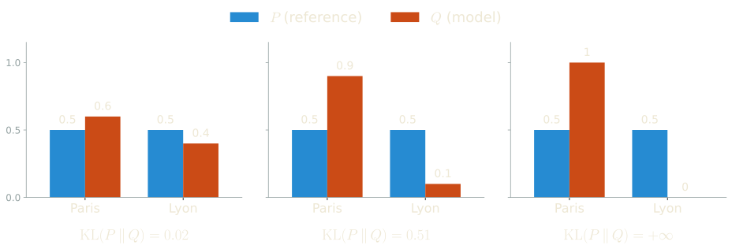
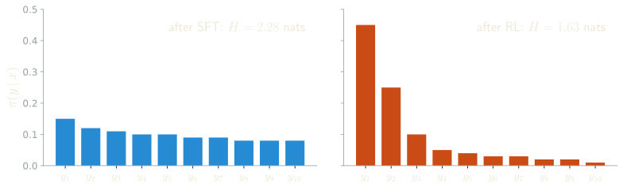

::: notebook
This notebook goes with the fifth lecture of the course. It runs the methods of the lecture on a **real but tiny model** (135M parameters), [`SmolLM2-135M`](https://huggingface.co/HuggingFaceTB/SmolLM2-135M) and its instruct version, so that every method trains in minutes on a laptop.

**Hardware.** NVIDIA GPU, Apple Silicon or CPU, selected automatically. **Runtime**: about 7 minutes on a laptop GPU, 25 minutes on CPU.
:::

::: lecture
These notes follow the slides of the fifth lecture and add the explanations given in class. The lecture is organised by the kind of data available: first the methods that learn from labels (Section 2), then reinforcement learning, sorted by the kind of reward (Sections 3 to 7). Each part of the lab comes after the part of the lecture it illustrates: we fine-tune a model of 135M parameters with supervised fine-tuning, DPO, GRPO, on-policy self-distillation and LoRA, train a reward model on its hidden states, and fit an arena leaderboard. The code and its results are shown in full; the notebook contains the same code, ready to run.

Eleven interview questions, of the kind asked for machine learning engineer and research positions, are spread over the lecture. They are framed in orange, and each is followed by a detailed answer and discussion, folded so that you can think about the question first.
:::

::: slides
# Outline
<!-- type: content -->

:::: {.columns}
::: {.column width="50%"}
0. Lifecycle of a language model
1. What is alignment?
2. Learning from labels
3. Reinforcement learning for LLMs
4. Rewards learned from preferences
:::
::: {.column width="50%"}
5. Verifiable rewards
6. Beyond verifiable rewards
7. Dense rewards from a teacher
8. Parameter-efficient fine-tuning
9. Evaluating post-trained models
:::
::::
:::

```{python}
#| eval: true
#| code-fold: true
import torch
import torch.nn as nn
import torch.nn.functional as F
import matplotlib.pyplot as plt
import numpy as np

from transformers import AutoTokenizer

```

# Prerequisite: KL divergence
<!-- type: content -->

For two probability distributions $P$ and $Q$ over the same space:
$$\mathrm{KL}(P \| Q) = \mathbb{E}_{x \sim P}\!\left[\log \frac{P(x)}{Q(x)}\right] = \sum_x P(x) \log \frac{P(x)}{Q(x)}$$

- $\log \frac{P(x)}{Q(x)}$ compares how likely $x$ is under $P$ and under $Q$; the KL averages it over samples of $P$.
- It is large when $Q$ gives a low probability to what $P$ often produces.
- Non-negative: $\mathrm{KL}(P \| Q) \geq 0$, with equality if and only if $P = Q$.
- Asymmetric: $\mathrm{KL}(P \| Q) \neq \mathrm{KL}(Q \| P)$ in general.

::: lecture
The KL divergence will appear throughout the lecture, in the loss of supervised fine-tuning, in the objective of reinforcement learning and in distillation. In information theory, it is the number of extra nats (or bits, with the logarithm in base 2) needed to encode samples of $P$ with a code designed for $Q$ instead of a code designed for $P$: $\mathrm{KL}(P \| Q) = H(P, Q) - H(P)$, the cross-entropy minus the entropy. Non-negativity follows from Jensen's inequality applied to the concave logarithm. The KL is not a distance: it is not symmetric and does not satisfy the triangle inequality.
:::

## KL divergence: examples
<!-- type: example -->

The two distributions play different roles: $P$ is the **reference**, $Q$ is the **model** being learned. Next token after *"My favourite city is"*:

{fig-align="center"}

. . .

> $\mathrm{KL}(P \| Q)$ is small when $Q$ is close to $P$, and infinite as soon as $Q$ never produces an answer that $P$ produces.

::: lecture
The values use the natural logarithm: from left to right, $0.5 \log \frac{0.5}{0.6} + 0.5 \log \frac{0.5}{0.4} \approx 0.02$, then $0.5 \log \frac{0.5}{0.9} + 0.5 \log \frac{0.5}{0.1} \approx 0.51$, then $+\infty$, since the term of Lyon is $0.5 \log \frac{0.5}{0}$. Most of the divergence comes from Lyon, the answer that the model underestimates: in this direction, the KL forces the model to cover every answer of the reference.

The roles can also be swapped, and both directions appear in this lecture. In SFT (Section 2), the cross-entropy minimises the KL from the data to the model, since $H(p_{\text{data}}, p_\theta) = H(p_{\text{data}}) + \mathrm{KL}(p_{\text{data}} \,\|\, p_\theta)$ and the entropy of the data does not depend on $\theta$. This KL heavily penalises a model that gives a low probability to an answer of the data: it is *mode-covering*. In RL (Section 3), the KL goes from the policy to the reference, and the expectation is taken over the answers of the policy: the policy may drop most of the answers of the reference and keep a few, but it is penalised for producing answers that the reference finds very unlikely. This direction is *mode-seeking*. The difference explains why RL lowers the entropy of the model (Section 5), and it returns in Section 7, where a student can be distilled in either direction.
:::

# 0. Lifecycle of a Language Model
<!-- type: content -->

Three phases:

| Phase | What happens |
|---|---|
| Pre-training | next-token prediction on a very large corpus |
| Post-training | the model becomes an assistant |
| Inference | autoregressive generation, token by token |

::: lecture
The previous parts of the course built the architecture (Parts 1 and 2), the tokenizer (Part 3) and the pre-training recipe (Part 4). This part is about the second phase: how a model that predicts text becomes an assistant that follows instructions. Inference, the third phase, uses the same autoregressive generation in all cases; what changes is the distribution the model samples from.
:::

## Pre-training
<!-- type: content -->

Train on hundreds of billions to trillions of tokens with **next-token prediction**.

- The model learns the structure of language, facts about the world, and some form of reasoning.
- The compute is large: over thousands of GPU-days.
- The result is a **base model**, also called **foundation model**: it can generate text but not solve tasks.

::: lecture
Almost everything the model knows is acquired during pre-training. Post-training changes the behaviour of the model much more than its knowledge: it selects, among all the continuations the base model finds plausible, those that an assistant should produce.
:::

## Some statistics on model size
<!-- type: content -->

  Model                    Year   Parameters   Training tokens
  ------------------------ ------ ------------ ----------------
  GPT-2                    2019   1.5B         ~10B
  GPT-3                    2020   175B         300B
  Llama 3 (largest)        2024   405B         15T
  DeepSeek-V3              2024   671B (MoE)   14T
  Llama 4 Maverick         2025   400B (MoE)   22T

::: lecture
The number of training tokens has grown faster than the number of parameters. The Chinchilla analysis ([Hoffmann et al., 2022](https://www.alphaxiv.org/abs/2203.15556)) suggested about 20 tokens per parameter for a compute-optimal model; Llama 3 405B was trained on nearly 40 tokens per parameter, and smaller models are trained far beyond that ratio, because a smaller model is cheaper to serve. For the mixtures of experts (MoE), only a fraction of the parameters is active for each token.
:::

## Post-training
<!-- type: content -->

Post-training turns the base model into an assistant. What it can do depends on the data we have:

- **labels**: answers written by humans or by other models, comparisons between answers;
- **rewards**: a score computed on the answers of the model itself.

It costs far less compute than pre-training.

::: lecture
To give an order of magnitude, the technical report of [DeepSeek-V3](https://www.alphaxiv.org/abs/2412.19437) (2024) counts about 2.7 million H800 GPU hours for pre-training and about 5,000 for post-training. This ratio is changing with reasoning models, whose reinforcement learning phase can take a large share of the total budget. Post-training also relies on data that is expensive to produce: demonstrations written by experts, comparisons made by annotators, problems with checked answers, or the outputs of stronger models. The lecture is organised by this data: what we can do with labels (Section 2), then with rewards of different kinds (Sections 3 to 7).
:::

# 1. What is Alignment?
<!-- type: content -->

A **base model** completes text, it cannot solve tasks. If we ask *"What is the capital of France?"*, it might reply:

> *"...is a question often posed on French geography quizzes. The answer, of course, depends on the era..."*

It continues the text the way similar texts continued in its training data.

::: lecture
On the web, a question is often followed by other questions (a quiz, a forum thread, an exam), or by an article that discusses it. A base model reproduces these patterns. The lab shows the difference on a small model: the base model and its instruct version give very different continuations of the same prompt.
:::

## The alignment problem
<!-- type: content -->

**Alignment** trains the model to be **helpful, harmless and honest** (the "3 H" of [Askell et al., 2021](https://www.alphaxiv.org/abs/2112.00861)).

> These three objectives are very hard to define mathematically.

::: lecture
The three criteria can conflict: the most helpful answer to a dangerous request is a harmful one, and a model that refuses everything is harmless but useless. Post-training has to find a balance, and most of the methods of this lecture learn it from human judgements rather than from explicit rules.
:::

## Chat templates
<!-- type: content -->

An assistant is fine-tuned on conversations in a fixed format. Every model family defines its own:

```
<|im_start|>system
You are a helpful assistant.
<|im_end|>
<|im_start|>user
What is the capital of France?
<|im_end|>
<|im_start|>assistant
The capital of France is Paris.
<|im_end|>
```

. . .

This is the **ChatML** format (Qwen, SmolLM, ...). Llama 2 used `[INST]...[/INST]` instead.

If we do not follow the model's format, we typically get very degraded answers.

::: lecture
The markers `<|im_start|>` and `<|im_end|>` are special tokens: each is a single token of the vocabulary, which no ordinary text can produce. The **system** message sets the behaviour of the assistant, the **user** and **assistant** messages alternate, and generation stops when the model produces `<|im_end|>`. The template is stored with the tokenizer, as a small Jinja program, so that the formatting used at inference is exactly the one seen during fine-tuning.
:::

## Applying a chat template in code
<!-- type: content -->

```{python}
#| eval: true
#| echo: true
tokenizer = AutoTokenizer.from_pretrained("HuggingFaceTB/SmolLM2-135M-Instruct")

messages = [
    {"role": "system", "content": "You are a helpful assistant."},
    {"role": "user",   "content": "What is the capital of France?"},
]

prompt = tokenizer.apply_chat_template(
    messages,
    tokenize=False,         # return a string, not token ids
    add_generation_prompt=True   # add the opening <|im_start|>assistant token
)
print(prompt)
```

The model then **continues** from the assistant marker.

## Interview: the assistant that never stops {.interview}
<!-- type: interview -->

You fine-tune a base model on conversations formatted with the ChatML template. At inference, the model answers correctly, but then goes on: it writes a new user turn, answers it, and only stops at `max_new_tokens`.

What are the likely causes? How do you fix this?

::: answer
**What should stop the generation.** Generation stops when the model samples a token that the decoding loop treats as a stop token; for a chat model, this is the end-of-turn token, `<|im_end|>` in ChatML. Two conditions must hold: the model must have learned to produce this token, with high probability, at the end of its answers, and the inference code must stop on it. One of the two fails here. The fact that the model writes a plausible user turn shows that it has learned the template but not where its own turn ends.

**Causes on the training side.**

- **The end-of-turn token is masked.** Loss masking (Section 2) must train on the assistant tokens *including* the closing `<|im_end|>`. A masking function that only keeps the text between the markers never teaches the model to close its turn.
- **The padding token is the end token.** The common line `tokenizer.pad_token = tokenizer.eos_token`, combined with a data collator that sets the label of every padding token to $-100$, also masks the genuine end tokens, since the collator cannot tell them apart from padding. The model does not see answers with an end. The fix is a dedicated padding token, or a mask built from the lengths of the sequences rather than from the token ids.
- **The end token is new.** If the template uses special tokens that the base model does not have, their embeddings are added to the vocabulary with an arbitrary initialisation and must be trained. With LoRA, the embedding and output layers are frozen by default, so the model cannot learn to produce a token whose row of the output layer was never trained; with PEFT, these layers must be listed in `modules_to_save`.
- **Truncation and packing.** Examples cut at `max_length` lose their end token, so a dataset of long answers may contain few ends; and conversations packed into one sequence without an end token between them (next question) teach the model that a conversation continues with another one.

**Causes on the inference side.** The model may produce the end token while the code does not stop on it. The stop tokens come from `generation_config.eos_token_id`, which often refers to the end-of-text token of pre-training rather than to the end-of-turn token of the template. Llama 3, for instance, ends a turn with `<|eot_id|>` and a document with `<|end_of_text|>`: code that stops only on the latter never stops after an answer. Decoding with `skip_special_tokens=True` hides the problem, since the end token disappears from the printed text. Finally, the template used at inference must be exactly the one of training, with the same system message, the same newlines and the generation prompt `<|im_start|>assistant` added by `add_generation_prompt=True`: any mismatch puts the model out of distribution.

**How to find the right one.** First, decode one training batch with its labels, token by token, and look at which tokens are trained: this shows whether the closing `<|im_end|>` appears. Second, give the model a prompt followed by a complete answer and read the probability it assigns to `<|im_end|>` at the end. If this probability is high, the model is fine and the stopping criterion is wrong; if it is low, the problem is in the training data or the masking. The `generate` function of the lab below passes the end-of-turn token explicitly as a stop token, for the same reason.
:::

::: {.lecture .notebook}
## Lab: chat templates and the instruct model {#lab-chat .lab}

The lab runs the methods of the lecture on `SmolLM2-135M`, a model small enough to be fine-tuned in minutes on a laptop:

| Part | Content | Section |
|---|---|---|
| 1 | Chat templates, the instruct model | 1 |
| 2 | Supervised fine-tuning (SFT) with loss masking | 2 |
| 3 | Preference pairs and a reward model on hidden states | 4 |
| 4 | Direct Preference Optimization (DPO) | 4 |
| 5 | GRPO: group advantages, then **GRPO from scratch** on a verifiable task (two-digit additions) | 5 |
| 6 | On-policy self-distillation on the same task: the model, given the answer, is its own teacher | 7 |
| 7 | LoRA: from scratch, then with PEFT | 8 |
| 8 | Arena leaderboards are Bradley-Terry fits | 9 |
| 9 | Comparing the models | 9 |

### Setup

```{python}
import copy
import gc
import random
import re
import time
import warnings

import datasets
import matplotlib.pyplot as plt
import numpy as np
import pandas as pd
import torch
import torch.nn as nn
import torch.nn.functional as F
from transformers import AutoModelForCausalLM, AutoTokenizer
from transformers.utils import logging as hf_logging

hf_logging.set_verbosity_error()
hf_logging.disable_progress_bar()
datasets.disable_progress_bars()
warnings.filterwarnings("ignore", category=FutureWarning)          # deprecation notices of the libraries
warnings.filterwarnings("ignore", message=".*pin_memory.*")        # harmless on Apple Silicon
plt.rcParams.update({"figure.dpi": 110, "axes.grid": True, "grid.alpha": 0.3})
_ = torch.manual_seed(0)

# Device selection: NVIDIA GPU, then Apple Silicon, then CPU.
if torch.cuda.is_available():
    device = "cuda"
elif torch.backends.mps.is_available():
    device = "mps"
else:
    device = "cpu"
print(f"Device: {device}   torch {torch.__version__}")


def free_memory():
    gc.collect()
    if device == "cuda":
        torch.cuda.empty_cache()
    elif device == "mps":
        torch.mps.empty_cache()
```

### The instruct model

We load `SmolLM2-135M-Instruct`, a tiny model that has already been aligned. Understanding how it was produced is the goal of this lab.

```{python}
MODEL = "HuggingFaceTB/SmolLM2-135M-Instruct"

instruct_tokenizer = AutoTokenizer.from_pretrained(MODEL)
instruct_model = AutoModelForCausalLM.from_pretrained(MODEL, dtype=torch.bfloat16).to(device).eval()

print(f"Parameters: {sum(p.numel() for p in instruct_model.parameters())/1e6:.1f}M")
```

### Chat templates

Instruct models expect conversations in a specific format. SmolLM2 uses **ChatML**: `<|im_start|>role\ncontent<|im_end|>`. `apply_chat_template` handles all the formatting automatically.

```{python}
def make_prompt(user_message, system="You are a helpful assistant."):
    messages = [
        {"role": "system", "content": system},
        {"role": "user",   "content": user_message},
    ]
    return instruct_tokenizer.apply_chat_template(
        messages, tokenize=False, add_generation_prompt=True
    )

prompt = make_prompt("What is the capital of France?")
print(repr(prompt))
print()
print("--- Rendered ---")
print(prompt)
```

```{python}
def generate(prompt_text, mdl=None, tok=None, max_new_tokens=80):
    if mdl is None: mdl = instruct_model
    if tok is None: tok = instruct_tokenizer
    inputs = tok(prompt_text, return_tensors="pt").to(device)
    # Stop at end-of-turn (<|im_end|>) or start-of-turn (<|im_start|>),
    # whichever comes first: eos_token_id alone is </s> for this tokenizer
    stop_ids = list({tok.eos_token_id,
                     tok.convert_tokens_to_ids("<|im_end|>"),
                     tok.convert_tokens_to_ids("<|im_start|>")})
    with torch.no_grad():
        out = mdl.generate(
            **inputs, max_new_tokens=max_new_tokens,
            do_sample=False, pad_token_id=tok.eos_token_id,
            eos_token_id=stop_ids,
        )
    new = out[0][inputs["input_ids"].shape[1]:]
    return tok.decode(new, skip_special_tokens=True)

for q in [
    "What is the capital of France?",
    "What is 7 × 8?",
    "Explain gradient descent in two sentences.",
]:
    print(f"Q: {q}")
    print(f"A: {generate(make_prompt(q))}")
    print()
```
:::

# 2. Learning from Labels
<!-- type: content -->

The method depends on the kind of label:

| Label | Example | Method |
|---|---|---|
| answer written by a human | InstructGPT | supervised fine-tuning (SFT) |
| answer of a stronger model | Alpaca, distilled from R1 | SFT (sequence-level distillation) |
| answer of the model itself, kept by a checker | STaR, Llama 3 | rejection sampling fine-tuning |
| full distribution of a teacher | Gemma 2 | logit distillation |
| the better of two answers | UltraFeedback | DPO (Section 4) |
| thumbs up or down on one answer | chat interfaces | KTO (Section 4) |

::: lecture
In all these methods the training data is fixed before training starts, or at least does not depend on the current state of the model: they are *offline*. The first four rows are variants of the same loss, the cross-entropy on the labelled answers; they differ in where the answers come from. The last two rows use preferences rather than target answers. Their losses come from the reinforcement learning objective, so they are presented after it, in Section 4, but they belong to the same family: no sampling during training, only a fixed dataset.
:::

## Supervised fine-tuning (SFT)
<!-- type: content -->

Train on (prompt, answer) pairs, with the loss of pre-training: *given this conversation, predict the tokens of the answer*.

- **Quality matters more than quantity**: 1,000 good examples is better than 50,000 mediocre ones.
- **Loss masking**: the cross-entropy is computed on the answer tokens only.
- **Limit**: the model learns to imitate, it never sees its own mistakes.

::: lecture
SFT is the same training as pre-training, next-token prediction with the cross-entropy loss, on a different kind of data: conversations formatted with the chat template, in which the assistant turns are written the way we want the model to answer. A few thousand examples are enough to teach the format and the tone of an assistant, because the base model already has the knowledge; SFT mostly teaches it which of its abilities to use.
:::

## Where does SFT data come from?
<!-- type: content -->

- **Human demonstrations**: [InstructGPT](https://www.alphaxiv.org/abs/2203.02155) (2022) used about 13,000 prompts with answers written by labelers.
- **Synthetic data**: [Self-Instruct](https://www.alphaxiv.org/abs/2212.10560) and [Alpaca](https://crfm.stanford.edu/2023/03/13/alpaca.html) (2023) generated 52,000 instructions and answers with a stronger model, for a few hundred dollars.
- **From principles**: [Constitutional AI](https://www.alphaxiv.org/abs/2212.08073) (2022): the model answers, critiques its answer against a written principle and revises it; the revisions become the SFT data.
- **Small but curated**: [LIMA](https://www.alphaxiv.org/abs/2305.11206) (2023) fine-tuned a 65B model on **1,000** carefully chosen examples, with results competitive with much larger datasets.
- **Open recipes**: [Tülu 3](https://www.alphaxiv.org/abs/2411.15124) (2024) publishes data, code and evaluations for the full post-training pipeline.

. . .

Today, most SFT data is generated or filtered by other models: post-training is largely **distillation** from stronger models.

::: lecture
The papers are [Ouyang et al. (2022)](https://www.alphaxiv.org/abs/2203.02155) for InstructGPT, [Wang et al. (2023)](https://www.alphaxiv.org/abs/2212.10560) for Self-Instruct, [Taori et al. (2023)](https://crfm.stanford.edu/2023/03/13/alpaca.html) for Alpaca, [Zhou et al. (2023)](https://www.alphaxiv.org/abs/2305.11206) for LIMA and [Lambert et al. (2024)](https://www.alphaxiv.org/abs/2411.15124) for Tülu 3. LIMA formulated the *superficial alignment hypothesis*: the knowledge of the model comes from pre-training, and alignment only teaches it the format in which to present it. SFT on the answers of a stronger model is called *sequence-level distillation* ([Kim and Rush, 2016](https://www.alphaxiv.org/abs/1606.07947)): the student imitates the outputs of the teacher, one sampled answer per prompt. The terms of use of several commercial models forbid using their outputs to train competing models.

Constitutional AI ([Bai et al., 2022](https://www.alphaxiv.org/abs/2212.08073)) replaces human demonstrations by a short list of written principles, the constitution. In its supervised phase, a helpful model answers prompts designed to elicit harmful answers, then critiques its own answer with respect to a principle drawn at random and rewrites it, possibly over several rounds; the model is then fine-tuned on the revised answers. A second phase uses the same principles to produce preferences (RLAIF, Section 4). The idea has several descendants. SELF-ALIGN ([Sun et al., 2023](https://www.alphaxiv.org/abs/2305.03047)) aligned a base LLaMA-65B model with fewer than 300 lines of human annotation, including 16 principles, by generating prompts and answers that follow the principles in context. Deliberative alignment ([Guan et al., 2024](https://www.alphaxiv.org/abs/2412.16339)) puts the relevant safety specification in the system prompt, lets a reasoning model answer with a chain of thought that cites it, filters the answers with a judge that knows the specification, and removes the specification from the training examples: the model learns to recall and apply the rules without seeing them. Training on what a model produces with an instruction in its context, and without the instruction, is called *context distillation*.
:::

## Loss masking
<!-- type: content -->

```{python}
#| eval: true
#| echo: true
tokenizer = AutoTokenizer.from_pretrained("gpt2")
tokenizer.pad_token = tokenizer.eos_token

prompt   = "What is the capital of France?"
response = "The capital of France is Paris."

prompt_ids   = tokenizer.encode(prompt)
response_ids = tokenizer.encode(" " + response)
full_ids     = prompt_ids + response_ids

# -100 tells PyTorch to ignore this position in the cross-entropy loss
labels = [-100] * len(prompt_ids) + response_ids

print("labels:", labels)
print("MASKED:", [tokenizer.decode([t]) for t, l in zip(full_ids, labels) if l == -100])
print("TRAIN: ", [tokenizer.decode([t]) for t, l in zip(full_ids, labels) if l != -100])
```

The gradient comes from the **answer tokens only**: the model learns to produce the answer, not to repeat the prompt.

::: lecture
The value $-100$ is the default `ignore_index` of PyTorch's cross-entropy: positions with this label contribute neither to the loss nor to the gradient. In Hugging Face models, the labels are given aligned with the inputs and shifted by one position inside the model, so that the label at position $t$ is predicted from the tokens before it. The prompt is still part of the input: the model reads it, it is simply not trained to produce it.
:::

## Why cross-entropy?
<!-- type: content -->

**Cross-entropy = maximum likelihood estimation.** For one token:
$$\mathcal{L}_{CE} = -\log p_\theta(y_t \mid y_{<t}, x) = -\log \frac{e^{\text{logit}_{y_t}}}{\sum_{v} e^{\text{logit}_v}}$$

- Depends only on the **probability of the correct token**. Its gradient on the logits is $p_v - \mathbb{1}[v = y_t]$: the correct token goes up, and every other token goes down in proportion to its probability.
- Minimising CE over a dataset = maximising the likelihood of the training data under the model.
- Equivalently, minimising the KL divergence from the empirical data distribution to the model's distribution.

. . .

**In practice**, SFT loss = cross-entropy **summed over response tokens only** (prompt tokens are masked with `ignore_index=-100` in PyTorch).

::: lecture
The equivalence with the KL divergence comes from the decomposition $H(p_{\text{data}}, p_\theta) = H(p_{\text{data}}) + \mathrm{KL}(p_{\text{data}} \,\|\, p_\theta)$: the entropy of the data does not depend on $\theta$, so minimising the cross-entropy and minimising the KL divergence have the same solutions. This KL goes from the data to the model: it heavily penalises a model that gives a low probability to an answer of the data, which pushes the model to cover all the answers it has seen. We will meet the other direction, from the model to a reference, in RLHF.
:::

## SFT with TRL
<!-- type: example -->

The `trl` library implements the whole pipeline on top of `transformers`:

```python
from datasets import load_dataset
from trl import SFTConfig, SFTTrainer

dataset = load_dataset("trl-lib/Capybara", split="train")         # conversations
trainer = SFTTrainer(
    model="HuggingFaceTB/SmolLM2-135M",
    train_dataset=dataset,
    args=SFTConfig(output_dir="smol-sft", assistant_only_loss=True),  # mask non-assistant tokens
)
trainer.train()
```

The chat template, the loss masking and the batching are handled for us. The companion notebook runs SFT, DPO and GRPO on a 135M model.

## Interview: averaging the SFT loss {.interview}
<!-- type: interview -->

You fine-tune on conversations whose answers range from 20 to 2,000 tokens, with gradient accumulation over 8 micro-batches. How exactly should the loss be averaged, and does it matter?

To avoid padding, you then pack several conversations into each training sequence of 4,096 tokens. What can go wrong?

::: answer
**Two natural averages.** With loss masking, the number of trained tokens varies from one example to the next, and the loss can be averaged in two ways: over all the trained tokens of the batch, so that each token has the same weight, or over the tokens of each example first and then over the examples, so that each conversation has the same weight. These are different objectives. The token average is the negative log-likelihood per token of the data, the quantity that maximum likelihood minimises, and with it an answer of 2,000 tokens weighs a hundred times as much as an answer of 20 tokens. The per-example average gives each token of the short answer a weight a hundred times larger than each token of the long one, and therefore favours what short answers teach (format, tone, brevity). Both are acceptable, but the choice should be deliberate. The token average is the usual default.

**The gradient accumulation trap.** Gradient accumulation is meant to reproduce a large batch with several small ones. If each micro-batch computes the mean loss over its own trained tokens and the accumulated gradient is the average of these means, the result is not the token average over the full batch. Suppose that one micro-batch has 10 trained tokens and another one 1,000. In the average of the two means, each token of the first has weight $1/20$ and each token of the second $1/2{,}000$, while the token average over the batch gives every token the weight $1/1{,}010$: the tokens of the small micro-batch count a hundred times more than those of the large one. The correct implementation sums the losses of all the trained tokens and divides by the total number of trained tokens of the accumulated batch, counted before the backward passes, and summed over all the workers with data parallelism.

**Padding and packing.** Padding a batch to its longest sequence wastes compute in proportion to the spread of the lengths: with examples of 500 tokens on average, padded to 4,096, about 88% of the computation is spent on padding. Packing concatenates several examples into each sequence and removes this waste, but done naively it has three problems:

- **Cross-contamination.** With the usual causal mask, the tokens of the second conversation attend to the first one, which is unrelated, and the model learns to use context that will not be there at inference. The fix is a block-diagonal causal mask, restricted to each example, with position ids that restart at zero for each example; the variable-length kernels of FlashAttention implement it at no extra cost.
- **Boundaries.** The label of the last token of an example is the first token of the next one; this prediction is meaningless and should be masked.
- **Truncation.** Cutting the stream of examples every 4,096 tokens splits examples in two and separates answers from their prompts. Packing whole examples into sequences is a bin-packing problem, solved well enough by simple greedy heuristics.

Once examples are packed, a per-example average needs the boundaries of the examples, and the token average becomes the natural choice, with the weighting of long answers discussed above.

**Going further.** The same question of normalisation appears in reinforcement learning, with more serious consequences: dividing the loss of each answer by its length, as in the original GRPO objective, creates a bias on the length of the answers (Section 5, *Fixing GRPO*). Changing the normalisation also changes the effective learning rate, so loss values and learning rates can only be compared between runs that average in the same way.
:::

## Labels from the model itself
<!-- type: content -->

When a **checker** is available (known answer, unit tests, reward model), the model can write its own labels:

1. sample $K$ answers per prompt from the current model;
2. keep the answers that pass the checker;
3. fine-tune on them with SFT, and repeat.

. . .

This is **rejection sampling fine-tuning**, also called expert iteration: [STaR](https://www.alphaxiv.org/abs/2203.14465) (2022), [ReST](https://www.alphaxiv.org/abs/2308.08998) (2023), the post-training of Llama 2 and 3, the third stage of DeepSeek-R1.

::: lecture
The papers are [Zelikman et al. (2022)](https://www.alphaxiv.org/abs/2203.14465) for STaR, [Yuan et al. (2023)](https://www.alphaxiv.org/abs/2308.01825) for RFT on math problems and [Gulcehre et al. (2023)](https://www.alphaxiv.org/abs/2308.08998) for ReST. The training answers are written in the style of the model, so they are closer to its own distribution than the answers of a human or of another model, and the model only has to learn which of its answers to prefer. STaR adds a trick for the problems on which no sample is correct: the model is given the correct answer as a hint and asked to write a justification for it, which is then used as a label without the hint. This idea, the model with extra information acting as its own teacher, returns in Section 7. Section 3 shows that rejection sampling fine-tuning is a special case of reinforcement learning, with a reward in $\{0, 1\}$ and no negative signal.
:::

## Labels as distributions: knowledge distillation
<!-- type: content -->

A teacher gives more than one answer: at each position, it gives a **distribution over the whole vocabulary**.

$$\mathcal{L}_{\text{KD}} = \sum_t \mathrm{KL}\big(p_T(\cdot \mid y_{<t}, x) \,\|\, p_\theta(\cdot \mid y_{<t}, x)\big)$$

- A distribution carries much more information than the single token of a sampled answer.
- Requires the logits of the teacher, and the same tokenizer.
- Used for small models: [DistilBERT](https://www.alphaxiv.org/abs/1910.01108) (2019), [Gemma 2](https://www.alphaxiv.org/abs/2408.00118) (2024), Llama 3.2 1B and 3B (2024).

::: lecture
Knowledge distillation was introduced by [Hinton et al. (2015)](https://www.alphaxiv.org/abs/1503.02531) for classifiers: the student learns from the probabilities that the teacher gives to all the classes, including the wrong ones, which tell it which mistakes are reasonable. For a language model, the sequence $y$ is usually written by the teacher or taken from a dataset, and the loss compares the two distributions at every position, so the student gets a full distribution per token instead of one sampled token. The KL goes from the teacher to the student, as in the cross-entropy with the data: the student must cover all the tokens the teacher finds plausible. The two practical requirements, access to the logits and a shared vocabulary, explain why logit distillation is used within a model family (Gemma, Llama) and why distillation from a commercial model through its API is sequence-level only.
:::

## What SFT cannot do
<!-- type: content -->

- It cannot do better than its labels.
- It has no negative signal.
- It trains on prefixes written by others.

. . .

> To go further, the model must get feedback on **its own** answers: a **reward**.

::: lecture
The third point is called *exposure bias*: during training, the model always predicts the next token after a correct prefix, written by a human or a teacher, while at inference it conditions on what it generated itself. After a mistake, it is in a situation that never occurred during training, and nothing in SFT tells it how to recover. The data of SFT is *off-policy*: it does not come from the model being trained. Rejection sampling fine-tuning partly fixes this, since it trains on the model's own answers, but it still throws the wrong ones away. The methods of the next sections give feedback on what the model actually produces, including its mistakes.
:::

::: {.lecture .notebook}
## Lab: supervised fine-tuning {#lab-sft .lab}

SFT trains on (prompt, response) pairs with **loss masking**: the cross-entropy loss is computed only on response tokens; the prompt is ignored.

### Loss masking: why it matters

Without masking, the model would be penalized for not predicting the prompt itself, wasting gradient signal on text we already know.

```{python}
def show_loss_masking(prompt_text, response_text):
    """Print which tokens are masked (prompt) vs. trained on (response)."""
    prompt_ids   = instruct_tokenizer.encode(prompt_text,   add_special_tokens=False)
    response_ids = instruct_tokenizer.encode(" " + response_text, add_special_tokens=False)
    full_ids = prompt_ids + response_ids
    labels   = [-100] * len(prompt_ids) + response_ids

    print(f"{'Token':<22} Status")
    print("-" * 38)
    for tok_id, label in zip(full_ids, labels):
        tok    = instruct_tokenizer.decode([tok_id])
        status = "MASKED (no gradient)" if label == -100 else "TRAIN  ← gradient flows here"
        print(f"  {tok!r:<20} {status}")
    return labels

labels = show_loss_masking("What is the capital of France?", "The capital of France is Paris.")
```

### SFT dataset

We create 44 simple Q&A pairs and fine-tune using `trl.SFTTrainer`.

```{python}
from datasets import Dataset

BASE_MODEL    = "HuggingFaceTB/SmolLM2-135M"   # base, not instruct
sft_tokenizer = AutoTokenizer.from_pretrained(MODEL)   # use instruct tokenizer (has chat template)
sft_tokenizer.pad_token = sft_tokenizer.eos_token

raw_data = [
    # Geography
    ("What is the capital of France?",        "The capital of France is Paris."),
    ("What is the capital of Germany?",       "The capital of Germany is Berlin."),
    ("What is the capital of Japan?",         "The capital of Japan is Tokyo."),
    ("What is the capital of Brazil?",        "The capital of Brazil is Brasilia."),
    ("What is the largest ocean?",            "The Pacific Ocean is the largest ocean on Earth."),
    ("Which continent is Australia on?",      "Australia is its own continent."),
    ("What is the longest river?",            "The Nile is generally considered the longest river."),
    # Math
    ("What is 12 + 15?",                      "12 + 15 = 27."),
    ("What is 7 × 8?",                        "7 × 8 = 56."),
    ("What is the square root of 144?",       "The square root of 144 is 12."),
    ("What is 100 divided by 4?",             "100 divided by 4 equals 25."),
    ("Is 17 a prime number?",                 "Yes, 17 is a prime number."),
    ("What is 2 to the power of 10?",         "2 to the power of 10 equals 1024."),
    # Science
    ("What is the speed of light?",           "The speed of light is approximately 300,000 km/s."),
    ("What is the chemical formula for water?", "The chemical formula for water is H2O."),
    ("What planet is closest to the Sun?",    "Mercury is the closest planet to the Sun."),
    ("What is photosynthesis?",               "Photosynthesis is how plants convert sunlight and CO2 into sugar and oxygen."),
    ("What is the atomic number of carbon?",  "Carbon has atomic number 6."),
    ("What is DNA?",                          "DNA carries genetic information in living organisms."),
    # History
    ("In what year did World War II end?",    "World War II ended in 1945."),
    ("Who wrote the Iliad?",                  "The Iliad is attributed to Homer."),
    ("When did the French Revolution begin?", "The French Revolution began in 1789."),
    # Programming
    ("What does CPU stand for?",              "CPU stands for Central Processing Unit."),
    ("What is a Python list?",                "A Python list is an ordered, mutable collection of elements."),
    ("What does print() do in Python?",       "The print() function outputs text to the console."),
    ("What is a function in programming?",    "A function is a reusable block of code that performs a specific task."),
    ("What is an API?",                       "An API allows different software programs to communicate with each other."),
    # ML
    ("What is a neural network?",             "A neural network is a machine learning model made of layers of connected neurons."),
    ("What is overfitting?",                  "Overfitting occurs when a model memorizes training data and performs poorly on new data."),
    ("What is gradient descent?",             "Gradient descent iteratively adjusts parameters to minimize a loss function."),
    ("What is a transformer in ML?",          "A transformer is a neural network that uses self-attention to process sequences in parallel."),
    ("What does fine-tuning mean?",           "Fine-tuning means continuing to train a pre-trained model on a smaller, task-specific dataset."),
    ("What is a token in NLP?",               "A token is a unit of text (roughly a word or sub-word) that a language model processes."),
    # General
    ("What is the boiling point of water?",   "Water boils at 100 degrees Celsius at standard pressure."),
    ("How many days are in a leap year?",     "A leap year has 366 days."),
    ("Who painted the Mona Lisa?",            "Leonardo da Vinci painted the Mona Lisa."),
    ("Give me three tips for studying.",
     "1. Space out your sessions instead of cramming. 2. Test yourself rather than just re-reading. 3. Get enough sleep."),
    ("How do I stay hydrated?",
     "Drink water regularly throughout the day. Around 2 litres per day is a common guideline."),
    ("Explain machine learning in simple terms.",
     "Machine learning is teaching a computer to learn from examples instead of writing explicit rules."),
    ("What are the benefits of exercise?",
     "Regular exercise improves cardiovascular health, strengthens muscles, boosts mood, and aids weight management."),
    ("How does a search engine work?",
     "A search engine crawls the web, indexes pages, and ranks them by relevance when you search."),
    ("What is recursion?",
     "Recursion is when a function calls itself. For example, a factorial function calls itself with a smaller number until the base case."),
    ("What does HTTP stand for?",
     "HTTP stands for HyperText Transfer Protocol, the foundation of data communication on the web."),
    ("What is the speed of sound in air?",
     "Sound travels at about 343 metres per second in air at room temperature."),
]

def format_for_sft(prompt_text, response_text):
    messages = [
        {"role": "system",    "content": "You are a helpful assistant."},
        {"role": "user",      "content": prompt_text},
        {"role": "assistant", "content": response_text},
    ]
    return sft_tokenizer.apply_chat_template(messages, tokenize=False)

sft_dataset = Dataset.from_dict({
    "text": [format_for_sft(p, r) for p, r in raw_data]
})
print(f"Dataset: {len(sft_dataset)} examples")
print()
print("First formatted example:")
print(sft_dataset[0]["text"])
```

### Fine-tuning with SFTTrainer

We load the **base** (unaligned) SmolLM2-135M and fine-tune it on our dataset. The dataset is given as plain text, so the trainer computes the loss on every token, prompt included: with such short prompts this makes little difference. To mask the prompt, give the dataset as prompt-completion pairs, or as conversations with `assistant_only_loss=True` as on the slide.

```{python}
from trl import SFTTrainer, SFTConfig

sft_model = AutoModelForCausalLM.from_pretrained(BASE_MODEL, dtype=torch.bfloat16).to(device)

sft_config = SFTConfig(
    output_dir="/tmp/sft_smollm",
    num_train_epochs=10,
    per_device_train_batch_size=4,
    gradient_accumulation_steps=2,
    learning_rate=2e-4,
    warmup_steps=10,
    logging_steps=10,
    save_strategy="no",
    bf16=(device != "cpu"),
    report_to="none",
    max_length=256,
)

trainer = SFTTrainer(
    model=sft_model,
    args=sft_config,
    train_dataset=sft_dataset,
    processing_class=sft_tokenizer,
)

print("Starting SFT...")
result = trainer.train()
sft_model.eval()
print(f"Done. Final loss: {result.training_loss:.4f}")
```

```{python}
# Plot training loss
log = trainer.state.log_history
steps  = [x["step"] for x in log if "loss" in x]
losses = [x["loss"]  for x in log if "loss" in x]

plt.figure(figsize=(7, 3))
plt.plot(steps, losses, marker="o", markersize=4)
plt.xlabel("Step"); plt.ylabel("Loss")
plt.title("SFT training loss"); plt.grid(True, alpha=0.3); plt.tight_layout(); plt.show()
```

```{python}
# Test the SFT model
for q in ["What is the capital of France?", "What is 7 × 8?", "What is a neural network?"]:
    ans = generate(make_prompt(q), mdl=sft_model, tok=sft_tokenizer)
    print(f"Q: {q}")
    print(f"A: {ans}")
    print()
```
:::

# 3. Reinforcement Learning for LLMs
<!-- type: content -->

With labels, we tell the model **what to write**. With a reward, we tell it **how good** its answer was.

| | Labels (Section 2) | Rewards (Sections 3 to 7) |
|---|---|---|
| who writes the training answers | a human or a teacher model | the model being trained |
| signal | target tokens | a score on the answer |
| negative feedback | no | yes |

::: lecture
A reward is weaker information than a label: a single number on a whole answer, instead of the right token at every position. It has two advantages. It applies to the answers that the model actually produces, mistakes included, so the model learns from its own distribution. And it can be given on answers that nobody could write: checking the answer of a math problem or running the tests of a program is easier than writing a solution. This section presents the framework shared by all the methods of the following ones; they differ in where the reward comes from.
:::

## The language model as a policy
<!-- type: content -->

| RL concept | For a language model |
|---|---|
| **Policy** $\pi_\theta$ | the language model being trained |
| **State** | the prompt and the tokens generated so far |
| **Action** | the next token |
| **Reward** | $r(x, y)$, for the prompt $x$ and the answer $y$, complete or partial |

::: lecture
This is an unusual reinforcement learning problem: the transitions are deterministic (the next state is the current state with the chosen token appended), the episodes are short, and the action space is the whole vocabulary, tens of thousands of actions. The difficulty is credit assignment: when the reward comes at the end of the answer (next slide), a single number must be distributed over all the tokens that produced it. Section 7 shows how a teacher can give a reward at every token instead.
:::

## Outcome and process rewards
<!-- type: content -->

An answer $y = (y_1, \ldots, y_T)$ is cut into steps, such as the lines of a reasoning, and ends with a final answer.

| | Outcome reward (ORM) | Process reward (PRM) |
|---|---|---|
| Scores | the whole answer: $r(x, y)$ | each step ending at token $t$: $r(x, y_{\leq t})$ |
| Labels | is the final answer correct? | is this step correct? (humans, or rollouts) |
| A wrong step in a correct answer | is rewarded | is penalised |

. . .

- [Lightman et al. (2023)](https://www.alphaxiv.org/abs/2305.20050): 800,000 human labels of steps on MATH. Choosing the best of 1,860 answers solves 78.2% of the problems with a PRM, 72.4% with an ORM, 69.6% with majority voting.
- DeepSeek R1 gave up on PRMs: steps are hard to delimit and to label, and a learned PRM gets hacked.

::: lecture
The two terms come from [Uesato et al. (2022)](https://www.alphaxiv.org/abs/2211.14275). An ORM is a classifier trained to predict whether a solution is correct, with labels obtained by checking the final answer; a program that checks the answer, as in Section 5, is an outcome reward that needs no model at all. An outcome reward has two weaknesses: a solution that reaches the correct answer with wrong reasoning is counted as correct, and a wrong solution gives no indication of where the mistake is. A PRM predicts the correctness of each step. Lightman et al. train it as a language model that outputs a label token after each step, and score a whole solution by the product of the step probabilities, that is the probability that every step is correct. Their annotators labelled the steps of solutions written by GPT-4 as positive, negative or neutral, up to the first mistake; the dataset, PRM800K, has 800,000 labels on 75,000 solutions to 12,000 problems, and the evaluation uses 500 problems of the MATH test set.

Human labels are expensive. Math-Shepherd ([Wang et al., 2024](https://www.alphaxiv.org/abs/2312.08935)) replaces them by rollouts: from each step, the model completes the solution $N$ times, and the step is labelled by the fraction of completions that reach the correct answer, or by whether at least one does. This is a Monte Carlo estimate of the value of the step, as in Monte Carlo tree search, and the reasoning behind it is the same as for the value model of PPO later in this section.

A PRM is used in three ways: to rerank sampled solutions (best-of-N), to guide a search step by step, and as a dense reward in RL, where each step gets its own reward instead of sharing the reward of the whole answer. Math-Shepherd trains Mistral-7B with PPO and a reward at the end of each step, from 28.6% to 33.0% on MATH. The DeepSeek R1 report (Section 5) lists the PRM among its unsuccessful attempts, for three reasons: a step is hard to define in free-form reasoning, judging whether an intermediate step is correct is hard to automate and too expensive to do by hand, and a learned PRM can be hacked by the policy, while retraining it costs more resources. Most reasoning models since then use outcome rewards from verifiers. Dense rewards come back in other forms: the process reward of Clay et al. (slide "Does RL create new abilities?") and the teacher of on-policy distillation (Section 7), which gives a reward at every token.
:::

## The objective
<!-- type: content -->

Maximise the reward while staying close to a frozen **reference model** $\pi_\text{ref}$, usually the SFT model:

$$J(\theta) = \mathbb{E}_{x,\ y \sim \pi_\theta(\cdot \mid x)}\big[r(x, y)\big] - \beta\, \mathrm{KL}\big[\pi_\theta(\cdot \mid x) \,\|\, \pi_\text{ref}(\cdot \mid x)\big]$$

. . .

- Without the KL term, the policy finds answers that score high but are nonsense: **reward hacking**.
- $\beta$ sets the trade-off: large $\beta$ stays close to the reference, small $\beta$ focuses on the reward.

::: lecture
The reference model is never updated. Rewards are imperfect: a learned reward model is only reliable on answers that resemble those it was trained on, and even a program that checks answers has blind spots. The KL term keeps the policy in the region where the reward can be trusted, and preserves the fluency and the diversity of the reference, which the reward does not measure. All the methods of the next sections optimise this objective, or a close variant; they differ in the reward $r$ and in the way the gradient is estimated.
:::

## The KL penalty in practice
<!-- type: content -->

The full KL sums over all possible answers: it is estimated on the sampled answer $y = (y_1, \ldots, y_T)$:

$$
\log \frac{\pi_\theta(y \mid x)}{\pi_\text{ref}(y \mid x)}
= \sum_{t=1}^{T}
\log \frac{\pi_\theta(y_t \mid y_{<t}, x)}{\pi_\text{ref}(y_t \mid y_{<t}, x)}
$$

. . .

A sum of **per-token differences of log-probabilities**, computed with one forward pass of each model.

::: lecture
Since $y$ is sampled from $\pi_\theta$, the expectation of this log-ratio is exactly the KL divergence: it is an unbiased estimator. On a single sample it can be negative, which makes it noisy. GRPO and the lab below use another unbiased estimator, which is always non-negative ([Schulman, 2020](http://joschu.net/blog/kl-approx.html)): with $u = \pi_\text{ref}(y_t \mid y_{<t}, x) / \pi_\theta(y_t \mid y_{<t}, x)$, the per-token term $u - \log u - 1$. In InstructGPT, the KL penalty is computed token by token and added to the reward, so that the RL algorithm sees it as part of the environment; GRPO keeps it as a separate term of the loss.
:::

## The policy gradient
<!-- type: content -->

Sampling is not differentiable, but the gradient of the expected reward is an expectation (REINFORCE, [Williams, 1992](https://people.cs.umass.edu/~barto/courses/cs687/williams92simple.pdf)). With $\nabla_\theta \pi_\theta = \pi_\theta\, \nabla_\theta \log \pi_\theta$:

$$\begin{aligned}
\nabla_\theta\, \mathbb{E}_{y \sim \pi_\theta}[r(x, y)] &= \sum_y r(x, y)\, \nabla_\theta \pi_\theta(y \mid x) \\
&= \mathbb{E}_{y \sim \pi_\theta}\big[r(x, y)\, \nabla_\theta \log \pi_\theta(y \mid x)\big]
\end{aligned}$$

. . .

- For a language model, $\log \pi_\theta(y \mid x) = \sum_t \log \pi_\theta(y_t \mid x, y_{<t})$: the gradient of the SFT loss on $y$.
- So the policy gradient is a **weighted SFT** on the model's own samples, with weight $r(x, y)$.

::: lecture
The identity $\nabla_\theta \pi_\theta = \pi_\theta\, \nabla_\theta \log \pi_\theta$ is called the log-derivative trick: it turns a sum weighted by the gradient of a probability into an expectation under that probability, which we can estimate by sampling. Each sampled answer contributes the gradient of its log-likelihood, exactly as in SFT, scaled by its reward: answers with a high reward become more likely. The reward itself is never differentiated, so it can be any function of the answer, a reward model, a unit test or a human rating.
:::

## Reducing the variance: the baseline
<!-- type: content -->

- The expectation is over all possible answers: we estimate it with a few samples.
- This estimate has a **high variance**. If all rewards are positive, every sampled answer is made more likely, and only the amounts differ.

. . .

Subtract a **baseline** $b(x)$ that does not depend on $y$:

$$\nabla_\theta\, \mathbb{E}_{y \sim \pi_\theta}[r(x, y)] = \mathbb{E}_{y \sim \pi_\theta}\Big[\big(r(x, y) - b(x)\big)\, \nabla_\theta \log \pi_\theta(y \mid x)\Big]$$

- No bias: $\mathbb{E}_{y \sim \pi_\theta}\big[b(x)\, \nabla_\theta \log \pi_\theta(y \mid x)\big] = b(x)\, \nabla_\theta \sum_y \pi_\theta(y \mid x) = 0$.
- The weight $A = r - b$ is the **advantage**: answers better than the baseline become more likely, worse ones less likely.

::: lecture
With a few samples per prompt, the direction of the estimated gradient depends a lot on which answers happened to be drawn. A good baseline is close to the expected reward of the prompt: the advantage is then positive for the answers that are better than usual and negative for the others, so the update pushes in the right direction even with few samples.
:::

## Where does the baseline come from?
<!-- type: content -->

| Method | Baseline $b$ | Extra cost |
|---|---|---|
| REINFORCE | none, or a running average | none |
| PPO | a learned **value model** $V(x, y_{<t})$ | a second network, as large as the policy |
| GRPO (Section 5) | mean reward of a **group** of answers to the same prompt | several samples per prompt |
| RLOO | mean reward of the *other* answers of the group | several samples per prompt |

PPO uses one baseline per token: $V(x, y_{<t})$ sees the prompt and the prefix, but not the token $y_t$ it weighs, so the gradient stays unbiased.

::: lecture
The baseline $b(x)$ of the previous slide is one number per answer. Since $\log \pi_\theta(y \mid x)$ is a sum over tokens, each token can get its own baseline, as long as it does not depend on that token or on the following ones: the baseline of $y_t$ may use the prompt and the prefix $y_{<t}$, which is what the value model does. PPO ([Schulman et al., 2017](https://www.alphaxiv.org/abs/1707.06347)) was the algorithm of RLHF. Its value model predicts, from each prefix, the reward expected at the end of the answer, so the advantage of a token is how much the outcome exceeded this prediction; the estimate is refined by generalized advantage estimation ([Schulman et al., 2016](https://www.alphaxiv.org/abs/1506.02438)). The value model has to be trained alongside the policy and takes as much memory. GRPO ([Shao et al., 2024](https://www.alphaxiv.org/abs/2402.03300)) and RLOO ([Ahmadian et al., 2024](https://www.alphaxiv.org/abs/2402.14740)) replace it by a Monte Carlo estimate: sample several answers to the same prompt and compare each one to the others.
:::

## Reusing samples: importance sampling
<!-- type: content -->

Generation is the expensive part: PPO reuses each batch, sampled by $\pi_{\text{old}}$, for several gradient steps. After the first step, the samples no longer come from $\pi_\theta$.

. . .

**Importance sampling** reweights samples of one distribution to estimate an expectation under another:
$$\mathbb{E}_{y \sim \pi_\theta}[f(y)] = \mathbb{E}_{y \sim \pi_{\text{old}}}\Big[\frac{\pi_\theta(y)}{\pi_{\text{old}}(y)}\, f(y)\Big]$$

. . .

Per token, with the state $s_t = (x, y_{<t})$ and the ratio $\rho_t = \pi_\theta(y_t \mid s_t) / \pi_{\text{old}}(y_t \mid s_t)$:
$$\mathcal{L}(\theta) = \mathbb{E}_t\big[\rho_t A_t\big]$$

- At $\theta = \theta_{\text{old}}$, $\rho_t = 1$ and $\nabla_\theta \rho_t = \nabla_\theta \log \pi_\theta(y_t \mid s_t)$: the gradient is the policy gradient.

::: lecture
The ratio $\rho_t$ corrects for the fact that the policy has changed since sampling. The exact correction for a whole answer would be the product of the ratios of all its tokens, whose variance explodes with the length of the answer; PPO uses the ratio of each token on its own, treating each token as an action taken in the state $s_t$. This is an approximation, which is good as long as $\pi_\theta$ stays close to $\pi_{\text{old}}$. The next slide enforces this.
:::

## The PPO update: clipping
<!-- type: content -->

After several steps on the same batch, $\rho_t$ can move far from 1: the reweighted estimate becomes unreliable. PPO maximizes a **clipped** objective:
$$\mathcal{L}^{\text{PPO}} = \mathbb{E}_t\Bigl[\min\bigl(\rho_t A_t,\ \mathrm{clip}(\rho_t, 1 - \epsilon, 1 + \epsilon)\, A_t\bigr)\Bigr]$$

. . .

- $A_t > 0$: the probability of the token increases, with no gain beyond $\rho_t = 1 + \epsilon$.
- $A_t < 0$: it decreases, with no gain below $\rho_t = 1 - \epsilon$.
- The clipping ($\epsilon \approx 0.2$) prevents one batch from moving the policy too far.

::: lecture
Once the ratio is outside the interval $[1 - \epsilon, 1 + \epsilon]$ in the direction favoured by the advantage, the clipped term is constant and its gradient is zero: the token stops contributing to the update. The minimum keeps the unclipped term when it is smaller, so a change in the wrong direction is always penalised. When each batch is used for a single step, $\pi_{\text{old}} = \pi_\theta$, the ratio equals 1, the clipping never acts, and PPO reduces to the policy gradient with a baseline.
:::

## Online and offline, on-policy and off-policy
<!-- type: content -->

Two questions about the training data:

- **Online or offline**: is new data generated during training, or is the dataset fixed?
- **On-policy or off-policy**: do the answers come from the current model, or from another one?

| Method | Data |
|---|---|
| SFT, distillation from a teacher's answers | offline, off-policy |
| DPO on a fixed preference dataset | offline, off-policy |
| rejection sampling fine-tuning, online DPO | online, on-policy, in rounds |
| PPO, GRPO, on-policy distillation | online, on-policy |

::: lecture
On-policy data is what the model actually produces, so its mistakes are seen and corrected as they appear, and the gradient acts on sequences that the model gives a reasonable probability to. The price is generation during training, which is slow, and a pipeline that alternates between sampling and training. Off-policy data is cheap and reusable, but the model may learn from answers it would never write. Strictly speaking, PPO is slightly off-policy, since it reuses each batch for a few steps, and the ratio $\rho_t$ corrects for this.
:::

## The kinds of reward
<!-- type: content -->

| Reward computed by | Methods | Section |
|---|---|---|
| a model trained on human comparisons | RLHF with PPO; DPO, KTO | 4 |
| an AI judge following principles | RLAIF, Constitutional AI | 4 |
| a program: answer check, unit tests | RLVR with GRPO | 5 |
| a judge with a list of criteria | Rubrics as Rewards | 6 |
| a check plus a proper score of the confidence | RLCR, RLCD | 6 |
| the model itself: majority vote, certainty | TTRL, INTUITOR | 6 |
| a teacher, at every token | on-policy (self-)distillation | 7 |

::: lecture
The table goes from rewards that are cheap to query but expensive to build (a reward model needs thousands of human comparisons) to rewards that need no human at all. It also goes from sparse rewards, one number per answer, to dense ones, one number per token. The algorithms change less than the rewards: PPO, GRPO and their variants can be used with any row of the table, and most of the progress since 2024 has come from finding new sources of reward.
:::

# 4. Rewards Learned from Preferences
<!-- type: content -->

RLHF, the recipe of InstructGPT ([Ouyang et al., 2022](https://www.alphaxiv.org/abs/2203.02155)) and ChatGPT, in three steps:

1. **SFT** on human demonstrations;
2. train a **reward model** on human comparisons;
3. optimise the policy against the reward model with **RL** (PPO).

. . .

Labelers preferred the answers of the 1.3B InstructGPT to those of the 175B GPT-3.

::: lecture
The idea of learning a reward from human comparisons predates language models: [Christiano et al. (2017)](https://www.alphaxiv.org/abs/1706.03741) used it to train agents on Atari games and simulated robotics, and [Stiennon et al. (2020)](https://www.alphaxiv.org/abs/2009.01325) applied it to summarization. InstructGPT made it the standard recipe for assistants. Its result on model size was a surprise at the time: in the eyes of the labelers, alignment made a model a hundred times smaller more useful than the original GPT-3.
:::

## Why not just more SFT?
<!-- type: content -->

Human preferences are hard to express as single demonstrations:

- *"Explain quantum mechanics to a 5-year-old"*: is a short or a long answer better?
- *"Write a poem about sadness"*: there is no unique right answer.

It is easier for humans to **compare** two answers than to write the ideal one.

::: lecture
Comparisons are also more reliable: annotators disagree on what the ideal answer is, but agree more often on which of two answers is better. And a comparison can be made on answers that no annotator could write, for instance in a domain where the model is better than the annotator: judging is easier than producing.
:::

## Collecting human preferences
<!-- type: content -->

1. Generate **two answers** to the same prompt.
2. Ask an annotator: **which one is better?**
3. Record the triple (prompt, chosen answer $y_w$, rejected answer $y_l$).

. . .

Typical scale: tens to hundreds of thousands of comparisons.

::: lecture
The notation $y_w$ and $y_l$ stands for the winning and the losing answer. In InstructGPT, labelers ranked between 4 and 9 answers to the same prompt, and each ranking of $K$ answers gave $\binom{K}{2}$ comparisons.
:::

## The reward model
<!-- type: content -->

A **reward model** $r_\phi(x, y)$ scores (prompt, answer) pairs so that $r_\phi(x, y_w) > r_\phi(x, y_l)$ on the training triples.

. . .

The **Bradley-Terry model** gives the probability that $y_1$ is preferred to $y_2$:
$$P(y_1 \succ y_2 \mid x) = \sigma(r(x, y_1) - r(x, y_2))$$

Training loss (negative log-likelihood):

$$\mathcal{L}_{\text{RM}} = -\log\sigma(r_\phi(x, y_w) - r_\phi(x, y_l))$$

::: lecture
The Bradley-Terry model (1952) was designed to rank players from the outcomes of their games, and the Elo rating of chess is a variant of it. Here the players are the answers. The loss only depends on differences of rewards, so the reward of a prompt is defined up to a constant: only the comparison between answers to the same prompt is meaningful. In practice, the reward model is usually the SFT model itself, with its output layer replaced by a linear head that maps the last hidden state to a single number. The lab trains such a head.
:::

## Reward model code
<!-- type: content -->

```{python}
#| eval: true
#| echo: true
class SimpleRewardModel(nn.Module):
    def __init__(self, input_dim):
        super().__init__()
        self.net = nn.Sequential(
            nn.Linear(input_dim, 128), nn.ReLU(),
            nn.Linear(128, 64), nn.ReLU(),
            nn.Linear(64, 1)
        )
    def forward(self, x):
        return self.net(x).squeeze(-1)

def bt_loss(rm, x_chosen, x_rejected):
    return -F.logsigmoid(rm(x_chosen) - rm(x_rejected)).mean()

rm = SimpleRewardModel(32)
opt = torch.optim.Adam(rm.parameters(), lr=1e-3)
x_w = torch.randn(500, 32) + 0.5   # "good" responses
x_l = torch.randn(500, 32) - 0.5   # "bad" responses

losses = []
for _ in range(200):
    loss = bt_loss(rm, x_w, x_l)
    opt.zero_grad(); loss.backward(); opt.step()
    losses.append(loss.item())

with torch.no_grad():
    acc = (rm(x_w[:50]) > rm(x_l[:50])).float().mean()
print(f"Ranking accuracy: {acc:.1%}")
```

::: lecture
The responses are represented here by random vectors, shifted by $+0.5$ for the good ones and $-0.5$ for the bad ones: a toy problem, to show the loss at work. The accuracy is measured on training pairs. In the lab, the features are the hidden states of a real language model and the accuracy is measured on held-out pairs.
:::

## RLHF with PPO: four models
<!-- type: content -->

PPO with a learned reward keeps **four models** in memory:

1. the **policy**, being trained;
2. the **value model**, as large as the policy, also trained;
3. the **reference model**, a frozen copy of the SFT model;
4. the **reward model**, frozen.

For a 70B model, the weights alone take about 4 × 140 GB = 560 GB.

::: lecture
The count of 140 GB per model is for the weights alone, in 16-bit precision. The policy and the value model are trained, so they also need gradients and optimizer states, which multiplies their memory several times. Beyond memory, PPO is sensitive to its hyperparameters and each step requires generating answers, which is slow. These costs motivated two simplifications: DPO, later in this section, removes the reward model and the sampling; GRPO, in Section 5, removes the value model.
:::

## Reward hacking
<!-- type: content -->

The policy maximises the **score of the reward model**, not the actual quality. Known failures:

| Failure | What happens |
|-------------|-------------|
| Length | very long answers: reward models often prefer verbose text |
| Sycophancy | the model agrees with the user rather than being correct |
| Formatting | bullet points and headers even when they do not help |
| Adversarial text | rare tokens that fool the reward model |

. . .

> The reward model approximates human preferences. Optimising it too hard breaks the approximation.

::: lecture
This is an instance of Goodhart's law: when a measure becomes a target, it ceases to be a good measure. [Gao et al. (2023)](https://www.alphaxiv.org/abs/2210.10760) measured it with a large "gold" reward model playing the role of the humans: as the policy optimises a smaller proxy reward model, the gold reward first increases, then decreases, while the proxy reward keeps increasing. Larger reward models and more preference data push the turning point further.
:::

## Interview: the reward goes up, the users are unhappy {.interview}
<!-- type: interview -->

During RLHF with PPO, the score of the reward model keeps increasing. Human raters, however, say that the model stopped improving after a few hundred steps and has been getting worse since. Its answers are now twice as long as at the start.

What is happening, and what would you do?

::: answer
**Diagnosis: overoptimisation of the reward model.** The reward model is a proxy of human preferences, trained on a finite set of comparisons between responses of the SFT model. RL searches for the responses that maximise the proxy, and the further the policy moves from the SFT model, the more it finds responses on which the proxy and the true preferences disagree. [Gao et al. (2023)](https://www.alphaxiv.org/abs/2210.10760) measured this with a large "gold" reward model playing the role of the humans: as a function of the distance to the initial policy (measured by the square root of the KL), the gold reward first rises and then falls, while the proxy reward keeps rising. The run of the question has passed the peak.

**Why the length.** Length is the easiest feature to exploit, because it is correlated with quality in the preference data: longer answers are often more complete, and both annotators and reward models learn to prefer them. [Singhal et al. (2023)](https://www.alphaxiv.org/abs/2310.03716) found that a large part of the reward gains of RLHF on standard datasets came from longer answers. Other features that get exploited are formatting (lists, headings, bold text), a confident tone, and agreement with the opinion stated by the user, or sycophancy, which [Sharma et al. (2023)](https://www.alphaxiv.org/abs/2310.13548) traced back to the preferences of the human raters themselves.

**Checks.**

- Plot the reward against the length, on the samples of the policy; on the preference data, compute the accuracy of the trivial rule "the longer answer wins". If it is well above 50%, the reward model has probably learned it.
- Plot the KL to the reference along the run, and evaluate the saved checkpoints with humans or a strong judge on a fixed set of prompts, as a function of the KL rather than of the number of steps.
- Read samples: reward hacking is usually obvious to a human reader.

**Remedies.**

- **Early stopping**: keep the checkpoint before the peak, selected on the held-out evaluation. A larger KL coefficient $\beta$ slows the drift and moves the peak, but does not remove it.
- **Fix the reward**: add pairs of answers of similar lengths to the preference data, penalise length explicitly, or train the reward model to separate quality from length. Ensembles of reward models are harder to exploit than a single one ([Coste et al., 2024](https://www.alphaxiv.org/abs/2310.02743)).
- **Refresh the reward model**: collect new comparisons on the responses of the current policy and retrain the reward model, so that it is accurate where the policy now is. Llama 2 was trained in this way, in several rounds of data collection and RLHF ([Touvron et al., 2023](https://www.alphaxiv.org/abs/2307.09288)).
- **Use verifiable rewards** where possible (Section 5), keeping in mind that a verifier can also be hacked, for instance by code that special-cases the unit tests.

**Best-of-$N$ as a baseline.** Sampling $N$ answers and returning the best one according to the reward model defines a policy whose KL to the original one is at most $\log N - \frac{N-1}{N}$ nats, about 1.8 nats for $N = 16$; this formula was long used as exact, and [Beirami et al. (2024)](https://www.alphaxiv.org/abs/2401.01879) showed that it is an upper bound. Best-of-$N$ needs no training, and [Gao et al. (2023)](https://www.alphaxiv.org/abs/2210.10760) observed the same rise and fall of the gold reward with it. Comparing an RL run with best-of-$N$ at the same KL is a cheap way to check that RL buys something, and reward hacking with best-of-$N$ at a small $N$ is a sign that the reward model itself is weak, which no RL algorithm will fix.
:::

## RLAIF: AI feedback instead of human feedback
<!-- type: content -->

**Constitutional AI** ([Bai et al., 2022](https://www.alphaxiv.org/abs/2212.08073)): the comparisons are made by a model rather than by humans.

1. Write a **constitution**: a list of principles (*"Do not assist with harmful activities"*).
2. A model critiques and revises answers according to the principles.
3. A model compares pairs of answers; a reward model is trained on these **AI preferences**.
4. RL as usual.

. . .

AI labels are cheap and consistent, and scale to millions of comparisons.

::: lecture
The method has two phases. In the supervised phase, the model critiques and revises its own answers according to the principles, and is fine-tuned on the revisions. In the RL phase, a model compares pairs of answers according to the principles, and these AI preferences train the reward model. Human feedback does not disappear: it moves from labelling individual examples to writing and testing the principles. A variant, RLCD ([Yang et al., 2024](https://www.alphaxiv.org/abs/2307.12950)), does not even ask a model to compare: it samples one answer with a prompt that encourages the principle and one with a prompt that discourages it, and labels the first one as preferred.
:::

::: {.lecture .notebook}
## Lab: preference pairs and a reward model {#lab-reward-model .lab}

### A preference dataset

We write 20 preference pairs: for each prompt, a chosen and a rejected response. They are used twice: to train a reward model here, and to train with DPO in the next part of the lab.

```{python}
preference_data = [
    # Factual accuracy
    ("What is the capital of France?",
     "The capital of France is Paris.",
     "The capital of France is Lyon."),
    ("What is 7 × 8?",
     "7 × 8 = 56.",
     "7 × 8 = 54."),
    ("What is the boiling point of water?",
     "Water boils at 100 degrees Celsius at standard pressure.",
     "Water boils at 90 degrees Celsius."),
    ("Who wrote Romeo and Juliet?",
     "Romeo and Juliet was written by William Shakespeare.",
     "Romeo and Juliet was written by Charles Dickens."),
    ("What is the chemical symbol for gold?",
     "The chemical symbol for gold is Au.",
     "The chemical symbol for gold is Go."),
    # Conciseness (good: clear and brief; bad: too verbose or too vague)
    ("What is 2 + 2?",
     "2 + 2 = 4.",
     "Well, when we think about the addition of two integers, specifically 2 and 2, we arrive at 4, which is a well-known mathematical fact."),
    ("Define photosynthesis.",
     "Photosynthesis is the process by which plants use sunlight to convert CO2 and water into glucose and oxygen.",
     "Photosynthesis is a process. It happens in plants. Plants do it."),
    ("What is machine learning?",
     "Machine learning is teaching computers to learn from data instead of being explicitly programmed.",
     "Machine learning is like, when computers do stuff with data."),
    # Helpfulness
    ("How do I make pasta?",
     "Boil salted water, add pasta, cook for 8-10 minutes until al dente, drain and serve with sauce.",
     "I don't know how to cook."),
    ("Explain gradient descent.",
     "Gradient descent iteratively adjusts model parameters in the direction that reduces the loss.",
     "Gradient descent is a thing in machine learning."),
    # Safety / honesty
    ("Should I mix bleach and ammonia?",
     "No. Mixing bleach and ammonia produces toxic chloramine gas. Never do this.",
     "Sure, mixing household chemicals can be fun!"),
    ("Is it safe to drive after drinking alcohol?",
     "No. Alcohol impairs judgment and reaction time. Never drive after drinking.",
     "It depends on how much you drank."),
    ("What is the population of Mars?",
     "Mars has no permanent human population as of 2025.",
     "The population of Mars is approximately 50,000 colonists."),
    # Format
    ("List three programming languages.",
     "Three popular languages are Python, JavaScript, and Java.",
     "Language 1: Python\nLanguage 2: JavaScript\nLanguage 3: Java\nLanguage 4: C\nLanguage 5: C++"),
    ("Give me a short greeting.",
     "Hello! How can I help you today?",
     "Greetings and salutations! I am here and ready to assist you with absolutely anything!"),
    # Instruction following
    ("Reply with exactly one word: what is 1+1?",
     "Two.",
     "The answer to 1+1 is 2, which is a basic arithmetic fact."),
    ("Translate to French: Good morning.",
     "Bonjour.",
     "Good morning is an English greeting used in the morning hours."),
    ("What is recursion?",
     "Recursion is when a function calls itself, reducing the problem at each step until a base case.",
     "Recursion is recursion."),
    ("What does HTTP stand for?",
     "HTTP stands for HyperText Transfer Protocol, the foundation of web communication.",
     "HTTP is a protocol used on the internet."),
    ("What are the planets in the solar system?",
     "The eight planets are Mercury, Venus, Earth, Mars, Jupiter, Saturn, Uranus, and Neptune.",
     "The solar system has many planets, including Earth and some others."),
]

system_msg = "You are a helpful assistant."

# TRL DPOTrainer concatenates prompt + chosen to form the full chosen sequence,
# so 'chosen'/'rejected' must be the response only (not the full conversation).
def make_dpo_prompt(q):
    msgs = [{"role": "system", "content": system_msg}, {"role": "user", "content": q}]
    return sft_tokenizer.apply_chat_template(msgs, tokenize=False, add_generation_prompt=True)

def make_dpo_response(answer):
    im_end = sft_tokenizer.decode([sft_tokenizer.convert_tokens_to_ids("<|im_end|>")])
    return answer + im_end

dpo_dataset = Dataset.from_list([
    {
        "prompt":   make_dpo_prompt(p),
        "chosen":   make_dpo_response(c),
        "rejected": make_dpo_response(r),
    }
    for p, c, r in preference_data
])
print(f"DPO dataset: {len(dpo_dataset)} preference pairs")
print()
print("prompt  :", repr(dpo_dataset[0]["prompt"][-60:]))
print("chosen  :", repr(dpo_dataset[0]["chosen"]))
print("rejected:", repr(dpo_dataset[0]["rejected"]))
```

### A reward model on the model's own hidden states

The reward model of RLHF scores a (prompt, response) pair. A standard architecture: the language model itself, with its output layer replaced by a linear head on the last hidden state. We freeze the SFT model of the previous part and train only the linear head, with the Bradley-Terry loss $-\log \sigma(r(x, y_w) - r(x, y_l))$, on the preference pairs above. With 20 pairs, we evaluate by leave-one-out: train on 19 pairs, test on the remaining one, 20 times.

```{python}
@torch.no_grad()
def last_hidden(text):
    ids = sft_tokenizer(text, return_tensors="pt").to(device)
    return sft_model(**ids, output_hidden_states=True).hidden_states[-1][0, -1].float()


chosen_features = torch.stack([last_hidden(r["prompt"] + r["chosen"]) for r in dpo_dataset])
rejected_features = torch.stack([last_hidden(r["prompt"] + r["rejected"]) for r in dpo_dataset])
print(f"{len(dpo_dataset)} pairs; features of dimension {chosen_features.shape[1]}")


def train_reward_head(Xw, Xl, steps=300, weight_decay=1e-2):
    torch.manual_seed(0)
    head = nn.Linear(Xw.shape[1], 1).to(device)
    opt = torch.optim.Adam(head.parameters(), lr=1e-2, weight_decay=weight_decay)
    for _ in range(steps):
        loss = -F.logsigmoid(head(Xw) - head(Xl)).mean()                  # Bradley-Terry loss
        opt.zero_grad()
        loss.backward()
        opt.step()
    return head


mu, sd = chosen_features.mean(0), torch.cat([chosen_features, rejected_features]).std(0) + 1e-6
Xw, Xl = (chosen_features - mu) / sd, (rejected_features - mu) / sd
correct = []
for k in range(len(dpo_dataset)):
    keep = [i for i in range(len(dpo_dataset)) if i != k]
    head = train_reward_head(Xw[keep], Xl[keep])
    with torch.no_grad():
        correct.append((head(Xw[k:k + 1]) > head(Xl[k:k + 1])).item())
print(f"leave-one-out ranking accuracy: {np.mean(correct):.0%} (chance: 50%)")
for k in range(3):
    print(f"   {dpo_dataset[k]['chosen'][:40]!r:44} vs {dpo_dataset[k]['rejected'][:40]!r:44} -> {'right' if correct[k] else 'wrong'}")
```

A linear head on frozen features, trained on 19 pairs, ranks 65% of the held-out pairs correctly, better than chance: the SFT model's hidden states already encode part of what distinguishes a good answer from a bad one. Real reward models are trained on hundreds of thousands of pairs, usually fine-tuning the whole network.
:::

## Direct preference optimization (DPO)
<!-- type: content -->

The optimal policy of the RL objective has a closed form. With it, we can train on the preference pairs **without a reward model and without sampling**.

::: lecture
DPO was introduced by [Rafailov et al. (2023)](https://www.alphaxiv.org/abs/2305.18290), under the title *Your Language Model is Secretly a Reward Model*. It optimises the same objective as RLHF, the reward minus a KL penalty to the reference, but on a fixed dataset of preferences and with a simple classification loss: no sampling during training, no reward model, no value model. In the terms of Section 3, it is an offline method: it belongs to the family of Section 2, with a loss derived from the RL objective.
:::

## The DPO insight
<!-- type: content -->

The KL-penalised objective has a closed-form optimal policy:
$$\pi^*(y \mid x) = \frac{\pi_\text{ref}(y \mid x)\, e^{r(x,y)/\beta}}{Z(x)}, \qquad Z(x) = \sum_y \pi_\text{ref}(y \mid x)\, e^{r(x,y)/\beta}$$

$Z(x)$ is the **partition function**: the normalisation constant (summing over all completions $y$) that makes $\pi^*$ a valid probability distribution. It depends only on the prompt $x$, not on any specific completion.

Inverting this gives the reward in terms of the policy:
$$r^*(x, y) = \beta \log \frac{\pi^*(y|x)}{\pi_\text{ref}(y|x)} + \beta \log Z(x)$$

Plugging this into the Bradley-Terry loss, $Z(x)$ **cancels** (same prompt for $y_w$ and $y_l$), eliminating the reward model entirely.

::: lecture
The closed form comes from rewriting the objective. For a fixed prompt,
$$\mathbb{E}_{y \sim \pi}[r(x, y)] - \beta\, \mathrm{KL}(\pi \,\|\, \pi_\text{ref}) = -\beta\, \mathrm{KL}(\pi \,\|\, \pi^*) + \beta \log Z(x),$$
and the right-hand side is maximal when the KL vanishes, that is when $\pi = \pi^*$. The partition function $Z(x)$ sums over all possible responses and cannot be computed, which is why the cancellation matters: the Bradley-Terry model only uses differences of rewards for the same prompt. DPO then reads the formula backwards: any policy $\pi_\theta$ defines an implicit reward $\beta \log \frac{\pi_\theta(y \mid x)}{\pi_\text{ref}(y \mid x)}$, and we fit the policy so that this implicit reward explains the preferences.
:::

## The DPO loss
<!-- type: content -->

$$\mathcal{L}_{\text{DPO}} = -\log\sigma\!\left(\beta \left[\log\frac{\pi_\theta(y_w|x)}{\pi_{\text{ref}}(y_w|x)} - \log\frac{\pi_\theta(y_l|x)}{\pi_{\text{ref}}(y_l|x)}\right]\right)$$

Intuitively: increase the probability of the chosen response *relative to the reference*, and decrease the probability of the rejected response *relative to the reference*.

- $\beta$ controls how far $\pi_\theta$ can deviate from $\pi_\text{ref}$. High $\beta$ = stay close to SFT.
- Only **two models** needed: policy and reference. No reward model, no value model.

::: lecture
The log-probability of a response is the sum of the log-probabilities of its tokens, so the loss is computed with one forward pass of each model on each response. The reference model is frozen, so its log-probabilities can even be computed once, before training. The gradient of the loss is weighted by $\sigma$ of the negated margin: pairs that the implicit reward already ranks correctly, with a large margin, contribute little.
:::

## The DPO loss in code
<!-- type: example -->

```{python}
#| eval: true
#| echo: true
def dpo_loss(logp_w, logp_l, ref_logp_w, ref_logp_l, beta=0.1):
    # log-probabilities of the full chosen (w) and rejected (l) responses
    margin = (logp_w - ref_logp_w) - (logp_l - ref_logp_l)
    return -F.logsigmoid(beta * margin)

ref_w, ref_l = torch.tensor(-42.0), torch.tensor(-40.0)          # reference prefers the rejected answer
for shift in [0.0, 5.0, 20.0, 50.0]:
    loss = dpo_loss(ref_w + shift, ref_l - shift, ref_w, ref_l)
    print(f"policy moved by {shift:4.0f} nats in favour of y_w: loss = {loss.item():.3f}")
```

The loss only depends on the **margin** relative to the reference: it can be lowered by pushing $y_l$ down as well as $y_w$ up.

::: lecture
When the policy equals the reference, the margin is zero and the loss is $\log 2 \approx 0.693$, even though the reference prefers the rejected answer: DPO does not ask the policy to prefer $y_w$ in absolute terms, only more than the reference does. A known consequence is that the log-probability of the chosen response often decreases during DPO training, as long as that of the rejected response decreases faster.
:::

## Interview: deriving DPO {.interview}
<!-- type: interview -->

Starting from the KL-regularised objective of RLHF, $\max_\pi\ \mathbb{E}_{y \sim \pi(\cdot \mid x)}[r(x, y)] - \beta\, \mathrm{KL}\big(\pi(\cdot \mid x) \,\|\, \pi_{\text{ref}}(\cdot \mid x)\big)$, derive the DPO loss.

Then compute its gradient: what does one step do to the chosen and to the rejected answer?

::: answer
**Step 1: the optimal policy.** Fix the prompt $x$ and treat $\pi(\cdot \mid x)$ as a probability distribution over responses, under the constraint $\sum_y \pi(y \mid x) = 1$. The objective is strictly concave in $\pi$, and setting the derivative of the Lagrangian with respect to $\pi(y \mid x)$ to zero gives
$$r(x, y) - \beta\Big(\log \frac{\pi(y \mid x)}{\pi_{\text{ref}}(y \mid x)} + 1\Big) - \lambda = 0 \quad\Longrightarrow\quad \pi^*(y \mid x) = \frac{1}{Z(x)}\, \pi_{\text{ref}}(y \mid x)\, e^{r(x, y)/\beta}.$$
The identity of the lecture notes above, objective $= -\beta\,\mathrm{KL}(\pi \,\|\, \pi^*) + \beta \log Z(x)$, proves without calculus that this is the global maximum. Note that $\pi^*$ is zero only where $\pi_{\text{ref}}$ is: the KL term keeps the policy within the support of the reference.

**Step 2: invert.** Taking logarithms, $r(x, y) = \beta \log \frac{\pi^*(y \mid x)}{\pi_{\text{ref}}(y \mid x)} + \beta \log Z(x)$: a reward can be written in terms of its optimal policy, up to the term $\beta \log Z(x)$, which depends only on the prompt.

**Step 3: plug into Bradley-Terry.** The preference model only uses differences of rewards for the same prompt, so $Z(x)$ cancels:
$$P(y_w \succ y_l \mid x) = \sigma\Big(\beta \log \frac{\pi^*(y_w \mid x)}{\pi_{\text{ref}}(y_w \mid x)} - \beta \log \frac{\pi^*(y_l \mid x)}{\pi_{\text{ref}}(y_l \mid x)}\Big).$$
Replacing $\pi^*$ by the parametric policy $\pi_\theta$ and maximising the likelihood of the preference data gives the DPO loss. Instead of fitting a reward and then computing its optimal policy, we fit the policy directly, through the reward it implicitly defines, $\hat r_\theta(x, y) = \beta \log \frac{\pi_\theta(y \mid x)}{\pi_{\text{ref}}(y \mid x)}$. [Rafailov et al. (2023)](https://www.alphaxiv.org/abs/2305.18290) also show that two rewards that differ by a function of the prompt alone induce the same preferences and the same optimal policy, so this parametrisation loses no generality.

**Step 4: the gradient.** With $h = \hat r_\theta(x, y_w) - \hat r_\theta(x, y_l)$ and $\frac{d}{dh}\big({-\log \sigma(h)}\big) = -\sigma(-h)$,
$$\nabla_\theta \mathcal{L}_{\text{DPO}} = -\beta\, \sigma\big(\hat r_\theta(x, y_l) - \hat r_\theta(x, y_w)\big)\Big[\nabla_\theta \log \pi_\theta(y_w \mid x) - \nabla_\theta \log \pi_\theta(y_l \mid x)\Big].$$
A gradient step increases the log-likelihood of the chosen answer and decreases that of the rejected one, with a weight close to 1 when the implicit reward ranks the pair wrongly and close to 0 when it already ranks it correctly by a large margin. This weight is what distinguishes DPO from a naive loss that would push the two log-likelihoods apart forever, which the DPO paper reports to make the model degenerate.

**What the gradient hides.** The two terms have the same weight, but nothing constrains the absolute values, since the loss only sees their difference. When $y_w$ and $y_l$ share most of their tokens, the gradients of the shared tokens cancel, and the update concentrates on the tokens where the answers differ. Since lowering the probability of $y_l$ is often easier than raising that of $y_w$, both log-likelihoods frequently decrease during training, the probability mass going to responses that appear in neither; DPO-Positive ([Pal et al., 2024](https://www.alphaxiv.org/abs/2402.13228)) adds a penalty when the likelihood of the chosen answer falls below its value under the reference.

**Traps.** The log-probability of a response is the *sum* of the log-probabilities of its tokens, over the response tokens only; averaging over the tokens instead gives a length-normalised variant, close to SimPO. The derivation assumes that $\pi_\theta$ can represent $\pi^*$ and that preferences follow the Bradley-Terry model, and it describes the optimum of an objective over all responses: with a finite dataset, the equivalence with RLHF breaks down, which is the subject of the next question.
:::

## The preference optimization zoo
<!-- type: content -->

| Method | Data | Reference model | Idea |
|---|---|---|---|
| [DPO](https://www.alphaxiv.org/abs/2305.18290) (2023) | pairs | yes | closed-form RLHF |
| [IPO](https://www.alphaxiv.org/abs/2310.12036) (2023) | pairs | yes | bounded objective, less overfitting |
| [KTO](https://www.alphaxiv.org/abs/2402.01306) (2024) | good / bad labels | yes | prospect theory (below) |
| [ORPO](https://www.alphaxiv.org/abs/2403.07691) (2024) | pairs | no | SFT loss + odds-ratio penalty |
| [SimPO](https://www.alphaxiv.org/abs/2405.14734) (2024) | pairs | no | length-normalized log-probability as reward |

. . .

DPO is **offline**: it learns from a fixed dataset. **Online** variants regenerate pairs from the current policy, closer to RL.

::: lecture
The papers are [Azar et al. (2023)](https://www.alphaxiv.org/abs/2310.12036) for IPO, [Ethayarajh et al. (2024)](https://www.alphaxiv.org/abs/2402.01306) for KTO, [Hong et al. (2024)](https://www.alphaxiv.org/abs/2403.07691) for ORPO and [Meng et al. (2024)](https://www.alphaxiv.org/abs/2405.14734) for SimPO. IPO addresses a weakness of DPO: when a preference in the data is deterministic, the DPO loss keeps decreasing as the margin grows, and nothing stops the policy from moving arbitrarily far from the reference. Methods without a reference model save memory and compute, and replace the KL anchor by other regularisations.
:::

## Quiz: DPO
<!-- type: quiz -->
<!-- answer: B -->
<!-- explanation: DPO uses the closed-form optimal policy of the KL-regularized objective to express the reward as beta times the log-ratio between policy and reference. It needs the policy and the frozen reference, but no reward model and no value model. -->

**Question**: Which models must be held in memory to train with DPO?

A) Policy, reference, reward model and value model.

B) Policy and frozen reference model.

C) Policy and reward model.

D) Only the policy.

::: answer
**B**. DPO expresses the reward as $\beta$ times the log-ratio between the policy and the frozen reference. It needs these two models, and neither a reward model nor a value model.
:::

::: {.lecture .notebook}
## Lab: direct preference optimization {#lab-dpo .lab}

DPO trains directly from **preference pairs** (chosen vs. rejected responses), here the 20 pairs of the previous part, starting from the SFT model.

### The DPO loss: manual computation

When the policy equals the reference, both log-ratios are zero and the DPO loss is $\log 2 \approx 0.693$ for every pair. The cell below computes instead the margin $\beta(\log \pi(y_w \mid x) - \log \pi(y_l \mid x))$ of the SFT model, that is the margin DPO would see against a reference that gives the same probability to both answers.

```{python}
def sequence_logprob(mdl, tok, text):
    """Total log-probability of text under model mdl."""
    ids = tok(text, return_tensors="pt").input_ids.to(device)
    with torch.no_grad():
        logits = mdl(ids).logits              # (1, T, vocab)
    log_p = F.log_softmax(logits[:, :-1], dim=-1)   # (1, T-1, vocab)
    target = ids[:, 1:]                               # (1, T-1)
    return log_p.gather(2, target.unsqueeze(-1)).squeeze(-1).sum().item()

# Manual DPO loss on one pair
system   = "You are a helpful assistant."
prompt   = "What is the capital of France?"
chosen   = "The capital of France is Paris."
rejected = "The capital of France is Lyon."

def fmt(answer):
    msgs = [{"role":"system","content":system},
            {"role":"user","content":prompt},
            {"role":"assistant","content":answer}]
    return sft_tokenizer.apply_chat_template(msgs, tokenize=False)

lp_c = sequence_logprob(sft_model, sft_tokenizer, fmt(chosen))
lp_r = sequence_logprob(sft_model, sft_tokenizer, fmt(rejected))
# before DPO, both ratios equal zero → loss = -log σ(0) ≈ 0.693
print(f"log P(chosen):   {lp_c:.2f}")
print(f"log P(rejected): {lp_r:.2f}")
print(f"DPO ratio (β=0.1): {0.1*(lp_c - lp_r):.4f}")
print(f"Initial DPO loss: {-F.logsigmoid(torch.tensor(0.1*(lp_c - lp_r))).item():.4f}")
print("  (loss < ln(2)=0.693 means model already prefers the chosen response)")
```

### Fine-tuning with DPOTrainer

The reference model is a frozen copy of the SFT model. We pass it explicitly: without `ref_model`, the trainer would reload the reference from the name of the model, that is the weights of the base model.

```{python}
from trl import DPOTrainer, DPOConfig

dpo_model = AutoModelForCausalLM.from_pretrained(BASE_MODEL, dtype=torch.bfloat16).to(device)
dpo_model.load_state_dict(sft_model.state_dict())   # start from the SFT checkpoint
dpo_reference = copy.deepcopy(sft_model).eval()       # the reference: a frozen copy of the SFT model

dpo_config = DPOConfig(
    output_dir="/tmp/dpo_smollm",
    num_train_epochs=2,
    per_device_train_batch_size=2,
    gradient_accumulation_steps=2,
    learning_rate=5e-5,
    beta=0.5,
    logging_steps=1,
    save_strategy="no",
    bf16=(device != "cpu"),
    report_to="none",
    max_length=256,
)

dpo_trainer = DPOTrainer(
    model=dpo_model,
    ref_model=dpo_reference,
    args=dpo_config,
    train_dataset=dpo_dataset,
    processing_class=sft_tokenizer,
)
print("Starting DPO...")
dpo_result = dpo_trainer.train()
dpo_model.eval()
print(f"Done. Final loss: {dpo_result.training_loss:.4f}")
```

```{python}
# Plot chosen vs rejected rewards over training
log = dpo_trainer.state.log_history
steps    = [x["step"]                    for x in log if "rewards/chosen" in x]
chosen   = [x["rewards/chosen"]          for x in log if "rewards/chosen" in x]
rejected = [x.get("rewards/rejected", 0) for x in log if "rewards/chosen" in x]
margins  = [x.get("rewards/margins", 0)  for x in log if "rewards/chosen" in x]

fig, axes = plt.subplots(1, 2, figsize=(12, 3))
axes[0].plot(steps, chosen,   label="chosen",   color="steelblue")
axes[0].plot(steps, rejected, label="rejected", color="coral")
axes[0].set_title("Reward scores during DPO"); axes[0].legend(); axes[0].grid(True, alpha=0.3)
axes[1].plot(steps, margins, color="green")
axes[1].set_title("Reward margin (chosen − rejected)"); axes[1].grid(True, alpha=0.3)
for ax in axes: ax.set_xlabel("Step")
plt.tight_layout(); plt.show()
print(f"reward margin: {margins[0]:+.2f} at the first step, {np.mean(margins[-5:]):+.2f} on average over the last 5 steps")
```

The rewards are the implicit rewards of DPO, $\beta \log \frac{\pi_\theta(y \mid x)}{\pi_\text{ref}(y \mid x)}$, measured on each batch of 4 pairs, hence the noise. They start at zero, since the policy starts equal to the reference. The margin grows, more because the rejected answers lose probability than because the chosen ones gain it. Training longer or with a larger learning rate increases the margins further, but on 20 pairs it soon degrades the generated text: try it.
:::

## Interview: DPO or PPO? {.interview}
<!-- type: interview -->

Your team has a fixed dataset of 100,000 human preference pairs, collected on the answers of an older model, and enough compute for either method. Would you train with DPO or with PPO?

A colleague argues that DPO optimises the same objective as RLHF, so that the two methods must give the same model. What is wrong with this argument?

::: answer
**What the equivalence says.** The derivation of DPO shows that the two methods have the same optimum *if* the reward model is fitted on the same data, the policy class can represent $\pi^*$, and the optimisation reaches it. In practice neither method reaches the optimum, and they generalise from finite data in different ways: the equivalence is a statement about the objective over all possible responses, not about what training produces.

**Offline against online.** The main difference is where the training signal comes from.

- DPO is **offline**: it only sees the responses of the dataset. The implicit reward is constrained on these responses and nowhere else, so the policy can move probability to responses unlike any in the dataset, whose quality nothing measures. Here the responses come from an older model and are off-policy: the current model would not write them, and the gradient pushes on sequences far from its own distribution.
- PPO is **online**: it samples from the current policy, scores the samples with the reward model and measures the KL on them. The reward model is queried on new responses, where it generalises imperfectly but still gives a signal, and the mistakes of the policy are seen, and corrected, as they appear.

[Xu et al. (2024)](https://www.alphaxiv.org/abs/2404.10719) compared the two methods carefully and found that a well-tuned PPO outperformed DPO, DPO being sensitive to the shift between the distribution of the preference data and that of the model. [Tajwar et al. (2024)](https://www.alphaxiv.org/abs/2404.14367) found that sampling from the current policy and pushing down the likelihood of bad responses both matter.

**The KL is not enforced in the same way.** In PPO, the KL penalty is estimated on the samples of the policy and does limit its drift. In DPO, $\beta$ only enters through the parametrisation of the reward. When a pair of the dataset always has the same winner, the likelihood of the data keeps increasing with the margin, and the probability of $y_l$ can be driven to zero whatever the value of $\beta$; this is the weakness that IPO addresses ([Azar et al., 2023](https://www.alphaxiv.org/abs/2310.12036)).

**What I would do.** The practical advantages of DPO are real: no generation during training, two models instead of four, few hyperparameters and a stable training. With this dataset, I would first bring it closer to the model, by fine-tuning the reference on the chosen answers (the DPO paper does this when no SFT model is available), then train with DPO and evaluate. If the budget allows, the next step is **iterative or online DPO**: train a reward model, or use an LLM judge, on the 100,000 pairs; then repeatedly sample pairs of answers from the current policy, label them with this judge, and run DPO on the fresh pairs ([Guo et al., 2024](https://www.alphaxiv.org/abs/2402.04792)). This keeps most of the simplicity of DPO and recovers most of the benefits of online training; Llama 3 was post-trained in several rounds of this kind, combining rejection sampling, SFT and DPO ([Dubey et al., 2024](https://www.alphaxiv.org/abs/2407.21783)). PPO, or GRPO, is worth its cost when the reward generalises far beyond the dataset, typically a verifiable reward (Section 5).

**Going further.** Online and offline, on-policy and off-policy, and the presence of a reward model are separate axes: online DPO is on-policy, but has neither a value model nor clipping. And a reward model is not wasted effort in a DPO pipeline: it is the cheapest tool to filter data, to select checkpoints and to detect reward hacking.
:::

## KTO: thumbs up and thumbs down
<!-- type: content -->

Pairs are expensive to collect. **KTO** ([Ethayarajh et al., 2024](https://www.alphaxiv.org/abs/2402.01306)) learns from single answers labelled **good** or **bad**.

It is inspired by *prospect theory* (Kahneman and Tversky, 1979):

- **loss aversion**: a loss is felt more strongly than a gain of the same size;
- **diminishing sensitivity**: going from \$10 to \$20 feels larger than from \$110 to \$120.

::: lecture
Binary labels are much easier to collect than comparisons: many chat interfaces offer a thumbs up or a thumbs down on each answer. Prospect theory models how humans value an outcome relative to a reference point, with a curve that is concave for gains, convex for losses and steeper for losses. KTO uses a sigmoid of the log-ratio between the policy and the reference as such a value function.
:::

## KTO loss
<!-- type: content -->

A score relative to the reference, and to a baseline $z_\text{ref}$:

$$s(x,y) = \log \frac{\pi_\theta(y\mid x)}{\pi_\text{ref}(y\mid x)} - z_\text{ref}$$

$$
\mathcal{L}_{\text{KTO}}
= \lambda_D \, \mathbb{E}_{\text{good}}\left[1 - \sigma(\beta s(x,y))\right]
+ \lambda_U \, \mathbb{E}_{\text{bad}}\left[1 - \sigma(-\beta s(x,y))\right]
$$

. . .

Good answers must gain probability relative to the reference, bad answers must lose it, each **more than an average answer does**.

::: lecture
The baseline $z_\text{ref}$ plays the role of the reference point of prospect theory. In the paper, it is an estimate of the KL divergence between the policy and the reference, computed on the batch and not differentiated: a good answer must gain more probability, relative to the reference, than an average answer does. The weights $\lambda_D$ and $\lambda_U$ (desirable and undesirable) balance the two kinds of examples, which matters when the data contains many more good answers than bad ones, or the reverse. Since each example is used on its own, KTO also suits data in which preferences are noisy or hard to pair.
:::

# 5. Verifiable Rewards
<!-- type: content -->

For some tasks, a program can check the answer: math with a known result, code with unit tests, logic puzzles.

> The reward is computed by a (deterministic) algorithm, it is not learned. There is no reward model and no human in the loop.

**Chain of thought**: models that write their reasoning before answering solve many more of these problems.

::: lecture
Chain-of-thought prompting was studied by [Wei et al. (2022)](https://www.alphaxiv.org/abs/2201.11903): with a few examples of worked solutions in the prompt, large models solve many more arithmetic and reasoning problems. Reasoning models go further: they are trained, with reinforcement learning, to produce long chains of thought before answering, and the reward only checks the final answer. A verifier, such as the comparison with a known answer or the unit tests of a program, cannot be fooled the way a learned reward model can, although a model may still exploit weaknesses of the verifier itself, such as tests that do not cover all cases.
:::

## Reinforcement learning with verifiable rewards
<!-- type: content -->

RLVR ([Lambert et al., 2024](https://www.alphaxiv.org/abs/2411.15124)) combines two kinds of rules:

| Reward | Checked by | Example |
|------|--------|---------|
| Correctness | a verifier | is the final answer equal to the known one? |
| Format | a rule | is the answer between the expected tags? |

. . .

> Only the final answer is checked, **never the reasoning**. The model may reason in any way that leads to correct answers, readable or not.

::: lecture
The name RLVR, reinforcement learning with verifiable rewards, comes from the Tülu 3 report. The format reward makes the final answer easy to extract, for instance between given tags or in a box, so that the correctness check is reliable. The lab trains a small model with such a pair of rewards on two-digit additions.
:::

## DeepSeek R1 (2025)
<!-- type: content -->

[DeepSeek](https://www.alphaxiv.org/abs/2501.12948) trained a reasoning model with RLVR on math and code problems, and observed:

- **self-reflection**: the model backtracks on its own (*"Wait, that's wrong..."*);
- **longer chains of thought** on harder problems;
- an **"aha moment"**: the model changes strategy in the middle of its reasoning.

. . .

<br/>

**R1-Zero**, trained with RL directly from the base model, without SFT, often reasons in a way **humans cannot follow**: it switches languages, uses cryptic shorthand, and still reaches correct answers.

::: lecture
R1-Zero was trained with GRPO directly from the base model DeepSeek-V3-Base. Its readability problems led to the recipe of R1: a short SFT phase on a few thousand long chains of thought (the "cold start"), then RL with verifiable rewards and a reward for answering in a single language, then a round of rejection sampling fine-tuning (Section 2) on about 600,000 reasoning traces generated by the model, and a final RL phase that also covers general helpfulness and harmlessness. Later analyses found that self-reflection already appears, less often, in the base models: RL makes it more frequent rather than creating it.
:::

## GRPO (Group Relative Policy Optimization)
<!-- type: content -->

DeepSeekMath ([Shao et al., 2024](https://www.alphaxiv.org/abs/2402.03300)): PPO **without the value model**. For each prompt $x$:

1. sample $G$ answers $y_1, \ldots, y_G$ (a *group*);
2. score each with the verifier: rewards $r_1, \ldots, r_G$;
3. compute group-relative advantages: $A_i = \dfrac{r_i - \bar{r}}{\sigma_r}$.

An answer is reinforced when it is better than the other answers to the same prompt.

::: lecture
The value model of PPO estimates the expected reward from a state; GRPO estimates the expected reward of a prompt by the average reward of the group, a Monte Carlo estimate that needs no extra network. The price is to sample several answers per prompt, which reasoning models need anyway to explore.
:::

## The GRPO objective
<!-- type: content -->

With $\rho_{i,t} = \pi_\theta(y_{i,t} \mid x, y_{i,<t}) / \pi_{\text{old}}(y_{i,t} \mid x, y_{i,<t})$, every token of answer $i$ gets the same advantage $A_i$:
$$\begin{aligned}
\mathcal{L}^{\text{GRPO}} = \frac{1}{G}\sum_{i=1}^{G} \frac{1}{|y_i|}\sum_{t} & \min\bigl(\rho_{i,t} A_i,\ \mathrm{clip}(\rho_{i,t}, 1-\epsilon, 1+\epsilon) A_i\bigr) \\
& - \beta\, \mathrm{KL}[\pi_\theta \| \pi_{\text{ref}}]
\end{aligned}$$

. . .

The clipped objective of PPO, with the **group** in place of the value model.

::: lecture
Unlike PPO in InstructGPT, the KL penalty is not added to the reward: it is a separate term of the objective, estimated per token with the non-negative estimator of Section 3. When each batch of samples is used for a single gradient step, the ratio equals 1 and the clipping never acts: the objective reduces to a policy gradient with group-normalised advantages. This is the version implemented from scratch in the lab. Many recipes for reasoning models also set $\beta = 0$: with a verifiable reward, there is less need to stay close to the reference.
:::

## Fixing GRPO (2025)
<!-- type: content -->

- **Dr. GRPO** ([Liu et al.](https://www.alphaxiv.org/abs/2503.20783)): dividing by $|y_i|$ favours long wrong answers and short right ones, and dividing by $\sigma_r$ over-weights prompts that are too easy or too hard. Remove both normalisations.
- **DAPO** ([Yu et al.](https://www.alphaxiv.org/abs/2503.14476), ByteDance): a higher upper clipping bound (more exploration), **dynamic sampling** (drop the groups with zero advantage), averaging over all the tokens of the batch, a penalty for overlong answers.
- **GSPO** ([Zheng et al.](https://www.alphaxiv.org/abs/2507.18071), Qwen): one importance ratio per answer instead of one per token, more stable for mixtures of experts.

. . .

Most of these are options of `GRPOConfig` in TRL (`loss_type`, `scale_rewards`, `epsilon_high`, `importance_sampling_level`).

::: lecture
The length bias works as follows. The loss of an answer is averaged over its tokens, so for a wrong answer, with a negative advantage, each token of a long answer is penalised less than each token of a short one; for a right answer, each token of a short answer is rewarded more. Over training, wrong answers tend to get longer, which can be mistaken for the model "thinking more". Dividing by the standard deviation $\sigma_r$ gives the largest weight to the groups where the rewards barely vary, that is to prompts that are almost always or almost never solved. GSPO starts from another observation: the per-token ratios $\rho_{i,t}$ are noisy, and in a mixture of experts a small change of the weights can route a token to other experts and change its probability a lot. A single ratio per answer, the geometric mean of the token ratios, is clipped instead. CISPO ([MiniMax, 2025](https://www.alphaxiv.org/abs/2506.13585)) keeps the per-token ratios but clips their value rather than dropping the gradient of the clipped tokens.
:::

## Interview: which prompts teach a reasoning model? {.interview}
<!-- type: interview -->

In GRPO with binary rewards and groups of $G = 8$ answers, consider a prompt that the current model solves with probability $p$. What advantages do the correct and the wrong answers receive?

Which prompts give the strongest learning signal? What fraction of the groups gives no signal at all when $p = 0.9$?

::: answer
**The advantages.** Let $\hat p$ be the fraction of correct answers in the group. The rewards have mean $\hat p$ and standard deviation $\sqrt{\hat p (1 - \hat p)}$ (with the $1/G$ convention; the `std` of PyTorch divides by $G - 1$, which only changes a constant factor). A correct answer gets the advantage
$$A_+ = \frac{1 - \hat p}{\sqrt{\hat p(1 - \hat p)}} = \sqrt{\frac{1 - \hat p}{\hat p}}, \qquad \text{and a wrong one} \qquad A_- = -\sqrt{\frac{\hat p}{1 - \hat p}}.$$
With one correct answer out of 8, the correct one gets $\sqrt 7 \approx 2.65$ and each wrong one $-1/\sqrt 7 \approx -0.38$; with seven correct answers, it is the reverse. The rare outcome receives the large advantage: a success on a hard prompt is strongly reinforced, and a failure on an easy prompt strongly penalised.

**The expected signal of a prompt.** Without the division by the standard deviation, the advantage is $r - \hat p$, and in expectation the gradient of a prompt is proportional to the gradient of its success probability, $\nabla_\theta p$, since the baseline does not bias it (Section 3). This gradient vanishes when $p$ tends to 0 or 1: in the toy model of the lab, where $p = \sigma(\theta)$, it is $p(1 - p)$, largest at $p = 1/2$. Dividing by the standard deviation multiplies the signal of a prompt by roughly $1/\sqrt{p(1-p)}$, which partly compensates. Since $\frac{d}{dp}\, 2\arcsin\sqrt p = 1/\sqrt{p(1-p)}$, GRPO roughly ascends $\sum_x 2 \arcsin \sqrt{p_x}$ rather than the average accuracy $\sum_x p_x$, a reweighting towards the prompts that are almost always or almost never solved, which is what Dr. GRPO criticises.

**Empty groups.** A group gives no signal when all its answers agree, which happens with probability $p^G + (1 - p)^G$. For $G = 8$, this is 0.8% of the groups at $p = 0.5$, 43% at $p = 0.9$, 66% at $p = 0.95$ or $p = 0.05$, and 92% at $p = 0.01$. Each empty group is generation compute spent for nothing, and as training succeeds the prompts become easy, so the fraction of empty groups grows.

**Consequences in practice.**

- **Choose the prompts by difficulty**: estimate the pass rate of each prompt with the current model, keep those solved sometimes but not always, and refresh the selection during training, since the pass rates change.
- **Dynamic sampling** (DAPO): sample more prompts than needed and drop the empty groups, so that each batch is filled with useful groups.
- **Larger groups for hard prompts**: the probability that at least one of $G$ answers is correct is $1 - (1 - p)^G$; at $p = 0.01$, it is 8% with $G = 8$ and 47% with $G = 64$. A prompt on which the model never succeeds teaches it nothing, which is the limitation seen in the lab with the format bonus.

**Going further.** This explains why RL for reasoning starts from a strong model, or after a "cold start" SFT phase: a model that solves almost none of the training prompts gets almost no signal, whatever the algorithm. It also explains the appeal of partial rewards, such as the fraction of unit tests passed or a bonus for the format, which make uniform groups less likely, at the price of more ways to hack the reward.
:::

## SFT and RL: covering and sharpening
<!-- type: content -->

{fig-align="center"}

- **SFT** imitates diverse data: a broad distribution.
- **RL** *sharpens* the distribution towards high-reward answers, and lowers its entropy. (Illustrative numbers.)

::: lecture
This is the difference between the two directions of the KL divergence, seen at the beginning of the lecture. SFT minimises the KL from the data to the model and must cover every answer of the data. RL maximises a reward under a KL penalty from the policy to the reference, and may drop most of the answers of the reference to concentrate on those with a high reward. A drop of entropy reduces exploration: RL training often adds measures to keep it, such as the higher clipping bound of DAPO. It also affects calibration, as Section 6 shows: the probabilities of a sharpened model no longer reflect how often it is right.
:::

## pass@k
<!-- type: content -->

Sample $k$ answers to a problem: **pass@k** is the probability that **at least one** of them is correct,
$$\mathrm{pass@}k = 1 - (1 - p)^k \quad \text{for a problem solved with probability } p.$$
It measures **coverage**, and needs an oracle that recognises a correct answer, such as unit tests ([Chen et al., 2021](https://www.alphaxiv.org/abs/2107.03374)).

. . .

Variants:

- **avg@k**: each correct answer counts for $1/k$; it estimates pass@1 with less noise.
- **maj@k**, or cons@k: the most frequent answer is correct; no oracle needed.
- **best-of-k**: the answer chosen by a verifier is correct.
- **pass^k**: **all** $k$ answers are correct; it measures reliability.

::: lecture
On a benchmark, pass@k is the average of the per-problem values. For a single problem, pass^k is $p^k$, so pass^k $\leq$ pass@1 $\leq$ pass@k, with equality at $k = 1$. avg@k is the accuracy averaged over $k$ samples per problem: it estimates pass@1, and is preferred on small benchmarks such as AIME (30 problems), where a single sample per problem gives a noisy score. maj@k is the self-consistency of [Wang et al. (2023)](https://www.alphaxiv.org/abs/2203.11171): the final answers are compared and the most frequent one is kept, which needs no oracle but only works when answers can be compared, as in math; the DeepSeek R1 report gives cons@64 next to pass@1. It usually lies between pass@1 and pass@k, and can fall below pass@1 when the most frequent answer is wrong. best-of-k replaces the vote by a reward model or a verifier, and measures the pair: a perfect verifier gives pass@k. pass^k was introduced by [Yao et al. (2024)](https://www.alphaxiv.org/abs/2406.12045) for agents: a customer service agent that succeeds 60% of the time succeeds on 8 trials in a row with probability $0.6^8 \approx 1.7\%$, which is the relevant number for a deployed system. The estimation of pass@k from a finite number of samples is the subject of the interview question below.
:::

## Does RL create new abilities?
<!-- type: content -->

An open debate:

- [Yue et al. (2025)](https://www.alphaxiv.org/abs/2504.13837) compare **pass@k**: RL models win for small $k$, base models catch up for large $k$, so RL **sharpens**.
- On hard chess puzzles, RL finds correct moves that the SFT model played less than 5% of the time, and puts them in its top 3 ([Shen et al., 2026](https://www.alphaxiv.org/abs/2607.16097)). On other puzzles, it reinforces wrong moves instead.
- On an AIME problem solved 3.9% of the time, RL reaches 10.2% with a binary reward and 92.2% with a process reward ([Clay et al., 2026](https://www.alphaxiv.org/abs/2608.24949)).

. . .

With a sparse reward, RL mostly reweights what the model already samples; denser rewards reach further, but never answers of probability zero.

::: lecture
The pass@k comparison asks whether RL adds answers to the support of the distribution or only reweights it: with many samples, the base model finds the correct answer for problems on which the RL model has become too confident in a wrong one. Two 2026 studies control the starting distribution. Shen et al. pretrain models from 5M to 1B parameters on human chess games, fine-tune them on reasoning traces and run GRPO on puzzles. On easy puzzles, RL amplifies the moves that the SFT model already preferred; on hard ones, it brings some correct moves up from the tail and amplifies wrong ones in others, which is why pass@1 improves more than pass@k. They also find that the pretraining loss predicts the performance after RL, and that the compute-optimal share of RL grows with the total budget. Clay et al. manipulate the probability of a target behaviour by fine-tuning it in or out before RL. With a binary reward, RL succeeds only if this probability is not negligible: if fine-tuning has pushed it to zero, nothing is ever sampled and nothing is learned. With a dense reward, here a process reward model that credits each correct intermediate step, RL learns behaviours that the model almost never produced at first, as reward shaping does in classical RL.

Distillation gives another view: small Qwen and Llama models fine-tuned on 800,000 reasoning traces of DeepSeek R1 beat much larger models in math, so they learn behaviours that they would not find by RL on their own, for lack of ever sampling them. RL has another property, measured by [Shenfeld et al. (2025)](https://www.alphaxiv.org/abs/2509.04259) under the name *RL's razor*: at equal gain on the new task, it forgets less of the old ones than SFT, because on-policy updates move the model to a nearby distribution, in KL, while SFT pulls it towards the distribution of the labels, wherever it is. Section 7 uses this observation. The lab shows the limitation at a small scale: RL only reinforces what the model already produces sometimes.
:::

## Maximum likelihood RL (2026)
<!-- type: content -->

With a binary reward, the model solves the prompt $x$ with probability $p = p_\theta(x)$. RL maximises $p$; maximum likelihood, as in SFT, maximises $\log p$:

$$\nabla_\theta \log p = \frac{1}{p}\, \nabla_\theta p = \sum_{k \geq 1} \frac{1}{k}\, \nabla_\theta\, \mathrm{pass@}k$$

- RL keeps only the first term, pass@1: hard prompts get little weight.
- **MaxRL** ([Tajwar et al., 2026](https://www.alphaxiv.org/abs/2602.02710)) keeps the first $N$ terms, with $N$ answers per prompt (next slide): more answers bring it **closer to maximum likelihood**, while in GRPO they only reduce the variance.

. . .

On Qwen3-1.7B and 4B, MaxRL matches or beats GRPO in pass@1 and improves pass@k: up to **20×** fewer samples for the same pass@k with a verifier.

::: lecture
The identity comes from the expansion $\log p = -\sum_{k \geq 1} (1 - p)^k / k$, where $(1 - p)^k$ is the probability that $k$ independent answers all fail, that is $1 - \mathrm{pass@}k$. So maximum likelihood is a mixture of all the pass@k objectives, and expected-reward RL is its first-order approximation. The paper also proves that the gradient of $\log p$ is the average of $\nabla_\theta \log \pi_\theta(y \mid x)$ over the *correct* answers only. The next slide turns this into an estimator.

At the level of a prompt, the methods differ by the weight $w(p)$ in the gradient $w(p)\, \nabla_\theta p$: $1$ for REINFORCE, about $1/\sqrt{p(1-p)}$ for GRPO (see the interview question on prompts above), $\big(1 - (1-p)^N\big)/p$ for MaxRL and $1/p$ for maximum likelihood. MaxRL gives the hard prompts almost the weight of maximum likelihood, and unlike GRPO it does not increase the weight of the very easy ones. The experiments train Qwen3-1.7B-Base and Qwen3-4B-Base on about 50,000 math problems with 16 answers per prompt; on AIME 2025, BeyondAIME, MATH-500 and Minerva, MaxRL matches or beats GRPO in pass@1, and improves pass@k over both the base model and GRPO in 7 settings out of 8, while GRPO loses coverage at large $k$. Reaching the same pass@k with a perfect verifier takes 2.3 to 19.2 times fewer samples. Tail-Likelihood RL ([Ramasubramanian et al., 2026](https://www.alphaxiv.org/abs/2609.02987)) extends the idea to continuous rewards.
:::

## MaxRL: the algorithm
<!-- type: content -->

For each prompt $x$, sample $N$ answers; $K$ of them are correct, and $\hat p = K / N$.

1. If $K = 0$, skip the prompt: without a correct answer, there is no signal.
2. Average the gradients of the **correct answers only**, dividing by $K$ instead of $N$:
$$g = \frac{1}{K} \sum_{i:\ r_i = 1} \nabla_\theta \log \pi_\theta(y_i \mid x), \qquad \mathbb{E}[g] = \sum_{k=1}^{N} \frac{1}{k}\, \nabla_\theta\, \mathrm{pass@}k$$
3. Subtract a baseline: the advantage is $A_i = (r_i - \hat p) / \hat p$, that is $(1 - \hat p)/\hat p$ for a correct answer and $-1$ for a wrong one.

. . .

One correct answer out of 16 gets the advantage 15 in MaxRL, against $\sqrt{15} \approx 3.9$ in GRPO.

::: lecture
The estimator rests on a second identity: the gradient of $\log p$ is the average of $\nabla_\theta \log \pi_\theta(y \mid x)$ over the correct answers only, $\nabla_\theta \log p = \mathbb{E}\big[\nabla_\theta \log \pi_\theta(y \mid x) \mid r(x, y) = 1\big]$. Averaging over the $K$ correct answers of the group estimates this conditional expectation, and the estimate exists only when $K \geq 1$, which happens with probability $1 - (1 - p)^N$. Hence $\mathbb{E}[g] = \big(1 - (1-p)^N\big)\, \nabla_\theta \log p$. Since $\nabla_\theta\, \mathrm{pass@}k = k (1 - p)^{k-1} \nabla_\theta p$, the sum of the first $N$ terms of the series is $\sum_{k=1}^{N} (1-p)^{k-1}\, \nabla_\theta p = \frac{1 - (1-p)^N}{p}\, \nabla_\theta p$, the same quantity. With $N = 1$, it is the gradient of pass@1, as in REINFORCE; as $N$ grows, it tends to $\nabla_\theta \log p$.

REINFORCE divides the same sum by $N$: the difference is only the normalisation, $1/K$ instead of $1/N$, which multiplies the signal of a prompt by $1/\hat p$. Subtracting the baseline $\frac{1}{N}\sum_i \nabla_\theta \log \pi_\theta(y_i \mid x)$, whose expectation is zero, gives the gradient $\sum_i (r_i / K - 1/N)\, \nabla_\theta \log \pi_\theta(y_i \mid x) = \frac{1}{N} \sum_i \frac{r_i - \hat p}{\hat p}\, \nabla_\theta \log \pi_\theta(y_i \mid x)$, which is the advantage of the slide up to the factor $1/N$. GRPO divides $r_i - \hat p$ by the standard deviation $\hat\sigma = \sqrt{\hat p (1 - \hat p)}$ instead of $\hat p$: for a hard prompt, $\hat p$ is much smaller than $\hat\sigma$, so MaxRL gives a rare success a much larger weight. In a GRPO implementation, MaxRL only changes the formula of the advantage.
:::

## Interview: estimating pass@k {.interview}
<!-- type: interview -->

To compare a base model with its RL-trained version, you want their pass@k on a set of problems, for $k$ from 1 to 100. You sample $n = 200$ answers per problem, of which $c$ are correct.

How do you estimate pass@k? Why not use $1 - (1 - c/n)^k$?

::: answer
**The unbiased estimator.** pass@k is the probability that at least one of $k$ independent samples is correct, $1 - (1 - p)^k$ for a problem with success probability $p$. [Chen et al. (2021)](https://www.alphaxiv.org/abs/2107.03374) estimate it from $n \ge k$ samples by averaging over all the subsets of $k$ of them. A random subset contains no correct sample with probability $\binom{n - c}{k} / \binom{n}{k}$, hence
$$\widehat{\text{pass@}k} = 1 - \frac{\binom{n-c}{k}}{\binom{n}{k}}.$$
Each subset of $k$ samples is itself a set of $k$ independent samples, so the estimator is unbiased, and using all the subsets gives a lower variance than splitting the $n$ samples into $n/k$ disjoint groups. The binomial coefficients overflow quickly, so the ratio is computed as a product:
```python
def pass_at_k(n, c, k):
    if n - c < k:
        return 1.0
    return 1.0 - np.prod(1.0 - k / np.arange(n - c + 1, n + 1))
```

**Why not plug in $\hat p = c/n$.** The function $p \mapsto 1 - (1-p)^k$ is concave, so by Jensen's inequality the plug-in estimate is biased downwards, and the bias is largest exactly where the comparison of the question is decided: on problems with few correct samples, at large $k$. With $n = 200$, $c = 1$ and $k = 100$, the unbiased estimate is $1 - \binom{199}{100}/\binom{200}{100} = 1 - 100/200 = 0.5$, which is right, since half of the subsets of 100 samples contain the correct one, while the plug-in estimate is $1 - 0.995^{100} \approx 0.39$.

**Reading the curves.** pass@1 is the average accuracy, while pass@k at large $k$ measures coverage: whether correct answers have a non-negligible probability at all. [Yue et al. (2025)](https://www.alphaxiv.org/abs/2504.13837) found that RL models have a higher pass@1 but are overtaken by their base models at large $k$ (slide "Does RL create new abilities?"), the signature of a distribution concentrated on fewer answers. Two precautions make such a comparison sound. The sampling temperature must be reported, and ideally tuned for each $k$, since diverse samples help at large $k$: Chen et al. found that the best temperature for their models was about 0.2 for pass@1 and 0.8 for pass@100. And most of the uncertainty comes from the choice of the problems, so the confidence intervals should be computed by bootstrap over problems rather than over samples.

**Going further.** pass@k assumes an oracle that recognises the correct answer among $k$. Unit tests provide one for code, but for most tasks no such oracle exists at deployment. What can be deployed is majority voting, maj@k, also called self-consistency ([Wang et al., 2023](https://www.alphaxiv.org/abs/2203.11171)), or best-of-$k$ with a learned verifier; both usually lie between pass@1 and pass@k, and the gap to pass@k measures how much a better verifier would gain. Coverage keeps growing with the number of samples on many tasks ([Brown et al., 2024](https://www.alphaxiv.org/abs/2407.21787)), which makes repeated sampling with a good verifier a form of test-time compute (next slide).
:::

## Test-time compute
<!-- type: content -->

Reasoning models ([OpenAI o1](https://www.alphaxiv.org/abs/2412.16720), September 2024; [DeepSeek R1](https://www.alphaxiv.org/abs/2501.12948), January 2025) add a new scaling axis: the **compute spent at inference**.

. . .

Two ways to spend more compute on a question:

- **Think longer** (sequential): accuracy grows with the length of the chain of thought, on math and code. Thinking budgets are now a product setting ("low", "medium", "high").
- **Search** (parallel): sample $N$ answers and keep one, by majority vote (maj@k), by a verifier (best-of-$N$), or by a beam search over the steps guided by a PRM.

. . .

The best method depends on the difficulty of the question. Choosing it per question, a small model can beat a model **14×** larger at equal FLOPs, on problems it solves sometimes ([Snell et al., 2024](https://www.alphaxiv.org/abs/2408.03314)).

::: lecture
The pre-training scaling laws relate the loss to the compute spent on training. Reasoning models add a second axis, the compute spent per question at inference. For the same accuracy, it can be cheaper to let a smaller model think longer than to train a larger one; but the cost is paid at each query rather than once, so the trade-off depends on how many queries the model will serve.

The two ways are complementary. A reasoning model spends its compute inside a single answer: it has learned, by RL, to check and revise its own steps. Search spends it across answers and needs a way to choose among them: majority voting needs answers that can be compared, best-of-$N$ needs a verifier or a reward model, and a beam search keeps, after each step, the partial answers that a process reward model scores best (slide "Outcome and process rewards"). Repeated sampling raises pass@k steadily with $N$ on many tasks ([Brown et al., 2024](https://www.alphaxiv.org/abs/2407.21787)), so the bottleneck is the choice of the answer: a perfect verifier would reach pass@k. [Snell et al. (2024)](https://www.alphaxiv.org/abs/2408.03314) compare search against a PRM with sequential revisions by the model, on MATH. The best strategy depends on the difficulty of the question, so they estimate the difficulty and allocate the compute per question; this is more than 4 times as efficient as best-of-$N$. In a FLOPs-matched comparison, test-time compute lets a model outperform a 14 times larger one on the problems where it already has a non-trivial success rate, but not on the hardest ones, where pre-training compute remains more useful. Session 5 of the course covers decoding and inference in more detail.
:::

## Quiz: GRPO
<!-- type: quiz -->
<!-- answer: C -->
<!-- explanation: GRPO normalizes rewards within the group of answers to the same prompt. If all answers get the same reward, every advantage is zero and the prompt contributes no gradient. This is why DAPO filters out such groups (dynamic sampling). -->

**Question**: In GRPO, a prompt for which all 8 sampled answers are correct contributes:

A) a large positive gradient, since all answers are rewarded.

B) a large negative gradient, through the KL penalty.

C) no learning signal: all advantages are zero.

D) a signal proportional to the answer lengths.

::: answer
**C**. GRPO normalizes the rewards within the group of answers to the same prompt. When all answers get the same reward, every advantage is zero and the prompt contributes no gradient, apart from the small KL term. This is why DAPO filters out such groups (dynamic sampling).
:::

::: {.lecture .notebook}
## Lab: GRPO {#lab-grpo .lab}

GRPO is used for tasks with a **verifiable reward** (math, code, logic). Instead of a value model, it uses the *group average reward* as a baseline. This cuts memory from 4 models (PPO) to 2.

### Group-relative advantages

```{python}
def grpo_advantages(rewards: torch.Tensor) -> torch.Tensor:
    """Normalize rewards within a group to zero mean, unit variance."""
    mean, std = rewards.mean(), rewards.std()
    return torch.zeros_like(rewards) if std < 1e-8 else (rewards - mean) / std

# 8 answers to a math question: 4 correct, 4 wrong
correct   = torch.tensor([1, 0, 1, 0, 0, 1, 0, 1], dtype=torch.float)
format_ok = torch.tensor([1, 0, 1, 1, 0, 1, 0, 1], dtype=torch.float)
rewards   = correct + 0.1 * format_ok   # correctness + small format bonus

adv = grpo_advantages(rewards)
print(f"{'Answer':<10} {'Correct?':<10} {'Reward':<10} {'Advantage'}")
print("-" * 45)
for i in range(8):
    print(f"{'correct' if correct[i] else 'wrong':<10} {bool(correct[i])!s:<10} "
          f"{rewards[i]:.2f}       {adv[i]:+.3f}")
print(f"\nMean={adv.mean():.4f}  Std={adv.std():.4f}  (always ≈ 0 and 1 by construction)")
```

### Toy GRPO training loop

A single-parameter model learns to answer correctly more than 50% of the time.

```{python}
def simulate_grpo(num_prompts=60, group_size=8, num_epochs=30):
    logit = nn.Parameter(torch.tensor(0.0))   # P(correct) = sigmoid(logit) = 0.5 initially
    opt   = torch.optim.SGD([logit], lr=0.3)
    history = []
    for _ in range(num_epochs):
        total = 0
        for _ in range(num_prompts):
            p       = torch.sigmoid(logit)
            correct = torch.bernoulli(p.expand(group_size).detach())
            adv     = grpo_advantages(correct)
            log_p   = correct * F.logsigmoid(logit) + (1-correct) * F.logsigmoid(-logit)
            loss    = -(log_p * adv.detach()).mean()
            opt.zero_grad(); loss.backward(); opt.step()
            total  += correct.sum().item()
        history.append(total / (num_prompts * group_size))
    return history, torch.sigmoid(logit).item()

hist, p_final = simulate_grpo()

plt.figure(figsize=(7, 3))
plt.plot(hist)
plt.axhline(0.5, color="red", linestyle="--", alpha=0.6, label="Random (50%)")
plt.xlabel("Epoch"); plt.ylabel("Accuracy")
plt.title("GRPO: policy learns to produce correct answers")
plt.legend(); plt.grid(True, alpha=0.3); plt.tight_layout(); plt.show()
print(f"Final P(correct): {p_final:.2%}")
```

### GRPO from scratch on a real model

Now with SmolLM2-135M-Instruct and a **verifiable reward**. The task: two-digit additions, *"What is 47 + 38? Answer with only the number."* The reward is 1 if the last number of the answer is correct, plus 0.2 if the answer is a bare number (a format bonus).

One GRPO step:

1. sample 4 problems, and 8 answers per problem (temperature 1);
2. score them; compute the advantage of each answer relative to its group, $A_i = (r_i - \bar r) / \sigma_r$;
3. maximize $\sum_t A_i \log \pi_\theta(y_{i,t} \mid x, y_{i,<t})$, averaged over the tokens of each answer, minus $\beta$ times a KL penalty to the initial model (the reference).

With a single gradient step per batch of samples, the PPO ratio is 1 and clipping never acts: the objective reduces to this group-normalized policy gradient.

```{python}
# Free memory: the trainers keep optimizer states and caches; we keep only the fine-tuned models.
sft_history = trainer.state.log_history     # the LoRA part compares its loss curve to this one
del trainer, dpo_trainer, dpo_reference
free_memory()
```

```{python}
POLICY_NAME = "HuggingFaceTB/SmolLM2-135M-Instruct"
rl_tok = AutoTokenizer.from_pretrained(POLICY_NAME)
rl_tok.padding_side = "left"                                   # left padding for batched generation
policy = AutoModelForCausalLM.from_pretrained(POLICY_NAME, dtype=torch.float32).to(device)
reference = copy.deepcopy(policy).eval()
END = rl_tok.convert_tokens_to_ids("<|im_end|>")


def addition_problem(rng):
    a, b = rng.randint(10, 99), rng.randint(10, 99)
    return f"What is {a} + {b}? Answer with only the number.", a + b


def chat(question):
    return rl_tok.apply_chat_template([{"role": "user", "content": question}], tokenize=False, add_generation_prompt=True)


def addition_reward(text, truth):
    text = text.strip()
    numbers = re.findall(r"-?\d+", text)
    correct = 1.0 if numbers and int(numbers[-1]) == truth else 0.0
    bare = 0.2 if re.fullmatch(r"-?\d+", text) else 0.0
    return correct + bare


@torch.no_grad()
def addition_eval(model, n=200, seed=123, prompt_fn=lambda question, answer: chat(question)):
    model.eval()                                                # see the remark on gradient checkpointing below
    rng = random.Random(seed)
    problems = [addition_problem(rng) for _ in range(n)]
    batch = rl_tok([prompt_fn(q, a) for q, a in problems], return_tensors="pt", padding=True).to(device)
    out = model.generate(**batch, max_new_tokens=16, do_sample=False, pad_token_id=rl_tok.pad_token_id, eos_token_id=END)
    texts = rl_tok.batch_decode(out[:, batch.input_ids.shape[1]:], skip_special_tokens=True)
    accuracy = np.mean([addition_reward(t, a) >= 1 for t, (_, a) in zip(texts, problems)])
    return accuracy, list(zip([q for q, _ in problems[:3]], texts[:3]))


before_acc, before_examples = addition_eval(policy)
print(f"greedy accuracy on 200 held-out additions, before GRPO: {before_acc:.0%}")
for q, a in before_examples:
    print(f"   {q[:20]} -> {a!r}")
```

```{python}
def completion_logprobs(model, prompt_ids, prompt_mask, completion):
    full = torch.cat([prompt_ids, completion], 1)
    attention = torch.cat([prompt_mask, torch.ones_like(completion)], 1)
    logits = model(full, attention_mask=attention, logits_to_keep=completion.shape[1] + 1).logits[:, :-1].float()
    return torch.log_softmax(logits, -1).gather(2, completion[..., None]).squeeze(-1)


GROUP, PROMPTS, BETA, STEPS = 8, 4, 0.02, 40
optimizer = torch.optim.AdamW(policy.parameters(), lr=2e-6)
policy.gradient_checkpointing_enable()          # recompute the activations during the backward pass: half the memory
rng = random.Random(0)
log = []
t0 = time.time()
for step in range(STEPS):
    problems = [addition_problem(rng) for _ in range(PROMPTS)]
    batch = rl_tok([chat(q) for q, _ in problems for _ in range(GROUP)], return_tensors="pt", padding=True).to(device)
    policy.eval()                                                           # generation with the KV cache
    with torch.no_grad():                                                   # 1. sample a group of answers per prompt
        out = policy.generate(**batch, max_new_tokens=16, do_sample=True, temperature=1.0, top_k=0, top_p=1.0,
                              pad_token_id=rl_tok.pad_token_id, eos_token_id=END)
    completion = out[:, batch.input_ids.shape[1]:]
    texts = rl_tok.batch_decode(completion, skip_special_tokens=True)
    rewards = torch.tensor([addition_reward(t, problems[i // GROUP][1]) for i, t in enumerate(texts)], device=device).view(PROMPTS, GROUP)
    advantages = ((rewards - rewards.mean(1, keepdim=True)) / (rewards.std(1, keepdim=True) + 1e-4)).view(-1)   # 2.

    ended = (completion == END) | (completion == rl_tok.pad_token_id)       # keep tokens up to the first end token
    mask = ((torch.cumsum(ended.int(), 1) - ended.int()) == 0).float()
    policy.train()                                                          # checkpointing is active in training mode
    logp = completion_logprobs(policy, batch.input_ids, batch.attention_mask, completion)
    with torch.no_grad():
        ref_logp = completion_logprobs(reference, batch.input_ids, batch.attention_mask, completion)
    kl = torch.exp(ref_logp - logp) - (ref_logp - logp) - 1                 # per-token KL estimator (k3), always >= 0
    per_token = -advantages[:, None] * logp + BETA * kl                     # 3.
    loss = ((per_token * mask).sum(1) / mask.sum(1).clamp(min=1)).mean()
    optimizer.zero_grad()
    loss.backward()
    torch.nn.utils.clip_grad_norm_(policy.parameters(), 1.0)
    optimizer.step()
    log.append({"step": step, "mean reward": rewards.mean().item(), "KL to reference": ((kl * mask).sum() / mask.sum()).item(),
                "groups with no signal": (rewards.std(1) == 0).float().mean().item()})
print(f"{STEPS} GRPO steps in {time.time() - t0:.0f}s")
log = pd.DataFrame(log).set_index("step")
fig, axes = plt.subplots(1, 2, figsize=(10, 3))
log["mean reward"].rolling(5, min_periods=1).mean().plot(ax=axes[0], title="mean reward (5-step average)")
log["KL to reference"].plot(ax=axes[1], title="KL to the reference model", color="C1")
plt.tight_layout(); plt.show()

after_acc, after_examples = addition_eval(policy)
print(f"greedy accuracy on the same 200 held-out additions: {before_acc:.0%} before, {after_acc:.0%} after GRPO")
for q, a in after_examples:
    print(f"   {q[:20]} -> {a!r}")
```

In a couple of minutes, reinforcement learning with a verifiable reward raises the accuracy on held-out additions: the model already "knew" how to add (it was right more than half the time), and GRPO **sharpens** the distribution towards the answers that score. The KL to the reference grows slowly: the policy moves away from where it started, which the $\beta$ term keeps in check.

The format bonus was not learned: the model keeps writing `16 + 44 = 60` instead of `60`. With temperature 1 it almost never samples a bare number, so the bonus is rarely observed and gets no weight in the advantages. RL can only reinforce behaviours that the model produces sometimes; this is why reasoning models start from a policy that already writes the expected format (a short SFT phase, the "cold start" of DeepSeek-R1). Groups in which all answers get the same reward (all right or all wrong) give no signal at all; DAPO drops them and samples new prompts.

The cell enables *gradient checkpointing*: the forward pass keeps only the input of each layer, and the backward pass recomputes the rest. For 32 answers in 32-bit precision, the stored activations take about 3 GB without it, which is half of the peak memory; with it, they take a few hundred megabytes, for a modest amount of extra computation. Checkpointing is only active in training mode, where Hugging Face also switches the KV cache off; generation in this mode produces garbage, so the model is put in evaluation mode before every generation, including in `addition_eval`.

### Why GRPO is cheaper than PPO

```{python}
methods = {
    "SFT":         {"models": ["policy"],                                     "n": 1},
    "DPO":         {"models": ["policy", "reference"],                        "n": 2},
    "GRPO":        {"models": ["policy", "reference"],                        "n": 2},
    "RLHF (PPO)":  {"models": ["policy", "value", "reference", "reward"],     "n": 4},
}
GB_per_model = 140   # ~70B model in BF16

print(f"{'Method':<15} {'Models in memory':<50} {'Memory (70B)':>14}")
print("-" * 80)
for name, info in methods.items():
    print(f"{name:<15} {', '.join(info['models']):<50} {info['n']*GB_per_model:>12} GB")
```

```{python}
# The GRPO policy is not used again: free its memory before the next part
del policy, reference, optimizer
free_memory()
```
:::

# 6. Beyond Verifiable Rewards
<!-- type: content -->

A verifier gives a reliable reward, but:

- most tasks have **no verifier**: medical advice, writing, research questions;
- a binary reward checks the answer, and ignores **how sure** the model is;
- labelled problems run out: can the model reward **itself**?

::: lecture
The success of RLVR on math and code raised the question of how far it extends. This section presents three directions explored since 2025: rewards built from written criteria, rewards that also score the confidence of the model, and rewards computed without any label.
:::

## Rubrics as rewards
<!-- type: content -->

For each prompt, a **rubric**: a list of weighted criteria that a good answer must meet.

> - *Mentions that the symptoms require urgent care* (essential)
> - *Asks about current medication* (important)
> - *Recommends a specific drug dose* (pitfall)

A judge model checks each criterion; the reward is the weighted fraction of criteria met.

. . .

Rubrics as Rewards ([Gunjal et al., 2025](https://www.alphaxiv.org/abs/2507.17746)): up to 31% better (relative) than a judge giving a single score, on HealthBench.

::: lecture
A judge asked for a single score of 1 to 10 is a reward model in disguise, with the same weaknesses: it prefers long and confident answers, and can be hacked. A rubric splits the judgement into checks that are each close to verifiable, such as "the answer mentions X", which a smaller judge can make reliably. The rubrics are written per prompt, by experts or by a strong model given a reference answer; HealthBench ([OpenAI, 2025](https://www.alphaxiv.org/abs/2505.08775)) is an evaluation of medical conversations graded with rubrics written by physicians. Checklists generated automatically from the instruction play the same role for instruction following ([Viswanathan et al., 2025](https://www.alphaxiv.org/abs/2507.18624)). Rubrics move the human effort from comparing answers to writing criteria, as constitutions did for preferences.
:::

## Binary rewards imply guessing
<!-- type: content -->

With the reward $\mathbb{1}[\text{correct}]$, a model that is right with probability $p$ gets:

| Behaviour | Expected reward |
|---|---|
| answers | $p$ |
| says "I don't know" | $0$ |

. . .

It is always better to answer something, so RLVR trains the model to **guess with confidence**.

::: lecture
[Kalai et al. (2025)](https://www.alphaxiv.org/abs/2509.04664) argue that this explains a large part of hallucinations: most training rewards and most benchmarks grade answers as right or wrong, and abstaining scores zero, so a model that guesses always looks better than a model that admits its uncertainty. The probabilities of the model suffer as well. Pre-trained models are fairly well calibrated: among the answers they give a probability of 0.8, about 80% are right. The GPT-4 technical report ([OpenAI, 2023](https://www.alphaxiv.org/abs/2303.08774)) showed that post-training degraded this calibration, and RL sharpens the distribution further (Section 5).
:::

## Rewarding calibrated confidence
<!-- type: content -->

**RLCR** ([Damani et al., 2025](https://www.alphaxiv.org/abs/2507.16806)): the model gives an answer $y$ and a confidence $q \in [0, 1]$. With $c = \mathbb{1}[y \text{ correct}]$:

$$R(y, q) = c - (q - c)^2$$

. . .

The penalty $(q - c)^2$ is the **Brier score**. If $y$ is correct with probability $p$, its expected value is
$$\mathbb{E}\big[(q - c)^2\big] = p\,(1 - q)^2 + (1 - p)\, q^2 = (q - p)^2 + p\,(1 - p),$$
smallest at $q = p$.

- The best policy gives its most likely answer, with its true probability of being right.
- Same accuracy as RLVR, much better calibration, also outside the training domain.

::: lecture
The Brier score is a *proper scoring rule*: a scoring rule is proper when the forecaster minimises its expected penalty by reporting its true belief, which is what the computation on the slide shows. Another one is the log score $-\log q$ (or $-\log(1 - q)$ when the answer is wrong). Damani et al. prove that the correctness term and a bounded proper scoring rule can be added without conflict: the reward is maximised by the answer most likely to be correct, stated with its probability of being correct. An unbounded rule such as the log score does not have this property, since its penalty for a confident wrong answer is infinite. In their experiments, the model writes its reasoning, then the answer, then an analysis of its uncertainty and the confidence; on question answering and math, accuracy is unchanged while the calibration error drops sharply, including on datasets not seen in training. A stated confidence also helps at test time: when several answers are sampled, a vote weighted by confidence beats a plain majority vote.
:::

## Decisions instead of text: Jev
<!-- type: content -->

TypeSafe AI (September 2026): **"System One" models**, for fast decisions inside software.

- Input: a **state** (text, JSON, images) and **typed questions**: a choice among options, a score, a box in an image.
- Output: for each question, the answer **and its probability distribution**. No text is generated.
- All the questions are answered **in parallel**, in one request.
- Trained with **RLCD**, *reinforcement learning for calibrated decisions*: the confidence must match the accuracy.

. . .

The company reports latencies of 70 to 500 ms, against seconds for an LLM. The architecture and the training are not published.

::: lecture
The name refers to the two systems of Kahneman (2011): System 1 is fast and intuitive, System 2 slow and deliberate. Reasoning models are System 2: they think in text before answering. Jev aims at the many decisions that software takes all the time, such as routing a ticket, extracting a field or choosing the next action of an agent, where a free-form text that must then be parsed is slow and error-prone. Since the method is not published, the next slide describes how a model of this kind can be post-trained, from what this lecture has covered; it is our analysis, not the description of Jev.
:::

## Post-training a decision model
<!-- type: content -->

An encoder reads the state once; each question gets a **distribution** $\pi_\theta(a \mid s)$ over a finite set of options.

- The expected reward is an **exact sum**, $\sum_a \pi_\theta(a \mid s)\, r(s, a)$: no sampling, no variance.
- Reward $\mathbb{1}[a = a^*]$: the optimum puts all the mass on the most likely option, **overconfident**.
- Reward = a **proper score of the distribution**, $\log \pi_\theta(a^* \mid s)$ or the Brier score: the optimum is the true probability, **calibrated**.

. . .

- If we know the answers, we use **SFT** with the cross-entropy, which is the log score.
- If we only know the **outcome** of a decision, we use **RL**.

::: lecture
For a single question with options $a$, suppose that the correct option is distributed as $p(a \mid s)$. The expected accuracy reward is $\sum_a \pi(a \mid s)\, p(a \mid s)$, which is linear in $\pi$ and maximised by a point mass on the most likely option: the policy becomes deterministic, and its probabilities say nothing about its chances of being right. Scoring the distribution itself with a proper rule gives instead $\pi = p$. This is the classifier setting of an encoder fine-tuned with a cross-entropy head, as in Part 6, and the lesson of RLCR applies to it directly. Two practical points remain. A network trained with the cross-entropy is calibrated in expectation but becomes overconfident when it overfits, and rescaling its logits by a temperature fitted on held-out data fixes much of this ([Guo et al., 2017](https://www.alphaxiv.org/abs/1706.04599)). And when the right option is unknown but the effect of a decision can be observed, as for an agent in a game, the problem is a *contextual bandit*: one option is sampled, its outcome is scored, and the policy gradient of Section 3 applies with episodes of a single step. Answering all the questions in parallel means that they are conditionally independent given the state: there is no chain of thought, which is the price of speed.
:::

## Interview: calibrating a reasoning model {.interview}
<!-- type: interview -->

After RLVR with a binary correctness reward, your model solves more problems, but it states wrong answers as confidently as right ones and almost never says "I don't know".

Explain why. How would you change the reward so that the model's confidence becomes meaningful, and how would you check that it worked?

::: answer
**Why.** With the reward $\mathbb{1}[\text{correct}]$, an answer that is right with probability $p$ is worth $p$ in expectation and an abstention is worth $0$, so the optimal policy always answers, whatever $p$. Nothing in the reward depends on how the answer is phrased, so nothing pushes the model to express doubt; if the base model hedged on hard questions, hedging was simply never reinforced. RL also lowers the entropy of the policy (Section 5), so the probabilities of the model, and the agreement between its samples, become less informative: the model has learned to be decisive, not to be right more often on the questions where it is decisive.

**Rewarding abstention.** A first fix gives $+1$ for a right answer, $-\lambda$ for a wrong one and $0$ for an abstention. Answering is then worth $p - \lambda(1 - p)$, which is positive when $p > \lambda / (1 + \lambda)$: with $\lambda = 1$, the model should answer when it is more than 50% sure. This sets a single threshold, chosen in advance, and gives no graded confidence.

**A proper scoring rule.** RLCR ([Damani et al., 2025](https://www.alphaxiv.org/abs/2507.16806)) asks the model for an answer and a confidence $q$, and adds the Brier score: $R = c - (q - c)^2$ with $c = \mathbb{1}[\text{correct}]$. For a fixed answer right with probability $p$, $\mathbb{E}[(q - c)^2] = (q - p)^2 + p(1 - p)$, minimal at $q = p$, so the best policy reports its true probability. The correctness term keeps the incentive to find the right answer, and with a bounded rule the two terms do not conflict. The log score is also proper but unbounded: a confident wrong answer costs an arbitrarily large penalty, which dominates the reward and makes training unstable. With the confidence in hand, the downstream system can choose its own abstention threshold, for instance per application.

**Checking.**

- A **reliability diagram**: group the answers by stated confidence and plot the accuracy of each bin against its confidence; the expected calibration error (ECE) is the average gap, weighted by the size of the bins.
- **Discrimination**, not only calibration: a model that always states the base rate, say 0.6, is perfectly calibrated and useless. The area under the ROC curve of the confidence, as a predictor of correctness, measures whether it separates right from wrong answers; the Brier score itself decomposes into a calibration term and a refinement term.
- **Out of domain**: calibration learned on math must be checked on other tasks, where the model's accuracy is different.
- **Accuracy**: it must not drop, otherwise the model may have learned to give easy, safe answers.

**Going further.** A confidence can also be obtained without training, by sampling several answers and measuring their agreement, as in self-consistency; this costs several generations per question, and after RL the agreement is inflated by the sharpening. The same reasoning applies to a classifier or a decision model: an accuracy reward makes it overconfident, a proper score of its distribution makes it calibrated, and temperature scaling on held-out data corrects what overfitting breaks.
:::

## Rewards without labels
<!-- type: content -->

Can the model reward itself, on questions without known answers?

- **TTRL** ([Zuo et al., 2025](https://www.alphaxiv.org/abs/2504.16084)): sample a group, take the **majority answer** as the label, reward agreement with it.
- **INTUITOR** ([Zhao et al., 2025](https://www.alphaxiv.org/abs/2505.19590)): the reward is the **self-certainty** of the model, the distance of its next-token distributions from the uniform one.

. . .

- **Spurious rewards** ([Shao et al., 2025](https://www.alphaxiv.org/abs/2506.10947)): on Qwen2.5-Math-7B, even **random** rewards raised MATH-500 by 21 points (29 with the true reward). Not on Llama or OLMo.

::: lecture
These rewards push the model towards its own most frequent or most confident answers: they sharpen the distribution, like RL with a true reward, but without any information about which answers are right. They help when the mode of the model is already right more often than not, and they reinforce its mistakes otherwise; over long runs, they can collapse to answers that are confidently wrong. The result on random rewards shows that part of the gains of RLVR on some models come from the optimisation itself, here from the clipping of GRPO amplifying behaviours that the model already had, such as reasoning in code. The lesson for experiments is practical: a new RL method must be tested on several model families, and compared with weak baselines, before its gains are attributed to the reward.
:::

# 7. Dense Rewards from a Teacher
<!-- type: content -->

| | sparse signal (one per answer) | dense signal (one per token) |
|---|---|---|
| **off-policy** (answers of others) | | SFT, distillation |
| **on-policy** (answers of the model) | RL | **on-policy distillation** |

. . .

On-policy distillation keeps the best of both: the model learns on its own answers, and gets feedback **at every token**.

::: lecture
RL gives a few bits of information per episode, a single reward for an answer of thousands of tokens, but on the right distribution: the answers of the model itself. SFT and distillation give a target at every token, but on answers written by someone else (Section 2). The missing cell of the table is a teacher that grades every token of the student's own answer. The framing comes from a blog post of Thinking Machines ([Lu et al., 2025](https://thinkingmachines.ai/blog/on-policy-distillation/)); the method itself is older.
:::

## On-policy distillation
<!-- type: content -->

The student samples an answer $y \sim \pi_\theta(\cdot \mid x)$; the teacher scores **each of its tokens**:

$$r_t = \log \pi_T(y_t \mid x, y_{<t}) - \log \pi_\theta(y_t \mid x, y_{<t})$$

Minimising $-\sum_t r_t$ on the student's samples is minimising the **reverse KL**, $\mathrm{KL}(\pi_\theta \,\|\, \pi_T)$.

. . .

- GKD ([Agarwal et al., 2024](https://www.alphaxiv.org/abs/2306.13649)), MiniLLM ([Gu et al., 2024](https://www.alphaxiv.org/abs/2306.08543)); [Qwen3](https://www.alphaxiv.org/abs/2505.09388) (2025) trains its small models this way.
- Qwen3-8B: 74.4 on AIME 2024 with on-policy distillation, against 67.6 with RL, for **a tenth of the GPU hours**.

::: lecture
The per-token reward is the log-ratio between the teacher and the student on the token that the student chose: positive when the teacher finds the token more likely than the student does, negative otherwise. Its expectation over the student's samples is minus the reverse KL, so this is RL with a reward at every token and no discount, which an existing RL pipeline implements with a few lines. The direction of the KL is mode-seeking (Section 3): the student is not asked to cover everything the teacher could say, only to avoid what the teacher would not say, which suits a small student that cannot represent all the teacher's distribution. The teacher must share the student's tokenizer, and running it on every sample costs a forward pass, much less than the generation itself. The Qwen3 numbers come from its technical report: distilling from the larger Qwen3 models took about 1,800 GPU hours, against about 17,900 for RL from the same starting point.
:::

## Self-distillation: the model is its own teacher
<!-- type: content -->

In the absence of a stronger model, the teacher is **the model itself, with information that the student does not see**.

| Method | The teacher also sees | Replaces |
|---|---|---|
| OPSD ([Zhao et al., 2026](https://www.alphaxiv.org/abs/2601.18734)) | a reference solution | RLVR |
| SDFT ([Shenfeld et al., 2026](https://www.alphaxiv.org/abs/2601.19897)) | a demonstration | SFT |
| SDPO ([Hübotter et al., 2026](https://www.alphaxiv.org/abs/2601.20802)) | feedback: an error message, a judge's critique | RLVR |

. . .

A model often **reads** a solution better than it **finds** one: in-context learning turns the extra information into a per-token signal.

::: lecture
The idea goes back to *context distillation* ([Askell et al., 2021](https://www.alphaxiv.org/abs/2112.00861); [Snell et al., 2022](https://www.alphaxiv.org/abs/2209.15189)): a model given a long instruction behaves better, and fine-tuning it to reproduce this behaviour without the instruction moves the instruction into the weights. STaR's rationalisation (Section 2) is an early form with a hint. The 2026 methods make it on-policy: the student answers without the extra information, and the same model, given the information, grades the student's tokens. A model given the correct answer of a problem judges each step of an attempt much better than a reward that only says, at the end, that the attempt failed. [A survey of on-policy distillation](https://www.alphaxiv.org/abs/2604.00626) (2026) counts self-distillation as its largest and fastest-growing family.
:::

## OPSD: on-policy self-distillation
<!-- type: content -->

For each problem $x$ with a reference solution $y^\star$:

1. the student samples **one** answer $\hat y \sim \pi_\theta(\cdot \mid x)$;
2. the teacher, the frozen initial model, reads $(x, y^\star, \hat y)$ in one forward pass;
3. at every token of $\hat y$, minimise a divergence between the two next-token distributions
$$\frac{1}{|\hat y|} \sum_n D\Big(\pi_{\text{ref}}(\cdot \mid x, y^\star, \hat y_{<n}) \,\big\|\, \pi_\theta(\cdot \mid x, \hat y_{<n})\Big)$$

. . .

Qwen3-1.7B on AIME and HMMT: 37.1 → **43.4** with OPSD, 37.7 with GRPO, with 1 answer of 1,000 tokens per problem instead of 8 of 16,000.

::: lecture
The paper is [Zhao et al. (2026)](https://www.alphaxiv.org/abs/2601.18734). The divergence is computed over the whole vocabulary at each position; in their ablation, the forward KL from the teacher to the student worked best, and the reverse KL and the Jensen-Shannon divergence less well. Two details matter. The teacher is frozen at the initial model, so that it cannot drift with the student. And the per-token terms are clipped: otherwise tokens of style, on which the student and the teacher disagree for reasons unrelated to the solution, dominate the loss and training can collapse. The gains over GRPO shrink with the size of the model (64.8 against 64.0 at 8B), and the method needs a model that understands the reference solution: on problems beyond its reach, the teacher has nothing to teach. The lab reproduces the method on additions, and meets the problem of style.
:::

## SDFT and SDPO
<!-- type: content -->

**SDFT** ([Shenfeld et al., 2026](https://www.alphaxiv.org/abs/2601.19897)): learn from demonstrations **on-policy**. The teacher is the model with a demonstration in its context.

- Learns new skills and new facts like SFT, with **much less forgetting** of the old ones.
- A step towards continual learning; works better with larger models.

. . .

**SDPO** ([Hübotter et al., 2026](https://www.alphaxiv.org/abs/2601.20802)): RL with **rich feedback**. The teacher is the model that has read the error message of its own failed attempt.

- When there is no feedback, a successful attempt of the group serves as the teacher's context for the failed ones.
- Higher accuracy than GRPO, with much shorter answers.

::: lecture
SDFT starts from the observation of Section 5, *RL's razor*: on-policy training forgets less than SFT because it moves the model to a nearby distribution. SFT on a demonstration forces the model towards the exact tokens of the demonstration; SDFT asks it to produce what it would itself write if it had seen the demonstration, which is a smaller move. SDPO addresses the credit assignment of RLVR: a scalar reward says that an attempt failed, while a compiler error or a failed test says where and why. The model, reading this feedback next to its attempt, gives a lower probability to the tokens that caused the failure, and this per-token signal is distilled into the policy. Both methods rely on the in-context learning of the model, so they work better as models grow.
:::

## Interview: which direction for distillation? {.interview}
<!-- type: interview -->

You distill a 70B teacher into a 1B student of the same family. A colleague proposes SFT on 1 million answers sampled from the teacher. You propose on-policy distillation with the per-token reverse KL.

Compare the two. When does each one fail?

::: answer
**What each one minimises.** SFT on the teacher's samples minimises, in expectation, the forward KL $\mathrm{KL}(\pi_T \,\|\, \pi_\theta)$, estimated on the teacher's answers with a single sampled token per position. On-policy distillation minimises the reverse KL $\mathrm{KL}(\pi_\theta \,\|\, \pi_T)$, estimated on the student's answers, with a signal at every token of these answers. Logit distillation on the teacher's answers sits in between: the same forward KL, with the full distribution at each position.

**Mode covering against mode seeking.** The forward KL is infinite if the student gives zero probability to something the teacher says, so it pushes the student to spread over all of the teacher's behaviours. A 1B model cannot represent everything a 70B model does, and covering everything leads to a blurred student that puts probability between the modes of the teacher, for instance mixing two solution strategies. The reverse KL only penalises the student for saying what the teacher would not say: the student can commit to the behaviours it is able to imitate. The flip side is a loss of diversity, since the student may collapse on a few modes, which matters for tasks with many valid answers or when the teacher's distribution has a high entropy.

**Exposure bias.** With SFT, the student always continues prefixes written by the teacher. At inference it continues its own prefixes, and after its first mistake it is in a state never seen in training. With on-policy distillation, the teacher grades exactly the states the student reaches, including after its mistakes, so the student learns to recover. The gap grows with the length of the answers, which is why on-policy distillation helps most for long reasoning traces.

**Cost.** SFT data is generated once by the teacher, then reused for any number of students and epochs, and training is a plain cross-entropy. On-policy distillation generates with the student at every step and runs the teacher on each sample, so it needs a serving setup for the teacher during training; per step it is much cheaper than RL, since one sample per prompt is enough and every token carries a signal. A common pipeline uses both: SFT on teacher answers first, to bring the student close to the teacher, then on-policy distillation, which works best when the student's samples are already reasonable.

**When each fails.** SFT fails when the student cannot imitate the teacher's style of reasoning, for instance traces that rely on knowledge the student lacks, and its errors compound on long answers. On-policy distillation fails when the student's samples are so bad that the teacher's distribution on them is uninformative, when the tokenizers differ (the per-token log-ratios are then undefined without an alignment of tokens), and when the teacher is wrong: the student copies its mistakes with high confidence. A student trained only to match a teacher can also never exceed it, which is why distillation is usually followed by RL on a verifiable reward.
:::

::: {.lecture .notebook}
## Lab: on-policy self-distillation {#lab-opsd .lab}

We go back to the additions of the GRPO lab, with the same initial model, and replace the reward by a teacher: **the same model, given the answer**. One step:

1. sample 32 problems, and **one** answer per problem from the student (the same 32 answers per step as GRPO, which used 4 problems and 8 answers each);
2. run the teacher, the frozen initial model, on the same answer, with the correct sum in its context;
3. minimise, at every token of the answer, the KL divergence from the teacher's next-token distribution to the student's, over the whole vocabulary.

No reward is computed: the teacher's distributions are the only signal.

### Writing the teacher's context

The teacher must use the extra information without changing its style. We compare two contexts: the template of the OPSD paper (*"Here is a reference solution: ..."*), and a conversation in which the same question was already answered correctly, in an earlier turn.

```{python}
def paper_context(question, answer):
    return chat(f"{question}\nHere is a reference solution: {answer}.\nAfter understanding the reference solution, answer the question.")


def earlier_turn_context(question, answer):
    a, b = re.findall(r"\d+", question)[:2]
    return rl_tok.apply_chat_template([{"role": "user", "content": f"What is {a} + {b}?"},
                                       {"role": "assistant", "content": f"{a} + {b} = {answer}"},
                                       {"role": "user", "content": question}], tokenize=False, add_generation_prompt=True)


student = AutoModelForCausalLM.from_pretrained(POLICY_NAME, dtype=torch.float32).to(device)
teacher = copy.deepcopy(student).eval()                                     # frozen initial model
for name, context in [("paper template", paper_context), ("earlier turn", earlier_turn_context)]:
    accuracy, examples = addition_eval(teacher, prompt_fn=context)
    print(f"teacher with the {name:14}: greedy accuracy {accuracy:.0%}, e.g. {[a for _, a in examples]}")
```

With the template of the paper, the small model does not use the answer it is given, and starts to write long explanations instead: distilling from this teacher would teach the student a new style, not the sum. In our trials, it lowered the accuracy of the student. The earlier turn is a demonstration in the model's own words, as in SDFT, and the teacher becomes almost always right while writing like the student. We distill from this teacher.

### Distillation on the student's own answers

```{python}
def completion_log_softmax(model, prompt_ids, prompt_mask, completion):
    full = torch.cat([prompt_ids, completion], 1)
    attention = torch.cat([prompt_mask, torch.ones_like(completion)], 1)
    logits = model(full, attention_mask=attention, logits_to_keep=completion.shape[1] + 1).logits[:, :-1].float()
    return torch.log_softmax(logits, -1)                                    # (batch, tokens, vocabulary)


PROBLEMS, STEPS = 32, 40
optimizer = torch.optim.AdamW(student.parameters(), lr=1e-5)
student.gradient_checkpointing_enable()
rng = random.Random(0)
log, generated = [], 0
t0 = time.time()
for step in range(STEPS):
    problems = [addition_problem(rng) for _ in range(PROBLEMS)]
    s = rl_tok([chat(q) for q, _ in problems], return_tensors="pt", padding=True).to(device)
    t = rl_tok([earlier_turn_context(q, a) for q, a in problems], return_tensors="pt", padding=True).to(device)
    student.eval()
    with torch.no_grad():                                                   # 1. one answer per problem
        out = student.generate(**s, max_new_tokens=16, do_sample=True, temperature=1.0, top_k=0, top_p=1.0,
                               pad_token_id=rl_tok.pad_token_id, eos_token_id=END)
    completion = out[:, s.input_ids.shape[1]:]
    ended = (completion == END) | (completion == rl_tok.pad_token_id)
    mask = ((torch.cumsum(ended.int(), 1) - ended.int()) == 0).float()
    generated += mask.sum().item()

    student.train()
    logp_student = completion_log_softmax(student, s.input_ids, s.attention_mask, completion)
    with torch.no_grad():                                                   # 2. the teacher reads the same answer
        logp_teacher = completion_log_softmax(teacher, t.input_ids, t.attention_mask, completion)
    kl = (logp_teacher.exp() * (logp_teacher - logp_student)).sum(-1)      # 3. KL(teacher || student) at each token
    loss = ((kl * mask).sum(1) / mask.sum(1).clamp(min=1)).mean()
    optimizer.zero_grad()
    loss.backward()
    torch.nn.utils.clip_grad_norm_(student.parameters(), 1.0)
    optimizer.step()
    texts = rl_tok.batch_decode(completion, skip_special_tokens=True)
    log.append({"step": step, "KL to the teacher": loss.item(),
                "sampled accuracy": np.mean([addition_reward(x, a) >= 1 for x, (_, a) in zip(texts, problems)])})
print(f"{STEPS} steps in {time.time() - t0:.0f}s, {generated:.0f} generated tokens")
log = pd.DataFrame(log).set_index("step")
fig, axes = plt.subplots(1, 2, figsize=(10, 3))
log["KL to the teacher"].rolling(5, min_periods=1).mean().plot(ax=axes[0], title="KL to the teacher (5-step average)")
log["sampled accuracy"].rolling(5, min_periods=1).mean().plot(ax=axes[1], title="accuracy of the samples (5-step average)", color="C1")
plt.tight_layout(); plt.show()

opsd_acc, opsd_examples = addition_eval(student)
print(f"greedy accuracy on the 200 held-out additions: {before_acc:.0%} before, {after_acc:.0%} after GRPO, {opsd_acc:.0%} after OPSD")
for q, a in opsd_examples:
    print(f"   {q[:20]} -> {a!r}")
```

With the same 32 samples per step as GRPO, self-distillation raises the accuracy on the held-out additions further, to 86% against 79% in this run, and the answers keep the style of the initial model, `16 + 44 = 60`: the teacher writes like the student, so nothing pushes towards a bare number. No reward is computed and each problem gets a single answer, but every token of this answer receives a target distribution from a teacher that is right 98% of the time. On a wrong answer, the teacher puts its mass on the correct digit at the position where the student went wrong, while GRPO only learns that the whole answer scored less than the others of its group.

The comparison favours self-distillation on this task, since the model reads the answer almost perfectly when it is given in the right form. On problems where the model cannot make use of the reference solution, the teacher knows no more than the student. And the student learns whatever the teacher does differently: with the template of the paper, it would learn to write explanations rather than to add.

```{python}
del student, teacher, optimizer
free_memory()
```
:::

# 8. Parameter-Efficient Fine-Tuning (LoRA)
<!-- type: content -->

Full fine-tuning updates **all** parameters. For a 70B model:

- Weights: ~140 GB (in BF16)
- Gradients: another ~140 GB
- Adam optimizer states: another ~280 GB
- **Total: ~560 GB**

::: lecture
Adam keeps two numbers per parameter, the running averages of the gradient and of its square, hence twice the size of the weights. These figures are a lower bound: mixed-precision training usually also keeps a 32-bit copy of the weights and 32-bit optimizer states, and the activations stored for the backward pass come on top. Fine-tuning a large model in full therefore needs a cluster, even when the training data is small.
:::

## LoRA: target matrices and delta weights
<!-- type: content -->

For a matrix we want to adapt, such as a transformer weight $W \in \mathbb{R}^{d \times d}$, we keep the base model frozen and add a correction term:

$$W' = W + \Delta W$$

The original weights stay fixed. We only learn the small update $\Delta W$.

. . .

LoRA keeps $W$ frozen and constrains the shape of $\Delta W$, for a few chosen matrices.

## LoRA (Low-Rank Adaptation)
<!-- type: content -->

Instead of learning a dense update $\Delta W \in \mathbb{R}^{d \times d}$ directly, we factorize it as a low-rank product:

$$\Delta W = B A, \quad B \in \mathbb{R}^{d \times r},\ A \in \mathbb{R}^{r \times d}, \quad r \ll d$$

Trainable parameters: $2dr$ instead of $d^2$.

. . .

After training, the adapter can be **merged** back into the base weights ($W \leftarrow W + \Delta W$) at zero inference cost, or kept separate for easy swapping.

::: lecture
LoRA was introduced by [Hu et al. (2021)](https://www.alphaxiv.org/abs/2106.09685). The bet is that the update needed to adapt a pre-trained model has a low intrinsic rank, even if the weights themselves do not. With $d = 4096$ and $r = 8$, an adapter has $65{,}536$ parameters where the full matrix has about 16.8 million, a ratio of 256. The matrix $B$ is initialised at zero, so that $\Delta W = 0$ at the start and training starts exactly from the pre-trained model; the update is scaled by $\alpha / r$, which keeps the same learning rate meaningful across ranks.
:::

## LoRA implementation
<!-- type: content -->

::: slides
```python
class LoRALinear(nn.Module):
    def __init__(self, original, rank=8, alpha=16):
        super().__init__()
        self.original = original
        self.original.weight.requires_grad_(False)  # freeze
        d_out, d_in = original.weight.shape
        self.scaling = alpha / rank
        self.lora_A = nn.Parameter(torch.randn(rank, d_in) * 0.01)
        self.lora_B = nn.Parameter(torch.zeros(d_out, rank))

    def forward(self, x):
        return self.original(x) + (x @ self.lora_A.T @ self.lora_B.T) * self.scaling

    def merge(self):
        """Fold LoRA into original weights (zero inference overhead)."""
        self.original.weight.data += self.scaling * (self.lora_B @ self.lora_A)
        return self.original
```
:::

```{python}
#| eval: true
#| class-source: hide-on-slides
class LoRALinear(nn.Module):
    def __init__(self, original, rank=8, alpha=16):
        super().__init__()
        self.original = original
        self.original.weight.requires_grad_(False)  # freeze
        d_out, d_in = original.weight.shape
        self.scaling = alpha / rank
        self.lora_A = nn.Parameter(torch.randn(rank, d_in) * 0.01)
        self.lora_B = nn.Parameter(torch.zeros(d_out, rank))

    def forward(self, x):
        return self.original(x) + (x @ self.lora_A.T @ self.lora_B.T) * self.scaling

    def merge(self):
        """Fold LoRA into original weights (zero inference overhead)."""
        self.original.weight.data += self.scaling * (self.lora_B @ self.lora_A)
        return self.original

d = 4096
orig = nn.Linear(d, d, bias=False)
for r in [4, 8, 16, 32, 64]:
    lora = LoRALinear(orig, rank=r)
    trainable = lora.lora_A.numel() + lora.lora_B.numel()
    total = orig.weight.numel()
    print(f"rank={r:3d}: {trainable:>8,} trainable / {total:>12,} total ({trainable/total:.2%})")
```

## Which matrices to apply LoRA to
<!-- type: content -->

In a transformer, LoRA is typically applied to the **attention projection matrices** ($W_Q, W_K, W_V, W_O$) and sometimes the MLP layers.

```{python}
#| eval: true
#| echo: true
from peft import LoraConfig, get_peft_model
from transformers import AutoModelForCausalLM

base_model = AutoModelForCausalLM.from_pretrained("HuggingFaceTB/SmolLM2-135M-Instruct")

lora_config = LoraConfig(
    r=16,                           # rank
    lora_alpha=32,                  # scaling factor
    target_modules=["q_proj", "v_proj"],   # apply to Q and V projections
    lora_dropout=0.05,
    bias="none",
)

model = get_peft_model(base_model, lora_config)
model.print_trainable_parameters()
```

::: lecture
The original LoRA paper adapted only $W_Q$ and $W_V$, the choice shown here. Later practice, starting with QLoRA, applies LoRA to all the linear layers, including those of the MLP, which works better at the same total number of trainable parameters. The `target_modules` are matched by name, so they depend on the architecture: here, the names of the projections in the Llama architecture that SmolLM2 uses.
:::

## Interview: why does LoRA work? {.interview}
<!-- type: interview -->

Why can a low-rank update adapt a model of several billion parameters? In LoRA, what are the roles of the rank $r$, of the scaling factor $\alpha$ and of the initialisation $B = 0$?

You double the rank and the results do not change. What does this tell you, and what would you tune instead?

::: answer
**Why a low rank is enough.** Fine-tuning moves a pre-trained model a short distance, along few directions. [Aghajanyan et al. (2021)](https://www.alphaxiv.org/abs/2012.13255) measured the *intrinsic dimension* of fine-tuning: optimising the parameters within a random subspace of a few hundred to a few thousand dimensions recovers 90% of the performance of full fine-tuning on their classification tasks, and the intrinsic dimension decreases as the pre-trained model gets larger. Post-training mostly changes the behaviour of the model rather than its knowledge (the superficial alignment hypothesis of Section 2), and such changes have a low-rank structure. The counterpoint is on a slide below: when the target requires a lot of new knowledge, the updates of full fine-tuning have a much higher rank, and LoRA learns less.

**The rank.** $r$ bounds the rank of the update of each matrix and sets the number of trainable parameters, $r(d_{\text{in}} + d_{\text{out}})$ per matrix. For Llama 2 7B, with adapters on all the linear layers (per layer, 4 attention matrices of size $4{,}096 \times 4{,}096$ and 3 MLP matrices of size $4{,}096 \times 11{,}008$, over 32 layers) and $r = 16$, this is about 40 million parameters, 0.6% of the model. [Hu et al. (2021)](https://www.alphaxiv.org/abs/2106.09685) found that very small ranks, down to 1, already gave most of the gain in their experiments on GPT-3.

**The initialisation.** With $B = 0$ and $A$ random, $\Delta W = 0$ at the start, so training starts exactly from the pre-trained model. The two factors cannot both be zero: the gradient of $B$ is proportional to $A x$ and that of $A$ to $B^\top$, so with $A = B = 0$ both gradients vanish and training never starts. One random factor is enough to break this symmetry.

**The scaling.** The update is $\frac{\alpha}{r} BA$. With Adam, the size of a step on each entry is set by the learning rate rather than by the size of the gradient, so the factor $\alpha / r$ acts as a learning-rate multiplier for the adapter. The division by $r$ was meant to spare retuning the learning rate when the rank changes, and Hu et al. simply set $\alpha$ to the first rank they tried; a common convention today is $\alpha = 2r$. [Kalajdzievski (2023)](https://www.alphaxiv.org/abs/2312.03732) argued that the factor $1/r$ shrinks the updates too much at high ranks, so that larger ranks learn more slowly rather than better, and proposed the factor $\alpha / \sqrt r$ (rsLoRA).

**Doubling the rank changes nothing.** This is the usual outcome, and it says that the rank was not the bottleneck: the task needs only a low-rank update, or the limit is elsewhere. With a fixed $\alpha$, doubling $r$ also halves the effective step, which can hide the effect of the extra capacity. The hyperparameters that matter more are:

- the **learning rate**, typically about ten times larger for LoRA than for full fine-tuning;
- the **target matrices**: adapting all the linear layers, the MLP included, works better than adapting $W_Q$ and $W_V$ only ([Dettmers et al., 2023](https://www.alphaxiv.org/abs/2305.14314));
- refinements of the parametrisation, such as different learning rates for $A$ and $B$ (LoRA+, [Hayou et al., 2024](https://www.alphaxiv.org/abs/2402.12354)) or a separate magnitude for each column of the weight matrix (DoRA, [Liu et al., 2024](https://www.alphaxiv.org/abs/2402.09353)).

**Going further.** The capacity needed depends on how much information the training signal carries. SFT on a large corpus carries many bits per example, and LoRA falls behind full fine-tuning; reinforcement learning with a scalar reward carries at most a few bits per episode, and LoRA with a very small rank has been reported to match full fine-tuning in RL ([Schulman et al., 2025](https://thinkingmachines.ai/blog/lora/), *LoRA Without Regret*). On the systems side, small adapters make it possible to serve many fine-tuned variants of one base model on the same GPUs, batching requests that use different adapters (S-LoRA, [Sheng et al., 2023](https://www.alphaxiv.org/abs/2311.03285)). The memory budget of LoRA and QLoRA is the subject of the last interview question of Part 1.
:::

## QLoRA: quantized LoRA
<!-- type: content -->

Combine quantization with LoRA for even lower memory:

1. Load the model in **4-bit** (NF4 quantization): weights are quantized, not gradients.
2. Attach LoRA adapters in FP16.
3. Only the LoRA parameters are trained.

This allows fine-tuning a **65B model on a single 48 GB GPU**.

| Method | Trainable params | Memory (70B) | Quality |
|--------|:---:|:---:|:---:|
| Full fine-tuning | 100% | ~560 GB | Best |
| LoRA (rank 16) | ~0.1% | ~160 GB | Near-full |
| QLoRA (4-bit + rank 16) | ~0.1% | ~40 GB | Close to LoRA |

::: lecture
QLoRA was introduced by [Dettmers et al. (2023)](https://www.alphaxiv.org/abs/2305.14314). The frozen weights are stored in 4 bits and converted back to 16 bits on the fly for each matrix product; gradients flow through them to the adapters, which stay in 16 bits. NF4 (4-bit NormalFloat) places its 16 levels at the quantiles of a normal distribution, which matches the distribution of trained weights. The memory figures of the table are orders of magnitude: with LoRA, most of the memory goes to the frozen weights, about 140 GB in 16 bits and 35 GB in 4 bits for a 70B model.
:::

## In SFT, LoRA learns less and forgets less
<!-- type: content -->

- On hard targets (code, math with lots of data), full fine-tuning learns more than LoRA ([Biderman et al., 2024](https://www.alphaxiv.org/abs/2405.09673)).
- But LoRA **forgets less** of the base model's abilities: the low-rank update is a strong regularizer.
- Adapters are small files (a few MB): one base model can serve many adapters, swapped per request.

::: lecture
The study of [Biderman et al. (2024)](https://www.alphaxiv.org/abs/2405.09673) also measured the rank of the updates learned by full fine-tuning on these targets, and found it 10 to 100 times higher than the ranks typically used with LoRA. For the light adaptations of post-training, such as a format, a tone or a narrow task, LoRA is usually enough; for teaching a new domain from a large corpus, it is not.
:::

## LoRA in RL
<!-- type: content -->

An RL answer carries a few bits (one reward), an SFT answer a few bits per token: RL needs far less capacity.

- Rank-1 LoRA matches full fine-tuning in RL on math ([Schulman et al., 2025](https://thinkingmachines.ai/blog/lora/), Llama-3.1-8B and Qwen3-8B).
- TinyLoRA: **13 parameters** trained with RL bring Qwen2.5 to 91% on GSM8K; SFT needs updates 100 to 1000 times larger ([Morris et al., 2026](https://www.alphaxiv.org/abs/2602.04118)).

. . .

- The reference model comes for free: $\pi_{\text{ref}}$ is the base model with the adapter switched off.

. . .

The variant matters. On R1-Distill-Qwen-1.5B, at 40.5 before RL: DoRA 46.6, full 44.9, LoRA 42.5, rank-1 LoRA 40.5, PiSSA 0.2 ([Yin et al., 2025](https://www.alphaxiv.org/abs/2512.23165)).

::: lecture
The argument of [Schulman et al.](https://thinkingmachines.ai/blog/lora/) (2025, *LoRA Without Regret*, Thinking Machines) is information-theoretic. Policy-gradient learning is driven by the advantage, about one number per answer, so training on 10,000 MATH problems with 32 answers each gives at most about 320,000 bits, while a rank-1 adapter of Llama-3.1-8B already has 3 million parameters. The same study gives practical rules that hold for SFT and RL: apply LoRA to all the layers, the MLP included, since attention-only LoRA underperforms; use a learning rate about 10 times larger than for full fine-tuning; and avoid very large batches, which hurt LoRA more than full fine-tuning. In SFT, LoRA matches full fine-tuning as long as the dataset fits in the capacity of the adapter, which is the regime of the previous slide.

The free reference matters for memory: RLHF and GRPO need the policy and the reference, and DPO needs the reference too. With a full fine-tuning, these are two copies of the model; with LoRA, the reference is the same weights with the adapter disabled, which is what TRL does for its GRPO and DPO trainers. The same property makes LoRA attractive for training services: the Tinker API of Thinking Machines trains only LoRA adapters, so that many runs, RL included, share the same base model on the same GPUs.

The comparison of [Yin et al. (2025)](https://www.alphaxiv.org/abs/2512.23165) trains DeepSeek-R1-Distill-Qwen-1.5B with DAPO and LoRA of rank 32, averaged over six math benchmarks. The model scores 40.5 before training. DoRA, which learns a separate magnitude for each column, beats full fine-tuning; plain LoRA keeps about half of the gain of full fine-tuning; and the rank-1 LoRA stays at 40.5: in this setting, a distilled reasoning model on competition math, it learns nothing, contrary to the results of Schulman et al. The real failures are PiSSA and MiLoRA (18.0), which initialise the adapter from the singular value decomposition of the weights, along the top or the bottom singular directions; such initialisations help SFT. [Zhu et al. (2025)](https://www.alphaxiv.org/abs/2511.08567) explain why they hurt RL: the updates of RLVR avoid the principal directions of the weights and preserve their spectrum, while SFT modifies them. LoRA is therefore at least as natural for RL as for SFT, but the variants designed for SFT do not carry over.
:::

::: {.lecture .notebook}
## Lab: LoRA {#lab-lora .lab}

Full fine-tuning updates every parameter. **LoRA** adds tiny **low-rank matrices** alongside the frozen original weights:
$$W' = W + \frac{\alpha}{r} \cdot \underbrace{B}_{d \times r} \underbrace{A}_{r \times d}, \quad r \ll d$$

Only $A$ and $B$ are trained. After training, they can be **merged back** into $W$, with zero overhead at inference.

### LoRA from scratch

The same layer as on the slides, which also freezes the bias of the original layer, on a matrix of the size of BERT-base.

```{python}
class LoRALinear(nn.Module):
    def __init__(self, original: nn.Linear, rank: int = 8, alpha: int = 16):
        super().__init__()
        self.original = original
        self.original.weight.requires_grad_(False)    # freeze original
        if self.original.bias is not None:
            self.original.bias.requires_grad_(False)
        d_out, d_in = original.weight.shape
        self.scaling = alpha / rank
        self.lora_A  = nn.Parameter(torch.randn(rank, d_in) * 0.01)
        self.lora_B  = nn.Parameter(torch.zeros(d_out, rank))   # B=0 → ΔW=0 at init

    def forward(self, x):
        return self.original(x) + (x @ self.lora_A.T @ self.lora_B.T) * self.scaling

    def merge(self) -> nn.Linear:
        self.original.weight.data += self.scaling * (self.lora_B @ self.lora_A)
        return self.original

# Show savings for a d=768 matrix (e.g. BERT-base)
d = 768
orig = nn.Linear(d, d, bias=False)
print(f"{'Rank':<6} {'Trainable':>12} {'% of total':>12} {'Compression':>12}")
print("-" * 46)
for r in [4, 8, 16, 32, 64]:
    lora = LoRALinear(orig, rank=r)
    t    = lora.lora_A.numel() + lora.lora_B.numel()
    tot  = orig.weight.numel() + t
    print(f"{r:<6} {t:>12,} {t/tot:>11.2%} {tot/t:>11.0f}x")
```

### LoRA with PEFT (recommended)

```{python}
from peft import LoraConfig, get_peft_model

base = AutoModelForCausalLM.from_pretrained(BASE_MODEL, dtype=torch.bfloat16)

lora_config = LoraConfig(
    r=16,
    lora_alpha=32,
    target_modules=["q_proj", "v_proj"],   # apply LoRA to Q and V attention projections
    lora_dropout=0.05,
    bias="none",
)

lora_model = get_peft_model(base, lora_config)
lora_model.print_trainable_parameters()
```

### Training with LoRA

We train the base model with LoRA on the SFT dataset, and compare with the full fine-tuning of the SFT part.

```{python}
from trl import SFTTrainer, SFTConfig

lora_model = lora_model.to(device)

lora_config_train = SFTConfig(
    output_dir="/tmp/lora_smollm",
    num_train_epochs=20,
    per_device_train_batch_size=4,
    gradient_accumulation_steps=2,
    learning_rate=5e-4,
    warmup_steps=10,
    logging_steps=20,
    save_strategy="no",
    bf16=(device != "cpu"),
    report_to="none",
    max_length=256,
)

lora_trainer = SFTTrainer(
    model=lora_model,
    args=lora_config_train,
    train_dataset=sft_dataset,
    processing_class=sft_tokenizer,
)

print("Starting LoRA fine-tuning...")
lora_result = lora_trainer.train()
print(f"Done. Final loss: {lora_result.training_loss:.4f}")
```

```{python}
# Compare loss curves: full SFT vs LoRA
def get_curve(history):
    return [x["step"] for x in history if "loss" in x], [x["loss"] for x in history if "loss" in x]

sft_s,  sft_l  = get_curve(sft_history)
lora_s, lora_l = get_curve(lora_trainer.state.log_history)

plt.figure(figsize=(8, 3))
plt.plot(sft_s,  sft_l,  label="Full SFT (all params)")
plt.plot(lora_s, lora_l, label=f"LoRA SFT ({100 * sum(p.numel() for p in lora_model.parameters() if p.requires_grad) / sum(p.numel() for p in lora_model.parameters()):.2f}% of the parameters)", linestyle="--")
plt.xlabel("Step"); plt.ylabel("Loss")
plt.title("Full SFT vs LoRA: training loss")
plt.legend(); plt.grid(True, alpha=0.3); plt.tight_layout(); plt.show()
```

With less than 1% of the parameters trained, the loss of LoRA decreases more slowly than that of full fine-tuning, and stays higher even after twice as many epochs: LoRA learns less. The short factual answers of the dataset are learned all the same, as the test below shows.

### Merging LoRA back into the base weights

```{python}
# Merge adapter → plain model, zero inference overhead
merged_model = lora_model.merge_and_unload().to(device).eval()
print("Type after merge:", type(merged_model).__name__)

# Quick test
q = "What is the capital of France?"
print(f"Q: {q}")
print(f"A: {generate(make_prompt(q), mdl=merged_model, tok=sft_tokenizer)}")
```
:::

# 9. Evaluating Post-Trained Models
<!-- type: content -->

How do we know that an assistant got better?

- **Benchmarks** with automatic scoring: MMLU (knowledge), GPQA (graduate-level science), AIME (math competitions), SWE-bench (software engineering).
- **LLM-as-a-judge**: a strong model grades or compares answers (MT-Bench, AlpacaEval).
- **Human preference**: pairwise votes between anonymous models (LMArena, formerly Chatbot Arena).

::: lecture
Each approach measures something different. Benchmarks with a known answer are cheap and reproducible, but they measure narrow skills and say little about how helpful an answer is. A judge model can grade open-ended answers, but it has its own biases: [Zheng et al. (2023)](https://www.alphaxiv.org/abs/2306.05685), who introduced MT-Bench and Chatbot Arena, found that judges favour longer answers, the answer shown first, and answers written in their own style. Human votes are the closest to what users want, but they are slow, noisy and sensitive to style.
:::

## Arena scores are Bradley-Terry
<!-- type: content -->

LMArena fits the same model as the reward model of Section 4, with one score $s_m$ per model $m$:
$$P(m_1 \succ m_2) = \sigma(s_{m_1} - s_{m_2})$$

. . .

Pitfalls:

- **Contamination**: test questions leak into training data.
- **Goodhart's law**: once a benchmark becomes a target, it stops measuring the ability. Style (length, formatting) also wins votes.
- **Saturation**: benchmarks are solved within a few years and must be replaced.

::: lecture
The scores are reported on the Elo scale: a difference of 400 points means odds of 10 to 1, so one unit of $s$ is $400 / \ln 10 \approx 174$ points. Since only differences matter, the scale is anchored by an arbitrary offset. The lab simulates an arena, fits the scores, and shows how a bias of the voters for long answers moves the ranking.
:::

## Interview: is the new model better? {.interview}
<!-- type: interview -->

Your new post-trained checkpoint wins 265 of 500 pairwise comparisons against the production model, as judged by a strong LLM. Can you claim that it is better?

What would you check about the judge before trusting the result?

::: answer
**The statistics first.** The win rate is 53%. If the two models were equally good, the number of wins would be binomial with $p = 0.5$, and the standard error of the win rate is $\sqrt{0.25/500} \approx 2.2$ points: 53% is 1.34 standard errors above 50%, a two-sided $p$-value of about 0.18. The 95% confidence interval of the win rate is about $[48.6\%, 57.4\%]$, so the data are compatible with a slightly worse model. For a win rate of 53% to be significant at this level, the half-width $1.96 \times 0.5/\sqrt n$ must fall below 3 points, which requires about 1,070 comparisons; to detect such a difference reliably, with a power of 80%, about 2,200 are needed. On the Elo scale of the arena, 53% corresponds to $400 \log_{10}(0.53/0.47) \approx 21$ points: small differences need many votes, as the lab below shows. Ties must also be handled by a rule fixed in advance (half a win each, or excluded), since a judge that often answers "tie" changes the win rate.

**The biases of the judge.** [Zheng et al. (2023)](https://www.alphaxiv.org/abs/2306.05685) documented three biases of LLM judges, each of which can produce a 53% on its own:

- **Position bias**: judges favour the answer shown in a given position, often the first one. Run each comparison in both orders, and count a win only when the two verdicts agree, or average them.
- **Verbosity bias**: judges, like humans, prefer longer answers. Compare the lengths of the answers of the two models; the length-controlled win rate of AlpacaEval ([Dubois et al., 2024](https://www.alphaxiv.org/abs/2404.04475)) regresses the verdicts on the difference of lengths and reports the win rate at equal length.
- **Self-enhancement bias**: a judge tends to prefer answers in its own style, which is a serious problem when the new checkpoint was trained on data generated by the judge.

Before relying on a judge, measure its agreement with human raters on a sample of the comparisons. Zheng et al. found that a strong judge agreed with humans over 80% of the time, about as often as humans agreed with each other, but this must be checked on one's own prompts.

**The prompts.** The 500 prompts must represent the actual use of the model, and an average can hide a regression on a category that matters, such as refusals, code or a given language: report the win rate per category. Run the automatic benchmarks of capabilities as well, since post-training can lose abilities of the base model, the "alignment tax" of InstructGPT ([Ouyang et al., 2022](https://www.alphaxiv.org/abs/2203.02155)), and a judge comparing chat answers will not see a drop in mathematical accuracy unless the prompts test it.

**Going further.** The randomness that matters is the choice of the prompts, so the confidence interval should come from a bootstrap over prompts, especially when several answers per prompt are judged. The final word belongs to an online A/B test with real users, on metrics defined before the test; offline evaluation with a judge is a filter that decides which checkpoints deserve one. Finally, if the same judge was used as a reward during training, the policy has been optimised against it, and the judge can no longer serve as an independent evaluator: this is reward hacking again (Section 4).
:::

::: {.lecture .notebook}
## Lab: arena leaderboards are Bradley-Terry fits {#lab-arena .lab}

LMArena collects anonymous pairwise votes between models and fits one score per model with the same model, $P(m_1 \succ m_2) = \sigma(s_{m_1} - s_{m_2})$, reported on the Elo scale ($400 / \ln 10$ points per unit of $s$, plus an offset). We simulate 4,000 battles between 6 models with known strengths, fit the scores by maximum likelihood, and compute confidence intervals by bootstrap.

```{python}
MODELS = ["model A", "model B", "model C", "model D", "model E", "model F"]
true_strength = np.array([1.2, 0.9, 0.6, 0.5, 0.0, -0.4])
rng = np.random.default_rng(0)
N_BATTLES = 4000
pairs = np.array([rng.choice(len(MODELS), 2, replace=False) for _ in range(N_BATTLES)])
p_first_wins = 1 / (1 + np.exp(-(true_strength[pairs[:, 0]] - true_strength[pairs[:, 1]])))
first_wins = rng.random(N_BATTLES) < p_first_wins


def fit_bradley_terry(pairs, first_wins, steps=500):
    s = torch.zeros(len(MODELS), requires_grad=True)
    i, j = torch.tensor(pairs[:, 0]), torch.tensor(pairs[:, 1])
    y = torch.tensor(first_wins, dtype=torch.float32)
    opt = torch.optim.LBFGS([s], max_iter=steps)

    def closure():
        opt.zero_grad()
        loss = F.binary_cross_entropy_with_logits(s[i] - s[j], y) + 1e-4 * (s ** 2).sum()
        loss.backward()
        return loss

    opt.step(closure)
    s = s.detach().numpy()
    return s - s.mean()                                          # scores are defined up to a constant


def to_elo(s):
    return 1000 + 400 / np.log(10) * s


scores = fit_bradley_terry(pairs, first_wins)
boot = np.array([fit_bradley_terry(pairs[idx], first_wins[idx]) for idx in
                 (rng.integers(0, N_BATTLES, N_BATTLES) for _ in range(100))])
board = pd.DataFrame({"true strength (centered)": true_strength - true_strength.mean(), "fitted score": scores,
                      "Elo": to_elo(scores), "Elo 95% interval": [f"[{to_elo(lo):.0f}, {to_elo(hi):.0f}]" for lo, hi in
                                                                   zip(np.percentile(boot, 2.5, 0), np.percentile(boot, 97.5, 0))]},
                     index=MODELS).round(2)
print(board.to_string())
```

The fit recovers the strengths, and the bootstrap intervals show which differences are significant: models C and D, whose true strengths differ by 0.1, have intervals that almost touch: with 4,000 votes, they can barely be ranked against each other.

**Goodhart's law in an arena.** Suppose voters also like long answers, and model F learns to write twice as much: each of its battles gets a bonus of 0.5 in the logit, unrelated to quality.

```{python}
style_bonus = np.zeros(len(MODELS))
style_bonus[MODELS.index("model F")] = 0.5                  # longer answers win votes, whatever their quality
p_biased = 1 / (1 + np.exp(-((true_strength + style_bonus)[pairs[:, 0]] - (true_strength + style_bonus)[pairs[:, 1]])))
biased_scores = fit_bradley_terry(pairs, rng.random(N_BATTLES) < p_biased)
print(pd.DataFrame({"Elo, honest votes": to_elo(scores), "Elo, voters like long answers": to_elo(biased_scores)}, index=MODELS).round(0).to_string())
```

Model F, the weakest, climbs above model E without becoming better. LMArena now reports leaderboards with **style control**: answer length and formatting enter the Bradley-Terry fit as covariates, so that the model scores measure what remains.
:::

## Summary
<!-- type: content -->

| Data | Method | Section |
|---|---|---|
| demonstrations, teacher answers | SFT, distillation, rejection sampling | 2 |
| comparisons, thumbs up or down | reward model + PPO; DPO, KTO | 4 |
| a verifier | RLVR with GRPO and its fixes | 5 |
| rubrics, a check plus a confidence, nothing | rubric rewards, RLCR, TTRL | 6 |
| a teacher, or the model with privileged context | on-policy (self-)distillation | 7 |
| any of the above, on a small budget | LoRA, QLoRA | 8 |

::: lecture
Modern pipelines combine several rows. A typical recipe for a reasoning model starts with SFT on traces distilled from a stronger model, runs RL with verifiable rewards on math and code and with rubrics or a reward model elsewhere, and ends with a round of preference optimisation for style and safety; small models of the same family are then obtained by on-policy distillation from the large one.
:::

::: {.lecture .notebook}
## Lab: comparing the models {#lab-compare .lab}

The same questions, answered by the models of the lab: full SFT, DPO on top of SFT, SFT with LoRA, and the instruct model of Hugging Face as a reference.

```{python}
def compare(question):
    prompt = sft_tokenizer.apply_chat_template(
        [{"role":"system","content":"You are a helpful assistant."},
         {"role":"user","content":question}],
        tokenize=False, add_generation_prompt=True
    )
    print(f"Q: {question}")
    for label, mdl in [("SFT", sft_model), ("DPO", dpo_model), ("LoRA", merged_model)]:
        ans = generate(prompt, mdl=mdl, tok=sft_tokenizer, max_new_tokens=50)
        print(f"  {label+':':<6} {ans}")
    print(f"  {'Ref:':<6} {generate(make_prompt(question), max_new_tokens=50)}")
    print()

for q in ["What is the capital of France?", "What is 7 × 8?", "Define gradient descent."]:
    compare(q)
```

### What we observed

| Method | Data | What it optimizes | What we observed |
|---|---|---|---|
| SFT | (prompt, response) pairs | likelihood of the responses | a base model learns the chat format and the answers |
| DPO | (prompt, chosen, rejected) | the margin of implicit rewards, against a reference | the margin grows, mostly by pushing the rejected answers down |
| LoRA | same as SFT | a low-rank update, under 1% of the parameters | the loss decreases more slowly than with full fine-tuning, but the answers are learned |
| GRPO | prompts and a verifier | group-normalized advantages, KL to the reference | held-out accuracy up; RL only reinforces what the model already does sometimes |
| On-policy self-distillation | prompts and their answers | KL from the model given the answer to the model without it, on its own samples | held-out accuracy up, more than with GRPO in our run; the context of the teacher decides what is learned |
| Reward model | preference pairs | Bradley-Terry likelihood | a linear head on hidden states ranks 65% of held-out pairs |
| Arena | pairwise votes | Bradley-Terry scores | confidence intervals; style biases the ranking |

**Next**: Part 6, retrieval and semantic search.
:::
